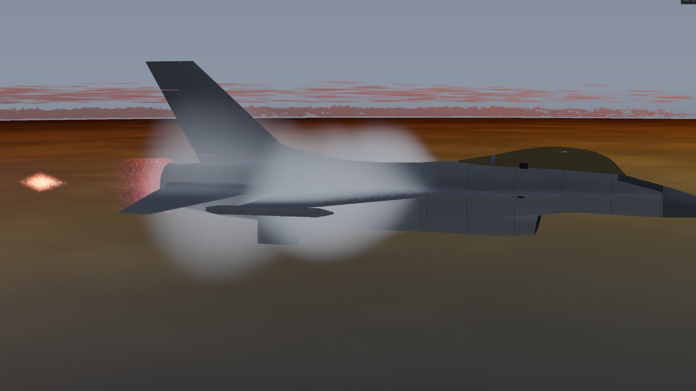
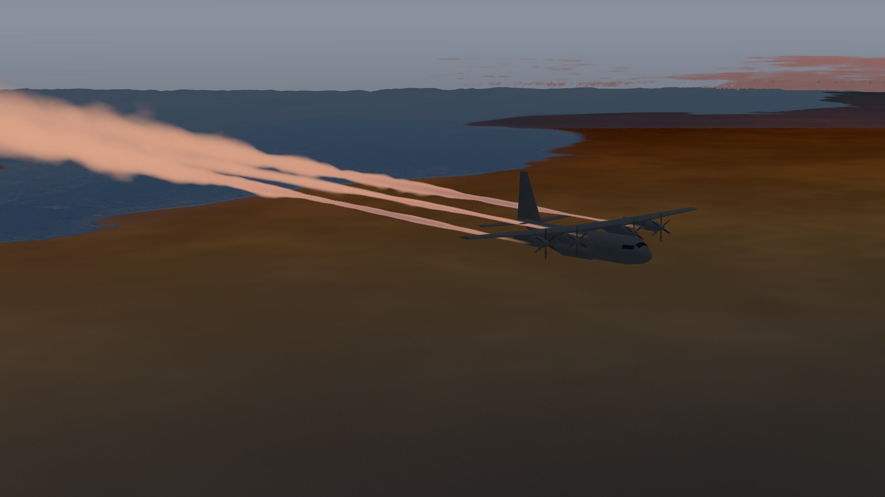
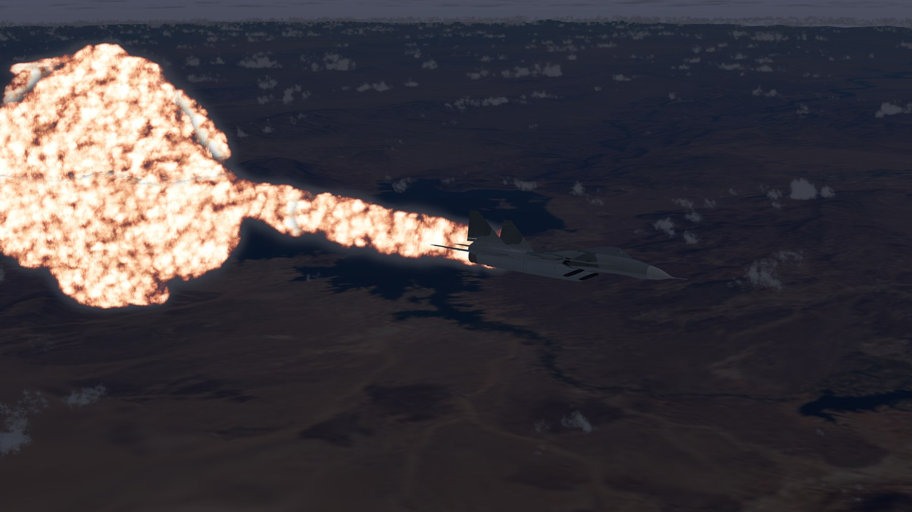
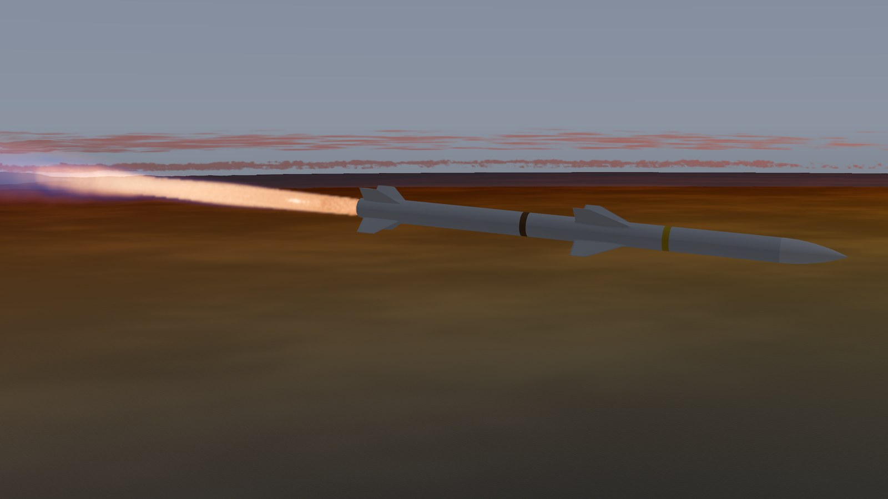
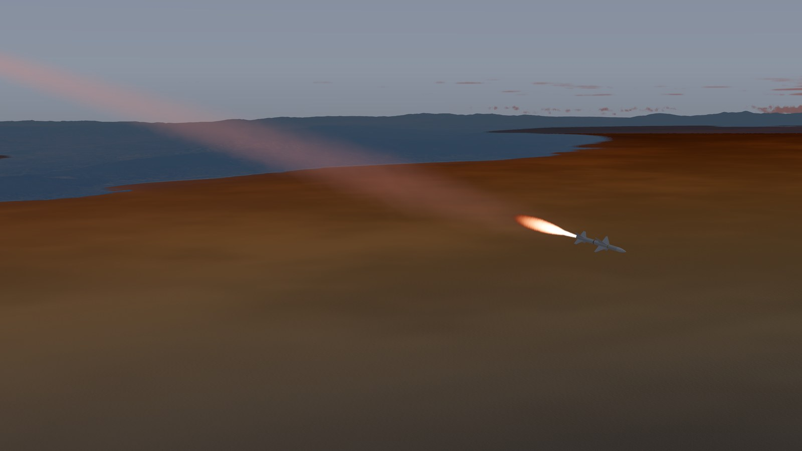
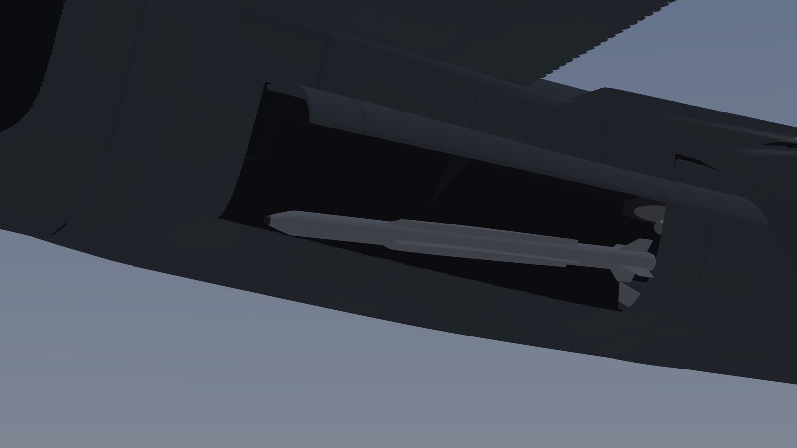

A better air combat game than DCS!

## Data-driven visual effects

Nothing in these pictures is the Viewer's own invention. A control surface moves, a plume burns and a trail is laid
because the vehicle's model and its manifest say where, the design says what the engine or motor is, and the
simulation says how far, how hot and how much at that instant. Every picture is a frame of the Viewer at 3840 x 2160,
of a world the simulation was flying. What each of the 87 designs gives the Viewer to draw from is listed in
[docs/hangar-effects.md](docs/hangar-effects.md); how each effect is worked out is in
[docs/sdk/viewer.md](docs/sdk/viewer.md#effects).

### Vehicles

| | |
| --- | --- |
|  | **F-16C, full reheat at 4,000 m.** The flame's temperature comes from the F100-PW-229's own ratings in its design (79.2 kN dry, 129.4 kN with reheat: 2,187 K), its shock train from the nozzle's pressure ratio at this height and speed; the vapour cone stands where the transonic pocket round the fuselage ends at its shock. |
|  | **C-130J at 10,500 m.** Four contrails, one from each turboprop's exhaust as the design places it, laid from the fuel the simulation says each engine burns and the efficiency it flies at (the Schmidt-Appleman criterion, then CoCiP's plume). |
|  | **MiG-29A, hit from its left by an AIM-120C.** The warhead's fireball is left behind on the side it burst; the fuel thrown out of the holed tanks goes the way the fragments went through them, and what leaks burns on down the flight path. The fire is a fluid solved by NVIDIA Flow from the damage model's own figures. |

### Payloads

| | |
| --- | --- |
|  | **AIM-120C, its motor's boost.** A reduced-smoke motor's plume: its gas and its exit as NASA's equilibrium code gives them for its propellant class, its width and length following the thrust the flight model reports. Its flight model, its motor and its 3D model are all built from one design by the Hangar pipeline. |
|  | **AIM-7M, a few seconds after its motor lit.** An aluminised motor: a white flame and a dense trail of alumina smoke, laid from the propellant the simulation says the motor burns each second. |
|  | **PL-10 leaving a J-20A's side weapon bay.** The bay's doors are opened by the store management's state; the missile is drawn on its station where the simulation releases it, the airframe hung from its model's origin as its centre of gravity moves with its fuel and its stores. |
