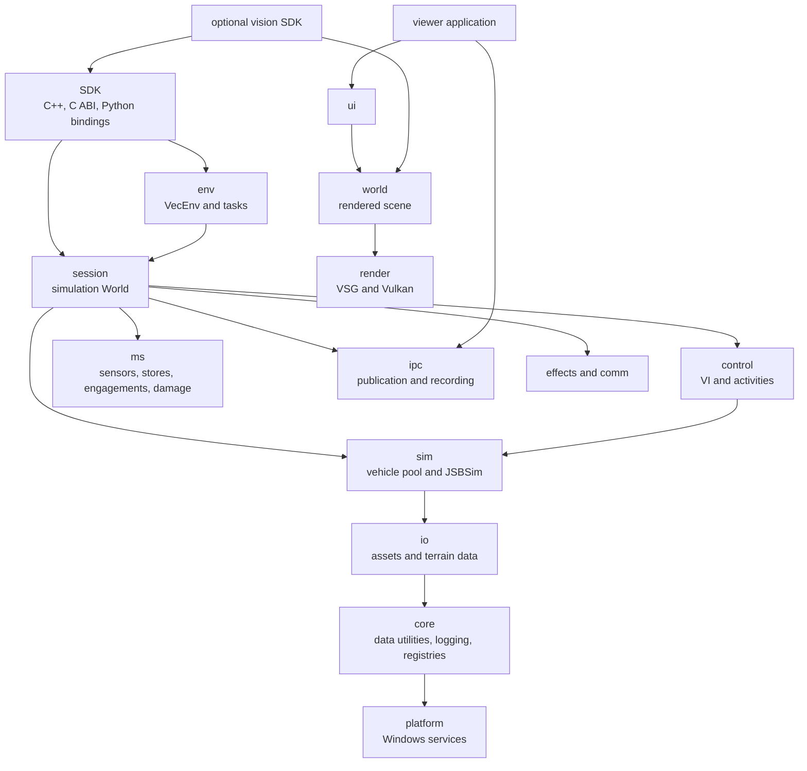
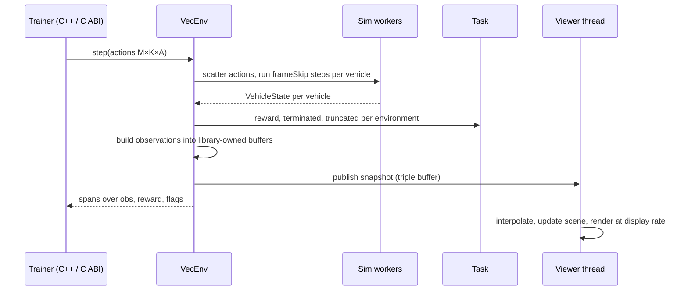
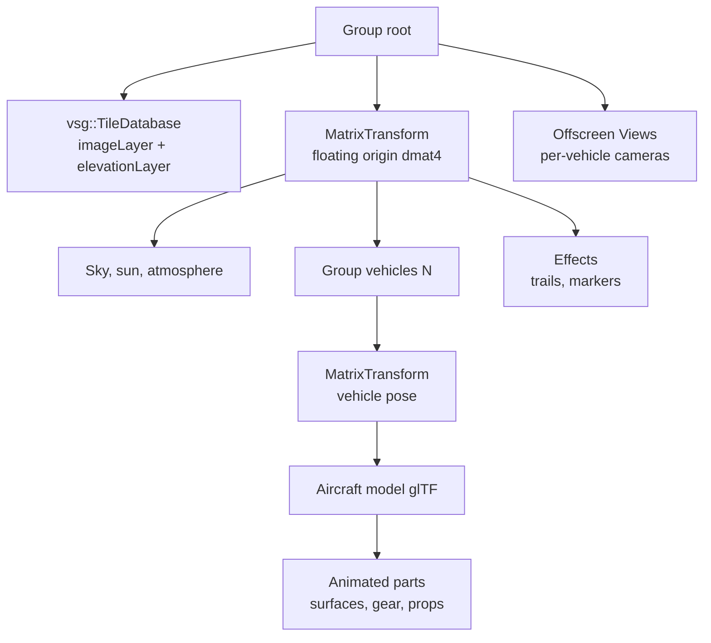
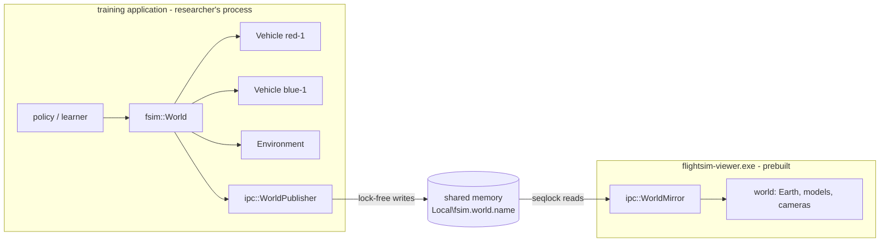
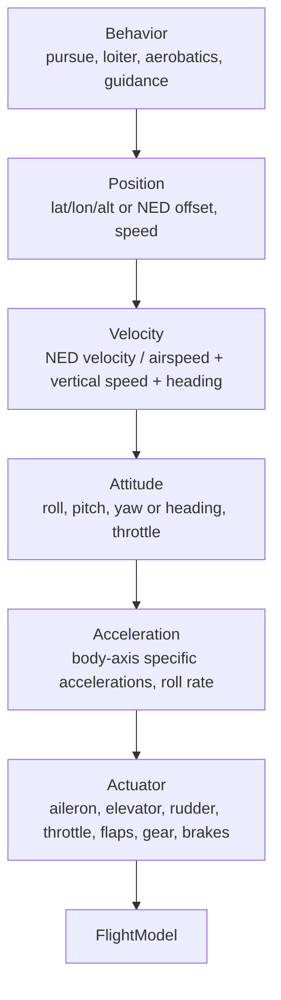

# Flight Simulator (C++ / VSG / JSBSim) — System Architecture & Design

2026-09-19 · @Someone

This document preserves the system design, owner decisions, targets and dated progress history.
[Status](status.md) is the sole current capability and milestone table. Use [development](development.md) for
the supported setup/build/validation workflow and [resources](resources.md) for dependency provenance and tools.
Historical measurements below apply to their recorded revision and hardware; design targets are not current
acceptance evidence. Current missile behavior is defined by [native engagement](sdk/engagement.md), whose game
assumptions do not complete ADR-30's high-fidelity modeling roadmap.

## 1. Purpose and scope

This document defines the architecture of a pure C++ flight-simulation platform for AI and reinforcement-learning (RL) training: JSBSim computes flight dynamics for many vehicles at once, VulkanSceneGraph (VSG) renders a full-Earth scene for visualisation and for vision-based observations, and a C++ SDK with a stable C ABI is the primary interface. It is the reference for structure, boundaries and major technical decisions; implementation details live in code and per-module design notes.

In scope: the application skeleton, module boundaries, runtime/threading model, integration of VSG and JSBSim, the RL environment API (C++ and C ABI), the debug viewer, VSG-native full-Earth terrain, build and packaging on Windows, and the extension mechanism. Out of scope for this revision: human-piloted operation (no flight-stick input, cockpit or instrument panels), networking/multiplayer, RL algorithms themselves, and certification-grade fidelity requirements. Project owner decisions of 2026-09-19 that shaped this revision: RL training is the primary purpose, full-Earth visualisation, no human pilot for now, powerful training hardware, open-source licence, Windows only, multiple vehicles, JSBSim used as-is, VSG mandatory, no Cesium, no Python. Owner workflow statement of 2026-09-20 (section 9): researchers build training applications against the vehicle SDK; a prebuilt viewer mirrors their world through shared memory transparently and without affecting training throughput; vehicles are created by name/type/initial state and controlled through a multi-level control stack; the environment is controllable in real time; effects and communication are abstract, extensible interfaces. Later owner requests added: an offline map package that ships with the viewer (2026-09-22); a Python SDK over the C ABI (2026-09-23), which relaxes "no Python" for trainers while the platform itself still embeds no language runtime (section 2); hangar (2026-09-22/23), a tool that turns an aircraft design into a flight-tested JSBSim aircraft with a 3D model, and a library of fighters and support aircraft made with it (2026-09-23 to 25); and engine exhaust and airflow effects in the viewer (2026-09-25).

Reading guide: sections 2–4 fix requirements and technology choices; sections 5–10 describe the design; sections 11–13 cover build, performance and cross-cutting concerns; sections 14–17 hold risks, roadmap, decisions and open questions.

## 2. Requirements and design drivers

Four drivers shape every decision below, in this priority order when they conflict: performance, portability, lightweight, extensibility. For an RL training platform "performance" means simulation throughput first and frame rate second, and "portability" means Windows x64 across GPU vendors today with a clean path to Linux servers later. Each driver has a measurable target so the architecture can be checked, not just argued.

| Driver | What it means here | Target (v1) | How it is enforced |
| --- | --- | --- | --- |
| Performance | Maximise simulated vehicle-steps per second; keep visualisation and vision rendering from slowing the simulation | ≥ 100,000 JSBSim vehicle-steps/s aggregate on a 16-core workstation (headless, stock c172/f16); a 64-vehicle scene renders at 60 fps at 1440p on an RTX-class GPU; vision observations at 128×128 for 64 vehicles ≥ 2,000 frames/s | parallel sim workers, zero per-step heap allocation, batched stepping API, offscreen render batching, throughput benchmark in CI |
| Portability | Windows 10/11 x64 on NVIDIA, AMD and Intel Vulkan drivers; no OS-specific code outside `platform/` so a Linux build is a port, not a rewrite | identical results on all three GPU vendors; `platform/` is the only module with Win32 includes (checked in CI) | C++17, VSG's own windowing and tile streaming, CMake, dependency isolation |
| Lightweight | Few dependencies, small install, low idle resource use, no language runtimes | headless library + viewer executable < 20 MB excluding terrain cache; ≤ 5 third-party libraries in the core; headless start < 1 s; idle RAM < 500 MB with 64 vehicles headless | static linking, dependency budget reviewed per ADR, VSG-native solutions preferred over third-party ones |
| Extensibility | New aircraft, tasks/rewards, observation types, sensors, cameras, data sinks and external trainers without touching the core | add a task or observation builder as a C++ module without core edits; bind the platform from any language through the C ABI; optional modules excluded at build time | module registry, property store, event bus, stable C++ SDK headers, versioned C ABI |

Secondary requirements that follow from the four drivers and the owner decisions:

- Determinism and reproducibility: given a seed, a scenario and a fixed step, every run produces the same trajectory; JSBSim guarantees this per instance when fed a fixed `dt`, and the platform never lets wall-clock time enter the simulation. A start depends on its conditions alone: a vehicle reset, or made in a slot another of its aircraft left, starts and flies as the same start on a new model, to the bit (7.2).
- Headless first: the simulation and environment API run with no window and no GPU; rendering is an optional module attached to a running simulation for visualisation or vision observations.
- Many vehicles: dozens to hundreds of JSBSim instances per process, stepped in parallel and in lockstep, grouped into independent environments.
- Full-Earth world on VSG alone: any latitude/longitude, WGS-84 ECEF double precision, imagery and elevation streamed by `vsg::TileDatabase` from a tile pyramid (self-hosted or public), and the same elevation tiles used for physics ground height, headless and offline once cached.
- Pure C++: no Python, Lua or other language runtime anywhere in the platform; external trainers use the C++ SDK or the C ABI. Still true since the Python SDK (2026-09-23, `python/`): it is a C extension over the C ABI loaded by the trainer's own interpreter, and hangar (`tools/hangar`), the aircraft design tool, is offline Python tooling that, like `tools/tile_builder`'s GDAL, is never part of the platform.
- Open source: the platform is released under MIT; every dependency is MIT, Apache-2.0, BSD, Zlib or LGPL (JSBSim), with JSBSim linked as a shared library.
- JSBSim as-is: stock aircraft, engines, systems and XML scripts from the JSBSim repository; flight-control automation uses JSBSim's own FCS/autopilot definitions; no custom FDM code in v1.

## 3. Technology stack baseline and historical selection

Licensing consequence: JSBSim's LGPL-2.1 is the only copyleft component. Dynamic linking of JSBSim, or shipping object files to allow relinking, keeps the application's own licence free. All other core components are MIT/Zlib/Apache.

The original stack selection was C++17, VSG 1.1.x and JSBSim 1.3.x, with vsgXchange for model loading and HTTP tile fetching and vsgImGui for the viewer UI. The version/release snapshot below was checked 2026-09-19; it is historical provenance rather than a current dependency inventory. Current source, runtime prerequisites and licenses are listed in [resources](resources.md) and `THIRD_PARTY_NOTICES.md`; CMake is the build system.

| Component | Version | License | Last release / push | Role | Notes |
| --- | --- | --- | --- | --- | --- |
| C++ | C++17 (GCC 16.2, MSYS2 UCRT64 — mandated toolchain at D:\\ENV\\DevLanguages\\Cpp\\msys2\\ucrt64) | — | — | Implementation language | C++17 is VSG's requirement; code stays C++17 so a GCC/Clang Linux port needs no language changes |
| [VulkanSceneGraph](https://github.com/vsg-dev/VulkanSceneGraph) | 1.1.16 | MIT | 2026-08-21 | Scene graph, Vulkan rendering, windowing, offscreen rendering, viewer, **full-Earth tile streaming (`vsg::TileDatabase` with `imageLayer` + `elevationLayer`)**, serialisation (`.vsgt/.vsgb`) | Requires Vulkan 1.1 SDK; glslang optional |
| [vsgXchange](https://github.com/vsg-dev/vsgXchange) | tracks VSG | MIT | 2026-08-24 | glTF loader (assimp), KTX/PNG/JPEG image readers, `curl` reader for HTTP tile sources | Only assimp, KTX, stb\_image and curl modules enabled; GDAL module off |
| [JSBSim](https://github.com/JSBSim-Team/jsbsim) | 1.3.1 | LGPL-2.1 | 2026-05-17 (push 2026-09-15) | Flight dynamics (`FGFDMExec`), stock aircraft/engines/systems, XML scripts, property tree | Linked as a DLL; one instance per vehicle |
| [vsgImGui](https://github.com/vsg-dev/vsgImGui) | 0.8.0 | MIT | 2026-08-21 | Dear ImGui + ImPlot debug/monitor UI inside the VSG frame | Viewer only |
| libcurl (via vsgXchange) | current | MIT-style | active | HTTP(S) fetch of imagery/elevation tiles when a remote pyramid is used | not needed for file-based pyramids |
| CMake | ≥ 3.25 | BSD-3 | — | Build and dependency management | The original vcpkg proposal is superseded; current source dependencies are vendored, with Catch2 fetched for tests and platform packages supplied by MSYS2 |
| Offline tooling only: GDAL | current | MIT | active | `tools/tile_builder` converts DEM and imagery sources into the tile pyramid | never linked into the platform; runs at data-preparation time |

Compiler and platform for v1 (owner decision 2026-09-19): MSYS2 **UCRT64** — GCC 16.2, mingw-w64, UCRT — on Windows 10/11 x64; CMake 4.1 and Ninja from the same environment; Vulkan headers/loader, glslang, SPIRV-Tools, assimp and curl from MSYS2 packages. The MSYS2 installation must be kept consistent with `pacman -Syu` (partial upgrades break newly installed packages). MSVC is not used. A Linux build is not a v1 deliverable but nothing in the stack prevents it.

## 4. Entry point and primary interface evaluation

Recommendation: the primary interface is a C++ SDK (`fsim::VecEnv`, static or shared library, public headers under `include/fsim/`) with a versioned C ABI (`fsim_c.h`) exported from the same DLL so trainers in any compiled language can bind it; an optional shared-memory environment server serves out-of-process trainers. The graphical interface is an optional in-process viewer using VSG's native window and Dear ImGui (vsgImGui). No scripting runtime, no flight-stick input and no cockpit UI.

### 4.1 Primary interface: how RL code reaches the simulator

| # | Option | How it works | Step overhead (64 envs) | Extra dependencies | Verdict |
| --- | --- | --- | --- | --- | --- |
| I1 | C++ SDK, in-process | trainer links `fsim.lib`/`fsim.dll`, calls `VecEnv::step(actions) -> batch` on preallocated buffers | \~0 (function call) | none | **Selected as primary** — fastest possible, type-safe, the platform's own tests and tools use it |
| I2 | C ABI, in-process | `fsim_c.h`: opaque handles, plain structs, `fsim_vecenv_step(h, actions, n)`; buffers owned by the library | \~0 | none | **Selected as companion** — stable across compiler versions; Rust/C#/Julia/Go bind it with their standard FFI tools; an `extern "C"` layer over I1 |
| I3 | Shared-memory environment server | `flightsim.exe --serve` maps a ring of action/observation buffers; trainer process attaches; semaphore handshake per step | \~20–50 µs | none (Win32 named shared memory in `platform/`) | **Selected as optional module** `ext/env_server` — isolates trainer crashes from the simulator, allows a different toolchain per side |
| I4 | TCP/UDP flat-binary protocol | same message layout as I3 over a socket | 100–300 µs + network | none | variant of I3 for remote trainers; post-v1 |
| I5 | gRPC / protobuf service | RPC per step | 200–500 µs, serialisation | gRPC, protobuf (\~10 MB) | rejected: dependency weight and latency for no gain over I3/I4 |
| I6 | Embedded scripting runtime (Lua, Python) | scripts drive the loop in-process | — | runtime + bindings | rejected by owner decision |
| I7 | In-process training with LibTorch | RL algorithm in C++ using the LibTorch C++ API | 0 | LibTorch (CPU \~200 MB, CUDA \~2 GB) | not part of the platform; supported as a consumer of I1 (`examples/torch_ppo` shows it); never a core dependency |

### 4.2 Graphical interface (optional viewer)

| # | Option | UI toolkit | Extra dependencies | Approx. size | Verdict |
| --- | --- | --- | --- | --- | --- |
| A | VSG native window + vsgImGui | Dear ImGui + ImPlot | none beyond VSG | \~0.5 MB | **Selected** — monitoring, telemetry plots, property browser, camera control |
| C | SDL3 / GLFW window + adopted surface | Dear ImGui | SDL3 or GLFW | 0.3–2 MB | rejected: a second library owning the window for no benefit; joystick support is not needed |
| E | Qt 6 + vsgQt | Qt Widgets/QML | Qt6 (LGPL-3) | 20–35 MB | rejected for the viewer; possible future scenario editor as a separate tool |
| G | RmlUi | HTML/CSS documents | RmlUi + FreeType | 2–3 MB | rejected: no operator-facing UI to justify it |
| H | Web dashboard (browser) | HTML/JS served from the process | embedded HTTP server (\~0.3 MB) | small | deferred: remote monitoring of long training runs; post-v1 module |

### 4.3 Scoring against the requirements

Scale 1 (poor) to 5 (excellent); weights follow the driver priority in section 2.

| Criterion (weight) | I1+I2 C++ SDK & C ABI + A | I3 shared memory + A | I5 gRPC + A | I1 + E Qt viewer |
| --- | --- | --- | --- | --- |
| Performance (3) | 5 | 4 | 2 | 5 |
| Portability (3) | 5 | 4 | 5 | 4 |
| Lightweight (2) | 5 | 5 | 3 | 1 |
| Extensibility (2) | 5 | 5 | 4 | 5 |
| VSG / JSBSim integration (2) | 5 | 5 | 4 | 4 |
| Maintainability (2) | 5 | 4 | 4 | 4 |
| Weighted total (max 70) | 70 | 62 | 51 | 55 |

### 4.4 Decision and rationale

- Entry points: (1) the `fsim` library, linked by the trainer's own C++ program — the primary one; (2) `flightsim.exe` for headless batch runs, benchmarks, recording and `--serve` (shared-memory server); (3) `flightsim-viewer.exe`, or `attachViewer()` from the SDK, for the window. All construct the same `Application` object.
- Batched API: `VecEnv` holds M environments, each with K vehicles; `step()` consumes an `(M×K×A)` action span and fills `(M×K×O)` observation, reward and flag buffers owned by the library, so one call advances every vehicle and no data is copied. The C ABI exposes the same buffers as raw pointers with sizes and a layout version.
- Windowing and viewer: `vsg::Window` and `vsg::Viewer`, Dear ImGui through vsgImGui. The viewer never blocks the simulation; it renders the latest snapshot at display rate (section 6).
- Not included: Python (bindings over the C ABI followed on 2026-09-23 at the owner's request, section 15), Lua, Cesium/3D Tiles, SDL3, HUD, instruments, cockpit view. The event/property infrastructure stays, so a piloted mode can be added later as a module.

## 5. System architecture overview

The native implementation is split into internal CMake targets behind the `fsim` SDK. `session::World` coordinates simulation; `src/world` composes optional rendered scenes. Core simulation and SDK state are plain C++ data, not VSG objects. The following diagram shows major relationships; the target CMake files define the complete link graph.



Trainers use public SDK objects. The viewer reads IPC snapshots in its own process; optional vision cameras use the public SDK plus rendering. The two meanings of world are intentional: simulation ownership is in `session`, scene composition in `world`. The directory map below describes existing targets, not the superseded `ext/*` proposal.

| Directory | Current responsibility | Target definition |
| --- | --- | --- |
| `include/fsim` | Stable C++ and C ABI declarations; `World.h` includes vehicle/environment objects | [Public headers](../include/fsim/) |
| `src/sdk` | Public object wrappers, C ABI conversion/guards and the SDK shared library | [CMake](../src/sdk/CMakeLists.txt) |
| `src/simulation/runtime` | Simulation World, MA core/DMS, stepping, engagement/damage coordination and publication | [CMake](../src/simulation/runtime/CMakeLists.txt) |
| `src/simulation/flight_control` | Control runtime, capability host, VI commands, activities, navigation and routes | [CMake](../src/simulation/flight_control/CMakeLists.txt) |
| `src/simulation/mission_systems` | Payload host/cards, RF, RCS lookup, radar/tracking, seekers, countermeasures and damage | [CMake](../src/simulation/mission_systems/CMakeLists.txt) |
| `src/simulation/flight` | JSBSim adapter, flight-model interface, vehicle pool and worker stepping | [CMake](../src/simulation/flight/CMakeLists.txt) |
| `src/env` | VecEnv, tasks, observations/actions and episode bookkeeping | [CMake](../src/env/CMakeLists.txt) |
| `src/simulation/environment` | Simulation effects and sensed-state channels | [CMake](../src/simulation/environment/CMakeLists.txt) |
| `src/simulation/communications/network` | Message fabric, codecs, protocols and media | [CMake](../src/simulation/communications/network/CMakeLists.txt) |
| `src/foundation/transport` | Shared-memory publication/mirroring, registries and custom binary recordings | [CMake](../src/foundation/transport/CMakeLists.txt) |
| `src/foundation/io` | Asset resolution, aircraft-file inspection and terrain data access | [CMake](../src/foundation/io/CMakeLists.txt) |
| `src/foundation/core` | Plain C++ utilities, JSON, units/RNG, logging, registries and lifecycle helpers | [CMake](../src/foundation/core/CMakeLists.txt) |
| `src/foundation/platform` | Paths, clocks/threads, HTTP, UDP, shared memory and minidumps | [CMake](../src/foundation/platform/CMakeLists.txt) |
| `src/render` | Optional VSG viewer/render graphs, screenshots and GPU timers | [CMake](../src/render/CMakeLists.txt) |
| `src/world` | Optional scene, terrain/sky/clouds, vehicle/store visuals, trails and Flow rendering | [CMake](../src/world/CMakeLists.txt) |
| `src/ui` | Optional native monitor, mission panels, key and viewer controls | [CMake](../src/ui/CMakeLists.txt) |
| `src/vision` | Optional offscreen cameras over the public SDK, with a separate C ABI/library | [CMake](../src/vision/CMakeLists.txt) |
| `src/app` | Headless and native-viewer command-line entrypoints | [CMake](../src/app/CMakeLists.txt) |
| `python/fsim`, `python/src` | Python wrappers and stable-ABI native bindings | [Python build](../python/CMakeLists.txt) |

Dependency conventions and current limits:

1. No module includes a header from a layer above it; `env` never includes `render` or `world`. [Native architecture acceptance](../tools/architecture/README.md) checks registered module/source ownership, declared CMake dependency closure, cycles, public/private leakage and headless GPU imports across all native conditional branches. Broad internal include directories remain; the executable check enforces the convention.
2. Public SDK headers keep JSBSim and Vulkan implementation types private. Rendering implementation lives in `render`, `world`, `ui` and `vision`. Most Win32 services live in `platform`; `world/FlowSolver.cpp` also uses Win32 for the NVIDIA Flow runtime.
3. Stepping, snapshots and observations use typed buffers. There is no implemented shared `EventBus` contract.
4. CMake options assemble optional targets. `fsim::ModuleRegistry` provides internal lifecycle support, but does not automatically register every CMake module. The headless configuration excludes rendering and vision targets and needs no Vulkan SDK.
5. Only `fsim/*.h` and `fsim_c.h` are public; everything else may change without notice.

The first architecture maintenance slice separates Mission Systems C entry points into `src/sdk/fsim_mission_c.cpp`,
using private `CAbiSupport.h` helpers and the same SDK library. Principal checks discover every native C adapter and
require coverage of exported world-handle entry points. Their exact exported names and public layouts remain stable.

Weapon launch eligibility belongs to `src/simulation/mission_systems/weapon/LaunchEligibility`; session World supplies resolved target and
illumination facts. The two-phase check retains target/FOV refusal before illumination lookup and Host admission.
World continues owning authority, inventory ordering, simulation stages and events. Shared quaternion math lives
in core with the existing sim forwarding interface. The [A1 design and remaining architecture work](superpowers/specs/2026-10-11-architecture-maintenance-design.md)
records the limited refactor and deferred stateful/GPU work.

The [A2 lifecycle and adapter slice](superpowers/specs/2026-10-12-architecture-lifecycle-design.md) assigns DMS/C2 C
entry points to `src/sdk/fsim_links_c.cpp` and Python native handlers to `python/src/_native_dms.c`. Both remain
in their existing SDK/module binaries. Python method/type registration and the public object model remain in
their original owners; `_native_world.h` shares only the private World layout and call support.

The [A3 control and Mission slice](superpowers/specs/2026-10-12-architecture-adapters-design.md) assigns C control/VI
entry points to `src/sdk/fsim_control_c.cpp`, with the unchanged parameter conversion in private
`CParameterSupport.h`. Python control and Mission handlers belong to `_native_control.c` and `_native_mission.c`;
the original `_native.c` continues owning World lifecycle, shared conversions, Error, BufferType and all registration.
These source owners link into the same SDK and Python binaries, using the original handle layout and principal
guards. Splitting ownership preserves validation order, command side effects, borrowed lifetimes and the existing
busy/GIL boundaries.

The [A4 World, Scenario and Environment slice](superpowers/specs/2026-10-12-architecture-world-adapters-design.md)
assigns C Scenario entry points to `src/sdk/fsim_scenario_c.cpp` and Environment, terrain and magnetic entry
points to `fsim_environment_c.cpp`. The latter includes five definitions previously in the control owner.
`fsim_world_c.cpp` retains lifecycle, handle and remaining World operations. Python handlers belong to
`_native_world.c`, `_native_scenario.c` and `_native_environment.c`; `_native_world_options.h` shares unchanged
private option metadata between core and Scenario. Core retains runtime type ownership, World construction,
borrowing/destruction, agent creation/sealing, state buffers, scenario application and all
registration. These source moves preserve Scenario string borrowing and partial application, versioned output
writes, Environment error retention and the existing busy/GIL/buffer boundaries.

The [A5 VecEnv and Recording slice](superpowers/specs/2026-10-12-architecture-batch-recording-design.md) assigns
C entry points to `fsim_vecenv_c.cpp` and `fsim_recording_c.cpp`. `VecEnvHandles.h` shares the original private
handle layout while C++ VecEnv wrappers/conversions and lastError stay in `fsim.cpp`. VecEnv keeps its original
void-return guard; Recording uses unchanged CAbiSupport and retains borrowed sample/event/string storage.
Python `_native_vecenv.c` and `_native_recording.c` use focused private layout headers. Core keeps all type
registration/runtime pointers and the three coupled callbacks: VecEnv buffers, VecEnv's borrowed World and
Recording sample buffers. Constructors and other operations move literally, retaining scratch conversion,
busy/GIL phases and owner retention. Public Python wrappers and C++ interfaces stay in their existing files.

The [A6 store binding slice](superpowers/specs/2026-10-12-architecture-store-binding-design.md) gives each simulation
Entry a private `StoreFlightBinding` owner for station property handles, mass/drag revisions, between-step weight-room
stamps, drag points/qbar and the reported-load revision. Its operations take explicit Host/model references and retain
no model pointer. World still owns entities/models, pointmass-name caches, global weighing cadence, authorization,
iteration, control-host publication and release/damage mass-change transactions. Reset retains the existing binding
state; a reused slot gets a new Entry/binding on its reset model. This is the first World state-owner decomposition,
not a change to store inventory, flight dynamics, fuel/drag formulas or update ordering.

MA retirement separates private consent bookkeeping from retained public history. Successful vehicle/C2 removal
releases private consent storage, then existing C2 completion, override expiry and lost-communication transitions
settle at their original steps. RBAC names, tasks, authority and controller mappings stay in place. This preserves
post-removal reads and unordered traversal; it does not bound aggregate public history or redesign iteration to
visit only live entities.

## 6. Runtime model

The simulation is driven in lockstep by the caller (`VecEnv::step()` from the trainer's C++ code, the C ABI, or the shared-memory server), not by a clock: each call advances every vehicle by a fixed number of JSBSim steps across a worker pool, then builds observations; the optional viewer runs on its own thread at display rate and reads immutable snapshots, so visualisation never slows training.

### 6.1 Process entry

1. The trainer constructs `fsim::VecEnv(scenarioPath, options)` (or `flightsim.exe` does) which builds `Application` in headless mode: `core` services, `io`, `sim`, `env`. The Vulkan SDK is not touched.
2. Scenario files (`.vsgt` text or JSON) define per-environment vehicles (JSBSim aircraft name, initial-condition distributions, JSBSim script if any), the task id, observation and action specs, the sensors and the tile pyramid to use for ground height.
3. `VehiclePool` creates one `JsbsimModel` per vehicle (M environments × K vehicles), each with its own `FGFDMExec`, `dt` and RNG stream derived from the seed.
4. `reset()` runs `RunIC()` per vehicle and fills the first observation batch.
5. `step(actions)` for each call: scatter actions to vehicles, step all vehicles `frameSkip` times in parallel, compute rewards/terminations in the task, gather observations into the output buffers, auto-reset finished environments, publish a snapshot for viewers.
6. `attachViewer()` (or `flightsim-viewer.exe --attach`) constructs `render`, `world` and `ui` on a separate thread with a window; detaching destroys them without affecting the simulation.
7. Shutdown is reverse order; `shutdown()` runs on every module even after an exception so JSBSim outputs and recordings are flushed.

### 6.2 Threads

| Thread | Driven by | Owns | Must never |
| --- | --- | --- | --- |
| Caller (trainer) | `step()` / `reset()` calls | `VecEnv`, task evaluation, observation assembly | touch `vsg::` GPU objects |
| Sim workers (`nWorkers`, default = physical cores − 2) | work items = one vehicle × `frameSkip` steps | `FGFDMExec` instances (each worker touches only its assigned vehicles for a given call) | allocate, log at info level, or share state across vehicles |
| Render (viewer only) | display refresh | `vsg::Viewer`, window events, ImGui, scene mutation | call into JSBSim or block the sim workers |
| Vision render (optional) | `step()` when a vision observation is requested | offscreen `vsg::View`s for sensor cameras, readback | — (synchronous with the step: the caller waits for readback) |
| Job pool | on demand | tile fetch/decode for `vsg::TileDatabase` and the ground provider, recording flush | mutate the live scene graph directly |
| Server (optional `ext/env_server`) | semaphore from the trainer process | shared-memory ring, one `VecEnv` | — |

### 6.3 Stepping and data flow



`VehicleState` is a fixed-size POD (ECEF position `dvec3`, attitude `dquat`, body and NED velocities, rates, accelerations, control positions, engine data, gear state, \~60 scalars) written by the worker that stepped the vehicle. Observation builders read these plus any cached JSBSim property handles declared in the observation spec; outputs are `float32` arrays owned by `VecEnv` and returned as `std::span` (C++) or pointer + length (C ABI) without copying. Actions map to JSBSim `fcs/*-cmd-norm` properties or, when the scenario says so, to JSBSim autopilot targets (heading, altitude, airspeed), which uses JSBSim's own FCS as-is.

### 6.4 Time

- Simulation time advances only inside `step()`; there is no real-time clock in the training path. `dt` (default 1/120 s) and `frameSkip` (default 4 → 30 Hz agent rate) are scenario parameters.
- Determinism: fixed `dt`, per-vehicle RNG streams seeded from `(seed, envIndex, vehicleIndex)`, and no dependence on thread scheduling (each vehicle's step is independent), so results are identical regardless of `nWorkers`.
- Viewer time: the render thread interpolates between the two latest snapshots using their simulation timestamps and shows the current wall-clock speed factor; a `--realtime` option throttles `step()` calls in the exe only.

### 6.5 Budget per `step()` (64 environments × 1 vehicle, frame\_skip 4, 16 workers)

Measured 2026-09-19 (M0 build, Release, 16-thread desktop, c172x, frame-skip 4): one JSBSim step costs \~6 µs, not the 40 µs assumed in the first draft. 64 vehicles run at 148,000 vehicle-steps/s on one worker and 1,138,000 on 16 workers (`step()` mean 0.225 ms), i.e. 11× the section 2 target before any tuning; the f16 runs at 757,000 on 6 workers. Vision observations add GPU render + readback time and will be the dominant cost when enabled (section 8.4).

## 7. Flight dynamics integration (JSBSim)

JSBSim is used as-is — stock aircraft, engines, systems, autopilots and XML scripts from the JSBSim repository — behind a `sim::FlightModel` interface implemented by `sim::JsbsimModel`, one instance per vehicle; the rest of the platform never sees JSBSim types, units or its property tree, and all conversion to SI units and the ECEF-metre world frame happens inside the adapter.

### 7.1 Interface

```cpp
class FlightModel : public vsg::Inherit<vsg::Object, FlightModel> {
public:
    virtual bool load(const AircraftSpec&, const InitialConditions&) = 0;
    virtual void step(const ControlInputs&, double dt) = 0;   // exactly one fixed step
    virtual void state(VehicleState&) const = 0;              // fill snapshot, SI units, ECEF metres
    virtual PropertyHandle property(std::string_view path) = 0; // cached, O(1) read/write after lookup
    virtual void reset(const InitialConditions&) = 0;
};
```

`step()` is the only method called at 120 Hz; `property()` returns a handle wrapping a cached `FGPropertyNode*` so hot reads (instrument values, control positions) never repeat a string lookup.

### 7.2 JSBSim adapter lifecycle

| Phase | JSBSim calls | Notes |
| --- | --- | --- |
| Construct | `FGFDMExec`, `SetRootDir`, `SetAircraftPath`, `SetEnginePath`, `SetSystemsPath`, `Setdt(dt)` | one instance per vehicle; JSBSim's own `aircraft/`, `engine/`, `systems/` and `scripts/` directories are shipped unchanged as the asset root |
| Load | `LoadModel(name)`, `GetIC()->...`, optionally `LoadScript(path)`, `RunIC()` | runs on a sim worker inside `try/catch`; XML errors become a `LoadFailed` result on the environment, never a crash. Initial conditions come from the scenario (lat/lon/alt, heading, speed) or a JSBSim IC file |
| Step | write commands via cached nodes (`fcs/*-cmd-norm`, `fcs/throttle-cmd-norm[n]`, gear, flaps, brakes, or autopilot targets `ap/*` when the aircraft defines them), `Run()` × `frame_skip`, read state | `Run()` advances exactly `dt`; JSBSim scripts, event triggers and `FGOutput` (CSV/socket) remain available and are enabled per scenario for logging |
| Reset | `ResetToInitialConditions(DONT_EXECUTE_RUN_IC)`, what that leaves put back, then the load's start: `GetIC()->...` from a new IC, `RunIC()`, the engines, the ground trim | preserves the loaded model and starts as a load does, to the bit (below); a reset costs 0.02-0.9 ms, so environments auto-reset in place, and a World gives a removed vehicle's model to the next of its aircraft |
| Destroy | destructor | JSBSim logging routed to `core::Log` via `FGLogger`, level warning and above only on workers |

**A reset starts as a load does** (2026-09-29). A vehicle reset (`World::resetVehicle`: every VecEnv episode), or made in a slot another vehicle of its aircraft left (`World::createVehicle` reuses that model), starts and flies as the same start on a new model, to the bit, whatever the model flew before. It did not, in four ways:

- *The initial conditions.* JSBSim's IC setters each start from what was set before them - the latitude re-places the position at the altitude last set, the angles turn the velocity last set - so the same conditions landed where the slot's last vehicle had left them: a Crazyflie spawned at 150 m after one had parked started one unit in the last place elsewhere, and its hover then differed in the fleet test. `JsbsimModel::applyInitialConditions` now starts from a new model's IC (`InitializeIC`), and the terrain's callback from no remembered frame.
- *The sequence.* The reset evaluated the models once more after the engines' start, to seed the integrators (after a violent step its first pass had replayed the old accelerations). That pass moved the start: the F-16C began with 249 lbf and 1 degree of elevator where a load gives 16,091 lbf and 10 degrees, and flew 7.5 m from the load's flight within 6.7 s. The reset now clears every model first, puts back what that leaves, and then runs the load's own start; with nothing left over, the first pass needs no replacing.
- *What JSBSim's reset leaves.* The plain properties the flight control system and the aircraft's functions wrote, which the next start's first pass reads before they are written again (saved at load, put back); the gear command and position, the brakes and the propeller levers (FGFCS keeps them: an aircraft made on the ground after an airborne one was trimmed with its gear up); a propeller's RPM (zeroed, as before); and, fixed in JSBSim (cmake/JsbsimPatches.cmake, THIRD_PARTY_NOTICES.md), an actuator's first run (a new one passes its input through, a reset one crawled from zero at its rate limit), the lift of the last run (the first pass's induced drag), the stall hysteresis's limits and the reference point's shift (a reset cleared them for good: the stock C172x flew without its hysteresis after every reset, the stock Concorde 114 m off in 6.7 s), and the centre of gravity (the first pass's tanks' inertia about it).
- *The air.* A flight model's reset returns it to calm, standard air, and `World::resetVehicle` did not give it the world's again: every VecEnv episode after the first flew in calm, standard air. It now re-applies the environment, as `createVehicle` does.

Measured with a probe that dumps JSBSim's whole property tree (not committed): the 35 hangar designs and the stock c172x, each spawned in the air and on the ground after five histories of its slot (untouched, flown on, parked, crashed, flown 3,300 km away), give the same `VehicleState` bits at the spawn and after 800 steps as a new model, and the same whatever the history; so does a reset in 12 m/s of wind on a hot day, and a reused slot with turbulence too (the vehicle's id the same, as its random stream is). Of twelve stock JSBSim aircraft, ten did (the F-16, Concorde, F-22, 737, C310, J3 Cub, P-51D, A320, F-15 and T-38); the PC-7 and the AH-1S kept part of their last run (12.8 m and 0.13 m in 6.7 s). The PC-7's was its constant-speed propeller's pitch, which a propeller's reset did not return to the least a load sets (JSBSim's FGPropeller, patched 2026-09-30); its turboprop engine, which has no reset of its own, is rewritten by the start where it reaches the forces. The AH-1S's transmission kept its free-wheel unit's lag: in a reused slot its engine started 2 % faster (JSBSim's FGTransmission, patched 2026-09-30). What is left of the AH-1S's difference is 8 µm to 0.1 mm in 6.7 s of hover: its downwash filters start a little differently even after a vehicle removed at once, from a cause not found. `test_sdk`'s "a vehicle in a reused slot, or reset, starts and flies as the same spawn in a new world, to the bit" checks it for the Crazyflie, the c172x, the F-16C, the UH-1H and the PC-7.

What changed with it (the measurements of docs/flight-autonomy.md, 9.5 and 14): every start made by a reset or in a reused slot; a new model's start is bit-identical. The control digests: `reset` (a c172x reset at step 300) ends 12 mm higher and 5 cm across; the other 19 flights are identical, with protection and without. The fleet test (one World for every case, so every case starts in a reused slot): 5,209 states compared, 167 identical. The cases' starts after their 10 s on the velocity loop moved by 6.6 cm at the median, 2.7 m at the 90th percentile and 8.4 m at most (the F-35A: the fly-by-wire designs most, their actuators now starting at their commands); the parked ones by 4.7 mm at most. The flights then amplify it: every judged state but 41 of 1,499 changed, the largest where a discrete decision flips (a hold that leaves at its exit point after its end time left a lap sooner: the E-3G 36 km from its old place at the same time). Every case stays within its thresholds but the parked Crazyflie's: it hops on its contacts (its gear leaves the ground every few steps, 1.5 to 2.1 cm up, however long it stands), and the new start has it in the air at the case's check where the old one happened to have it on the ground. Contacts sized for the step let it rest. A reset costs what it did (0.02 to 0.93 ms): the pass it no longer makes pays for the properties it puts back.

Merged onto main at FA-8d (2026-09-29), after the quadrotors' contacts sized for the step (so the parked Crazyflie rests) and the helicopters' ground contacts, and measured there the same way, each flight's state printed as it is judged and every vehicle's as its case ends (the starts were not printed this time). Of the fleet test's 3,992 states, 119 are identical: 51 of the 1,752 judged, 68 of the 2,240 ends. The judged states moved 5.7 m at the median and 35 m at the 90th percentile; the largest where the hold's lap flips, the E-3G 36 km, as above. Every case stays within its thresholds, the parked Crazyflie's among them, and no flight ended diverged, before or after. The control digests: `reset` as above, 12 mm higher and 5 cm across; the other 19 identical, with protection and without. `ctest`: 373 of 373, the 144 determinism checks among them.

A vehicle's random stream (effects, JSBSim's turbulence and sensor noise) is seeded from the world's seed and its id when the vehicle is made. A reset given a seed (`World::resetVehicle`, `Vehicle::reset(initial, seed)`) restarts it from that seed and the id - the world's seed gives a new vehicle's stream, to the bit (tested in turbulence) - and a reset without one lets it go on. Each `VecEnv` episode seeds its vehicles' streams from the same seed and episode number as their starts (2026-09-30), so an episode's turbulence and noise no longer depend on what the episodes before it drew. Left as it is: JSBSim's frame counter (`simulation/frame`) counts on through a reset (only its logging reads it).

### 7.3 Units and frames

| Quantity | JSBSim | Application (`VehicleState`) | Conversion |
| --- | --- | --- | --- |
| Position | ECEF, feet (`FGPropagate::GetLocation`), WGS-84 | ECEF, metres, `vsg::dvec3` | × 0.3048 |
| Attitude | body-to-local (NED) Euler/quaternion; body axes x forward, y right, z down | ECEF-to-body quaternion `vsg::dquat`; model axes x forward, y left, z up | compose with NED-to-ECEF at current lat/lon; body→model flips y and z |
| Velocities | body frame ft/s, NED ft/s | body and NED m/s | × 0.3048 |
| Angular rates | rad/s | rad/s | none |
| Mass, forces | slugs, lbf | kg, N | × 14.5939, × 4.44822 |
| Altitude | ft (`position/h-sl-ft`), AGL via terrain callback | m | × 0.3048 |

Terrain: JSBSim asks the host for ground elevation through `FGGroundCallback`; the adapter implements it against `sim::GroundProvider`, which samples the same elevation tile pyramid that `vsg::TileDatabase` renders (section 8.2), decoded on the CPU by `io::TilePyramid` at a configurable level (default: the pyramid's finest level, 30 m) with bilinear interpolation in double precision. Physics and rendering therefore read identical data, the provider works headless and offline once tiles are cached, and it is deterministic.

### 7.4 Rendering frame

The world frame is ECEF metres in double precision. `world` keeps a floating origin: the scene root is a `vsg::MatrixTransform` with a `dmat4` that re-bases the scene near the camera, so GPU floats never see coordinates above \~10 km. VSG performs the `dmat4` × `dmat4` multiplication on the CPU during record and uploads floats, which is what its `dmat4` transforms exist for.

### 7.5 Multiple vehicles

`sim::VehiclePool` owns N `FlightModel`s and steps them with a fixed worker pool: each `step()` call partitions vehicles across workers in a deterministic order, every worker steps its vehicles `frame_skip` times, and a barrier ends the call. Vehicles share nothing (separate `FGFDMExec`, separate ground-provider cache handles), so scaling is linear until memory bandwidth limits; JSBSim's \~5–10 MB per instance puts 256 vehicles at 1.5–2.5 GB, well within the training hardware. Interactions between vehicles (relative geometry for pursuit/evasion or formation tasks, simple collision detection) are computed in the `env` task layer from the snapshot batch after the step, not inside the FDM. A lighter `KinematicModel` implementing the same interface serves scripted traffic and replay without a JSBSim instance.

## 8. Visualization design (VSG)

Rendering is an optional module built entirely on VSG with two jobs: a full-Earth viewer for humans (one `vsg::Viewer`, one window, Earth streamed by VSG's own `vsg::TileDatabase`, ImGui overlay) and offscreen sensor cameras that produce vision observations for agents; both read the same immutable snapshots and share one scene graph, and neither is present in the headless training configuration.

### 8.1 Scene graph layout



`vsg::TileDatabase` builds a `PagedLOD` quadtree over the WGS-84 `EllipsoidModel` in ECEF metres with its own precision handling; vehicle transforms above the model level are `dmat4`, model-local data is float.

### 8.2 Components

| Concern | Design | Why |
| --- | --- | --- |
| Full-Earth terrain and imagery | `vsg::TileDatabase` with `TileDatabaseSettings`: `imageLayer` and `elevationLayer` URL templates (`{z}/{x}/{y}`), `ellipsoidModel` = WGS-84, `maxLevel` per pyramid, `lodTransitionScreenHeightRatio` tuned per quality tier; tiles come from a **self-hosted tile pyramid** (files on disk or any HTTP server) produced by `tools/tile_builder`, or from public XYZ imagery servers (OpenStreetMap, Bing via VSG's `createBingMapsSettings()`) for quick starts | VSG-native, zero extra runtime dependency, streamed by VSG's `DatabasePager` on the job pool, cached on disk by `io` |
| Tile pyramid format | imagery: JPEG or KTX2 256×256 tiles; elevation: 16-bit PNG heightmaps (metres × scale + offset, documented in `pyramid.json`) decoded by vsgXchange's stb\_image reader and interpreted through `elevationLayerCallback`; global coverage from Copernicus GLO-30 (30 m) or GLO-90 built offline | one format for physics and rendering; PNG/JPEG readers already in the stack; no GDAL at runtime |
| Physics vs. visual ground | both read `io::TilePyramid`; the viewer's debug layer shows the residual between the CPU sample and the rendered mesh at the selected vehicle (mesh simplification + skirts explain sub-metre differences) | consistency by construction |
| Aircraft models | glTF 2.0 via vsgXchange; a `ModelManifest` (`.vsgt`) maps named nodes to `VehicleState` fields; stock JSBSim aircraft get simple placeholder models until proper ones exist | one loader, PBR materials |
| Part animation | `world::PartAnimator` resolves named transforms once at load and writes rotations each frame from the interpolated snapshot | no per-frame lookups |
| Sky / lighting | analytic sky shader; sun position from scenario date/time; one directional light + ambient; VSG PBR `ShaderSet`; shadows optional | no texture assets; time of day for free |
| Cameras | `CameraController` strategies: chase, orbit, free, tower, follow-selected; plus `SensorCamera`s attached to vehicles for vision observations | swap by key; sensors are data-defined in the scenario |
| Many vehicles | vehicle subgraphs share model geometry (one loaded model, N transforms); per-vehicle `vsg::Switch` for visibility; selection and labels via ImGui overlay | 64–256 vehicles at 60 fps with a few draw calls per model |
| Shaders | GLSL compiled to SPIR-V at build time; runtime glslang only in developer builds | size and startup |
| Frame statistics | VSG frame stamps + GPU timestamp queries in the ImGui monitor | needed to hold budgets |

### 8.3 Viewer update pass

Each frame the render thread pumps events (VSG visitors, then ImGui), acquires the latest snapshot batch and interpolates, writes vehicle `dmat4`s and part rotations, updates the floating origin when the camera moved more than 5 km, updates cameras, builds the ImGui frame, then `viewer->update()`, `recordAndSubmit()`, `present()`. `vsg::DatabasePager` loads and compiles tiles on its own threads and merges them during `update()`; the pager's memory and tile-request limits are set per quality tier.

### 8.4 Vision observations

When a scenario declares a camera observation (`rgb`, `depth`, `segmentation`; resolution, field of view, mount pose), `render` creates an offscreen `vsg::View` per sensor rendering into a shared image array; all sensors for a `step()` are recorded into one command buffer, submitted once, and read back with a single copy into a host-visible buffer exposed as an `(M×K×H×W×C)` `uint8`/`float16` span. Terrain tiles for sensor views are requested by the pager from each sensor camera, so agents see the same Earth the viewer does; for training on a fixed region the pyramid is prefetched by `tools/tile_builder --prefetch` so no I/O happens during episodes (today: `tools/tile_prefetch` fills the shared cache for a region from the public servers). Budget: 64 cameras at 128×128 RGB in under 30 ms per step on an RTX-class GPU; a GPU-resident path (no host readback) is a post-v1 optimisation. Delivered 2026-09-21 as `fsim_vision.dll` (`fsim::vision::Sensors`, `include/fsim/Vision.h`): a headless `vsg::Viewer` with one framebuffer and render graph per camera in a single command graph, colour attachments copied into cached host-visible images after the pass, own-vehicle hiding through view masks; 64 cameras measured at ~8 ms per step on an RTX 5070 Ti. Segmentation followed 2026-09-21: `CameraSpec::segmentation` adds a second pass per camera that draws an id-coloured copy of the vehicles over the depth the colour pass just wrote, so occlusion is exact, and reads back a `uint16` vehicle id per pixel (64 cameras: 13.2 ms without, 18.7 ms with). `rgb`/`depth`/`segmentation` are therefore all delivered; semantic classes beyond "which vehicle" are not.

### 8.5 Assets and cache

The install ships shaders, placeholder aircraft models, the JSBSim aircraft tree and the ImGui font (< 20 MB). The tile pyramid is separate data: a global 90 m elevation + low-resolution imagery pyramid is \~3 GB; 30 m elevation with 10 m imagery for a training region of 500×500 km is \~2 GB. Both are built once with `tools/tile_builder` and either copied locally or served from any static HTTP server; the runtime disk cache has a configurable size limit (default 20 GB). As built: the package ships the aircraft designed with hangar (`share/flightsim/aircraft/<name>`: the JSBSim files and the glTF model) and, since 2026-09-22, its own maps instead of a pyramid built with `tools/tile_builder` (not needed so far): `fetch-maps` downloads the public imagery and elevation (Esri World Imagery, AWS Terrain Tiles) that `assets/config/offline-map-plan.json` asks for - a global base to level 9, mountain ranges, airports and route corridors deeper, about 2.4 GB against the owner's 2.5 GB budget - and the packaged viewer reads only those files, opening no sockets.

## 9. User interface design: the vehicle SDK, transparent visualisation and the C ABI

Revised 2026-09-20 to the owner's workflow statement. Researchers write a **training application** against the `fsim` SDK; the platform ships a **prebuilt viewer** (`flightsim-viewer.exe`) that discovers the training application's world through shared memory and mirrors it. The two processes never talk directly, never wait for each other, and the training application contains no visualisation code. The SDK is organised around **vehicle instances** with a **multi-level control stack**, **real-time environment control**, and abstract **effect** and **communication** interfaces; the earlier vectorised `VecEnv` remains as a convenience layer built on top of it.

### 9.1 Researcher workflow



1. The researcher reads `include/fsim/*.h` and `docs/sdk/*.md`, links `fsim.dll`, creates a `World`, creates vehicles by name, type and initial state, commands them at whichever control level the experiment needs, and steps the world.
2. Starting `flightsim-viewer.exe` at any time - before, during or after training starts - shows that world: the viewer lists live worlds, attaches to one, creates a visual for every vehicle it finds and follows creations, resets, state changes and control inputs from then on. Closing it changes nothing in the training process.
3. Visualisation costs the training application one bounded, lock-free memory copy per publish interval (section 9.7); it never allocates, blocks, or waits for a reader, so training throughput is the same with zero, one or several viewers attached.

### 9.2 Object model

```cpp
#include <fsim/World.h>

fsim::World world({.name = "dogfight-01", .dt = 1.0 / 120, .frameSkip = 4, .seed = 7});
world.environment().setWind({.directionDeg = 270, .speedMs = 8, .turbulence = 0.3});
world.environment().setTime(fsim::Utc{2026, 9, 20, 14, 30, 0});

fsim::Vehicle red  = world.createVehicle({.name = "red-1",  .type = "jsbsim:f16",
    .initial = {.latitudeDeg = 37.62, .longitudeDeg = -122.38, .altitudeMslM = 3000, .headingDeg = 90, .airspeedTrueMs = 220}});
fsim::Vehicle blue = world.createVehicle({.name = "blue-1", .type = "jsbsim:f16", .initial = /* ... */});

red.command(fsim::AttitudeCommand{.rollRad = 0.4, .pitchRad = 0.05, .throttle = 0.9});   // attitude loop
blue.command(fsim::PursuitBehavior{.target = red.id(), .rangeM = 500});                    // behaviour

for (int k = 0; k < 10'000; ++k) {
    world.step();                                    // all vehicles, lockstep, frameSkip FDM steps
    const fsim::VehicleState& s = red.state();       // truth
    const fsim::SensedState&  z = red.sensed();      // through the vehicle's sensor models
    red.command(policy(z));                          // any level, any time
}
```

| Type | Role | Notes |
| --- | --- | --- |
| `World` | The simulation session: owns vehicles, the environment, the clock, the worker pool and the shared-memory publisher | `createVehicle`, `removeVehicle`, `vehicle(id/name)`, `vehicles()`, `step(n = 1)`, `time()`, `environment()`, `addEffect` (world-wide), `comm()` (the medium), `reset()`; one `World` per training process is typical, several are allowed (each publishes under its own name) |
| `VehicleSpec` | What to create: `name` (unique in the world, shown by the viewer), `type` (`"jsbsim:<aircraft>"`; other prefixes map to other `FlightModel` implementations), `initial` state (position, attitude, velocity, on-ground), optional `model` (glTF override for the viewer), `sensors`, `controlRateHz` | The type string is the only thing the viewer needs to pick a model: `models/<aircraft>.glb` + manifest, or the default aircraft |
| `Vehicle` | A lightweight handle (id + world pointer) to a vehicle instance | `state()`, `sensed()`, `command(...)`, `controls()` (the stack), `reset(initial)`, `addEffect`, `comm()` (this vehicle's endpoint), `property(path)` for raw JSBSim access, `name()`, `type()`, `alive()` |
| `Environment` | Global conditions applied to every vehicle each step and published for illumination | section 9.4 |
| `Effect` | A disturbance or fidelity effect attached to a vehicle or the world | section 9.5 |
| `comm::Node` | A vehicle's or an external node's communication endpoint | section 9.6 |
| `VecEnv` | The gym-style batch layer: scenario -> vehicles, task -> rewards, spaces -> buffers | section 9.9; built entirely from the public `World`/`Vehicle` API, so it doubles as the reference example |

Rules: every call is on the caller's thread; `step()` is the only call that does work; handles stay valid until `removeVehicle`; nothing in the object model knows about rendering.

### 9.3 Multi-level control architecture

Every vehicle owns a **control stack**: an ordered set of levels, one controller per level, and one *active* command. Commanding a level makes it the active level; each step the stack runs the cascade from the active level down to the actuators, each controller translating its command into a command for a lower level, until an `ActuatorCommand` reaches the flight model. Nothing above the active level runs.



| Concept | Definition |
| --- | --- |
| `ControlLevel` | `Actuator < Acceleration < Attitude < Velocity < Position < Behavior`; a strict order (`levelRank`), so "lower" and "higher" are unambiguous. Until ADR-26's step 5b the acceleration level sat above the attitude level; the enum's values, which the C ABI uses, keep that numbering |
| `Command` | One plain struct per level (`ActuatorCommand`, `AttitudeCommand`, `AccelerationCommand`, `VelocityCommand`, `PositionCommand`, `BehaviorCommand`) held in a `std::variant`; every field has a `hold`/`nan` = "keep current" convention so partial commands are natural |
| `Controller` | `level()` (the level it accepts) and `update(const ControlContext&, const Command& in) -> Command` returning a command at **any lower** level in that order; the stack keeps cascading from the returned level. A controller is plain C++ with a `reset()` and its own gains/state; built-ins are PID loops written against `VehicleState` only, so they work for any `FlightModel` |
| `Behavior` | A controller at the `Behavior` level with a lifecycle (`start`, `update`, `finished()`) and parameters, e.g. `Pursuit{target, range}`, `Loiter{centre, radius}`, `Waypoints{...}`, `Aerobatic{Loop, Roll, Immelmann}`; a finished behaviour holds its last output until replaced |
| `ControlStack` | Per vehicle: `command(Command)` sets the active level and command; `use(level, controllerId)` swaps the controller at a level; `controller(level)` for gain tuning; `activeLevel()`; `derived(level)` returns the command the cascade produced at any lower level last step (introspection, telemetry, observations); `rateHz` (defaults to the FDM rate) |
| `ControllerRegistry` | `registerController(id, level, factory)` and `registerBehavior(id, factory)` from trainer code or built-in modules; `VehicleSpec.controllers` and `use()` select by id, so a researcher swaps a loop without touching the rest of the stack |
| `ControlContext` | What a controller sees: truth `state`, `sensed` state, `dt`, the environment, the vehicle's `Rng` stream, the `World` (for behaviours that look at other vehicles) |

Choosing a level is one line (`vehicle.command(VelocityCommand{...})`); extending is one class (`struct MyLoop : fsim::Controller { ... }` + `registerController`); replacing a built-in loop is one call (`vehicle.controls().use(Level::Attitude, "my_attitude")`). Because RL actions are just commands, the same policy can act on surfaces, attitudes or velocities by changing one enum, and hierarchical RL maps to the stack directly (a high-level policy commands `Position`, a low-level policy owns `Attitude`).

Built-in controllers (v1): `Actuator` (identity, clamps), `pid_attitude` (roll/pitch/heading with throttle or airspeed hold), `pid_acceleration` (normal/longitudinal acceleration + roll rate to attitude), `pid_velocity` (airspeed, vertical speed, heading to acceleration), `pid_position` (guidance to a point / along a track to velocity), and behaviours `hold`, `waypoints`, `loiter`, `pursuit`, `evade`, `formation`, `aerobatics` (a sequence of attitude/rate segments). The loops' default gains fly the stock JSBSim aircraft; an aircraft may carry its own (below).

Per-aircraft gains (2026-09-26): the built-in loops' defaults suit the stock c172x, and flew most other aircraft badly - fly-by-wire fighters in a standing pitch oscillation, heavies drifting in height - so an aircraft may carry its own. They are JSBSim properties `fsim/control/<controller id>/<parameter>` in its flight control section, read once per aircraft type when it first loads (`FlightModel::properties`) and set by the `ControlStack` on every controller it creates by id (`setControllerSettings`); a trainer's own `setParameter` still wins, and an instance handed to `use()` is left as it is. The loops gained what makes one set of gains hold over an envelope: a schedule on true and equivalent airspeed (each channel's gains scaled by the inverse of how the aircraft's response to that control grows with speed), the elevator trim law of a surface-controlled aircraft, flight-path and 1 g angle-of-attack feedforwards, a lag on commanded vertical speed, and feedforwards of the stick a load factor or roll rate needs - all off by default, so a stock aircraft flies as before. hangar's `autopilot` stage identifies each design by small steps at a reference condition, places the loops' poles, writes the gains into the aircraft and flies it (docs/hangar.md, The autopilot).

Capability contracts (ADR-26, 2026-09-26; [control-architecture.md](control-architecture.md)): the stack becomes the control runtime of a two-part design. A contract layer - a catalog of capabilities per aircraft type and a host per vehicle - takes commands as NEW, UPDATE and CANCEL with synchronous acceptance or a reason, keeps activities (pending, active, completed, failed, canceled), arbitrates authority per axis between a policy, an engaged autopilot and an override, and answers discovery queries; it runs only between steps. The runtime keeps flying on the workers and shares exactly two fixed structs with it (`RuntimeConfig`, `RuntimeReport`). What differs between aircraft sits in a `VehicleProfile` of separately versioned sections and in one adapter per aircraft family. Envelope protection limits demand and reports exceedances; it does not promise the state stays inside. Every existing entry point keeps its meaning and its trajectories; the record gives the struct layouts, the lifecycle, the compatibility guarantees and the migration order.

### 9.4 Real-time environment control

`world.environment()` is a settable model applied to every vehicle's flight model at the start of each step (JSBSim: `FGAtmosphere` and `FGWinds` of every instance) and published to the viewer, which lights the scene accordingly.

| Parameter | API | Effect |
| --- | --- | --- |
| Time | `setTime(Utc)`, `setTimeFactor(x)`, `time()`; simulation time advances with `step()` | sun position and sky in the viewer; available to sensors and behaviours |
| Atmosphere | `setAtmosphere({temperatureSlK or deltaK, pressureSlPa, humidity})`, `setProperty(...)` for anything else | density, speed of sound, engine power through JSBSim's standard atmosphere |
| Wind | `setWind({directionDeg, speedMs, gustMs, turbulence [0..1], shearProfile})` and `setWindField(fn(position, time) -> WindNed)` for spatially varying wind | JSBSim `FGWinds` (steady wind, gusts, Dryden/Milspec turbulence with the vehicle's seed) |
| Visibility / precipitation | `setWeather({visibilityM, cloudBase, cloudCover, precipitation})` | viewer rendering and sensor models; no FDM effect |
| Ground | `setGround(GroundProvider)` (flat, terrain tiles, custom) | contact height for every vehicle |

All setters are immediate and take effect at the next step; changes are cheap (a few property writes per vehicle) and may be made every step. Per-vehicle overrides are effects (9.5), not environment settings.

### 9.5 Abstract vehicle simulation effects

`fsim::Effect` is the extension point for fidelity and disturbance: `apply(EffectContext&)` runs once per FDM step per vehicle it is attached to, before the flight model steps. The context exposes what an effect may touch:

| Channel | Context call | Implementation |
| --- | --- | --- |
| Local wind | `setWindNed(...)`, `addWindNed(...)` | per-instance `FGWinds`, overriding the global wind for that vehicle |
| External force / moment | `addForceBody(N)`, `addMomentBody(N·m)` | a generic external reaction injected into the JSBSim instance at load time (in-memory `<external_reactions>` element), so no aircraft XML edit is needed |
| Property | `property(path).set(...)` | any JSBSim/FDM property (mass, fuel, engine health, control-surface limits) |
| Sensors | `SensedState& sensed()` | noise, bias, drift, dropout, latency on what `vehicle.sensed()` returns; truth is untouched |
| Electromagnetic / GNSS | `gnss().degrade(...)`, `radio().jam(...)` | marks the sensed state and the communication medium (9.6) |
| Lifecycle | `onReset()`, `enabled` | effects survive vehicle resets |

Built-in effects (v1): `GaussianSensorNoise`, `SensorLatency`, `ConstantForce`, `WindGustField`, `GnssDegradation`; the interfaces are defined and tested even where an implementation is minimal, so researchers can add electromagnetic interference, icing, damage or actuator faults as effects without touching `sim`.

### 9.6 Abstract communication interfaces

`fsim::comm` models messages between vehicles and other nodes (ground stations, the trainer itself) without fixing a wire format or protocol:

| Concept | Role |
| --- | --- |
| `Node` | An endpoint with an address (`vehicle:<id>` or a named external node); `send(Message)`, `receive() -> span<Message>` for messages delivered up to the current step |
| `Message` | `from`, `to` (address or broadcast/group), `channel`, `timeSent`, `timeDelivered`, `Payload` (bytes + format id) |
| `Codec` | Encode/decode a typed struct to `Payload` under a format id (`raw`, `json`, `msgpack`, user formats); vehicles exchange typed state reports, commands, or arbitrary bytes |
| `Protocol` | Application-level rules on top of nodes (request/response, periodic beacons, group membership, ack/retry); registered by id; users add MAVLink-like or custom protocols |
| `Medium` | Delivery model for the whole world, stepped with the simulation: `IdealMedium` (instant, lossless), `LinkModel` (range, line-of-sight, latency, jitter, loss, bandwidth) |
| `Transport` / `BridgeProtocol` | A byte transport (`createUdpTransport`; users add serial, shared memory, queues) under a protocol that carries one node's traffic to an external process or device in a fixed little-endian wire format (`"FSMG"` header + payload), so external software is a node of the world behind the same medium |

Every part is a registry-backed interface; the v1 implementation ships `IdealMedium`, `LinkModel`, the `raw` and `json` codecs, a `beacon` protocol (periodic state reports) that `pursuit`/`formation` behaviours use to find their targets, and the UDP bridge (`examples/udp_peer` is a peer in plain sockets).

### 9.7 Transparent visualisation through shared memory

`ipc::WorldPublisher` (inside `fsim.dll`, created by every `World`) and `ipc::WorldMirror` (inside the viewer) share one named page-file-backed mapping, `Local\fsim.world.<name>`, plus a tiny `Local\fsim.registry` listing live worlds for discovery. No sockets, no daemons, no handshakes.

| Region | Content | Written by | Concurrency |
| --- | --- | --- | --- |
| Header | magic, layout version, world name, `dt`, frame skip, capacity, simulation time, wall clock of the last publish, time factor, environment (wind, atmosphere, weather, UTC), `readers` (attached viewers) | publisher (readers increment `readers`) | plain atomics |
| Vehicle table `[capacity]` | id, `name`, `type`, model override, `generation` (bumped on create/reset/remove), alive flag, control level, initial conditions | publisher on create/reset/remove | per-row seqlock |
| State slots `[3][capacity]` | `VehicleState` (appended-only layout) + `ControlInputs` + derived commands of the cascade + per-vehicle sensed summary | publisher, triple buffered, at most every `publishIntervalMs` (default 16 ms) | slot seqlock; writer never waits |
| Event ring | create, remove, reset, effect attached, message sent (metadata only), small fixed-size records | publisher | single-producer ring, readers catch up or skip |

Guarantees: the writer is wait-free (a bounded `memcpy` behind a sequence counter); publishing is rate limited by wall clock so a 5,000× real-time trainer copies at 60 Hz, not at 600 kHz; a reader that lags or dies is never noticed by the writer; a crashed publisher leaves a stale mapping the viewer reports as "not updating". The viewer interpolates between the two latest slots by wall time, exactly as it does today for its own sim thread, and renders vehicle creations/removals as the table's generations change. The same segment is what the optional out-of-process environment server (ADR-17) extends with an action/observation exchange; the mirror is read-only by design.

### 9.8 C ABI

`fsim_c.h` exports the object model as opaque handles and plain structs: `fsim_world_create/destroy/step`, `fsim_world_create_vehicle(world, const fsim_vehicle_spec*, uint32_t* id)`, `fsim_vehicle_state(world, id, fsim_vehicle_state*)`, `fsim_vehicle_command_<level>(world, id, const fsim_<level>_command*)`, `fsim_world_set_wind/atmosphere/time`, `fsim_comm_send/receive`, and the existing `fsim_vecenv_*` batch API. Rules: `struct_size`-versioned structs that only grow within a major version, library-owned buffers, integer return codes with `fsim_last_error()`, no exceptions and no C++ types. This is the binding surface for any language with a C FFI; the platform ships no bindings.

### 9.9 `VecEnv` batch layer

`fsim::VecEnv` is now a thin composition of the object model: a scenario declares vehicles per environment (spec templates + initial-condition ranges), a `Task` produces rewards/terminations from `Vehicle` handles, an `ObservationBuilder` reads its vehicle's agent's view - its own ship as reported, its clock, its radar's tracks (ADR-31, AB-3) - and an `ActionMapper` issues a command at a chosen level (`"surfaces"` -> `ActuatorCommand`, `"attitude"` -> `AttitudeCommand`, `"velocity"` -> `VelocityCommand`, ...). It keeps its vehicle-major buffers, Gymnasium auto-reset semantics and the `fsim_vecenv_*` C ABI, and gains the viewer for free because its `World` publishes like any other.

### 9.10 Command line

`flightsim-viewer.exe [--world <name>] [--list] [--demo ...]`: with no arguments the viewer lists live worlds in the registry, attaches to the only one (or the newest) and waits, showing "waiting for a training application" until one appears; `--demo` runs the built-in scenario with its own simulation thread as before (development and screenshots). `flightsim.exe` keeps the headless benchmark and `--serve` (ADR-17). Parsing uses `vsg::CommandLine`; every option maps to the same configuration schema as `config.json`.

### 9.11 Viewer layers (ImGui)

| Layer | Content | Default key |
| --- | --- | --- |
| Monitor | attached world, publish rate and age, vehicle-steps/s reported by the publisher, environment summary, GPU/CPU frame time | always on |
| Vehicle list | every mirrored vehicle: name, type, control level, state summary; click to follow; multi-select for labels and trails | `L` |
| Telemetry | ImPlot strip charts of any state field or derived command for the selected vehicles; CSV export | `T` |
| Control stack | the active level and the cascade's derived commands for the selected vehicle | `K` |
| Environment | wind, atmosphere, weather, time as published (read-only in mirror mode) | `E` |
| Sensor preview | thumbnails of vision observations for the selected vehicle | `V` |
| Debug | VSG statistics, tile streaming status, mirror status (age, dropped slots), thread states | `F3` |

### 9.12 Input and style

Keyboard and mouse only, delivered by VSG to a `ui::EventDispatcher` that offers events to ImGui first and then to the camera controller and key-binding table. One ImGui style, DPI scaling from the window's content scale, a single embedded font.

### 9.13 Scenario files

A scenario is a JSON document (`include/fsim/Scenario.h`) holding the `WorldOptions`, an optional environment (UTC time, wind, atmosphere, weather), world-wide effects, and the vehicles to create - each with its `VehicleSpec`, an optional instance `count` (placed abreast), an initial command at any level (behaviour targets by vehicle name, resolved after all vehicles exist) and its own effects. `fsim::loadScenario` parses it (errors carry `file:line:col`), `fsim::applyScenario(world, scenario)` performs the setup in order (environment, world effects, vehicles and their effects, commands) and `dumpScenario` writes one back. The parser is the platform's own `core::Json` (no dependency); the C ABI mirrors the calls (`fsim_scenario_*`). Scenarios describe the start of an experiment; the trainer's program is what happens next. `VecEnv` keeps its compact per-environment `env::Scenario` with sampled initial conditions.

## 10. Extensibility

Extension happens at four levels — data, SDK registration, built-in modules and (later) dynamic plugins — and every level reaches the same small set of core interfaces, so a task can start in the trainer's own code, be promoted to a built-in module, and be split into a plugin without changing the core.

### 10.1 Extension points

| Level | Mechanism | Examples | Requires platform rebuild |
| --- | --- | --- | --- |
| Data | JSON scenarios/cards, TOML design inputs, generated JSBSim XML, GLB/manifests and offline map tiles; runtime lookup through `io::AssetResolver` | aircraft/store designs, payload fits, scenarios and map regions | no; regenerate/stage owned products when needed |
| SDK registration | trainer code implements `fsim::Controller`, `fsim::Behavior`, `fsim::Effect`, `fsim::comm::Codec`/`Protocol`/`Medium`, `fsim::Task`, `fsim::ObservationBuilder` or `fsim::ActionMapper` and registers it by id through the SDK | a new control loop or manoeuvre, sensor noise or damage model, a message format, curriculum, reward shaping, custom observation stacks | no (trainer rebuild only) |
| Internal registries | Typed registries and subsystem-owned registration, with lookup/refusal rules defined by each consumer | control/effect/communication and VecEnv registrations; see the corresponding public interfaces | internal changes require rebuild |
| Internal lifecycle | `fsim::Module` provides `init / start / stop / shutdown`; `fsim::ModuleRegistry` starts in registration order and shuts down in reverse | lifecycle services for explicitly registered modules; no `update(phase)` hook or automatic CMake registration | yes |
| VecEnv plugins | The SDK's VecEnv plugin loader and registration API | [compiled task example](../examples/python/plugin/climb_task.cpp) and [VecEnv guide](sdk/vecenv.md) | plugin/trainer rebuild; public contract unchanged |

### 10.2 Core interfaces modules use

- `Context`: the current internal lifecycle context carries the JSBSim root, seed and headless flag (`src/foundation/core/Context.h`). It does not expose a viewer, event bus, property store or general job system.
- Registries and public plugin interfaces expose their own typed contracts; their callers decide how unknown identifiers are rejected. Do not assume a universal no-op fallback.
- Vehicle property handles address native flight-model properties through the SDK. They are not an implemented shared application `PropertyStore`.
- World snapshots, engagement records and scenario APIs are the implemented data paths. Consult [the SDK index](sdk/README.md) rather than the former `ext/*`, `EventBus`, `JobSystem` or dynamic `createModule` proposals.

### 10.3 Stability rules

1. Headers under `include/fsim/` are the SDK; anything else is internal and may change without notice.
2. Internal targets include lower-layer headers according to the dependency graph; stable consumers use `include/fsim`. There is no shared bus/property-store implementation replacing these dependencies.
3. The headless preset builds without rendering targets; `ext/*` is not a directory or option family in the current implementation.
4. `VehicleState` may only gain fields, appended, so recorders and network consumers stay compatible.

### 10.4 No scripting runtime

The native simulator embeds no general scripting interpreter. Scenarios and JSBSim files are data; controllers and effects use compiled interfaces. External orchestration may use C++, the C ABI or the Python SDK. Agent process isolation and read-only viewer IPC are implemented contracts; a generic shared-memory environment server is not an implemented `ext/env_server` module.

## 11. Build, dependencies and packaging

The supported build is Windows x64 with MSYS2 UCRT64 GCC, CMake and Ninja; the presets in `CMakePresets.json` cover headless Release and rendered Release/Debug. MSVC and Linux are not verified delivery configurations. The original MSVC 2022/vcpkg proposal is historical and superseded. JSBSim and the VSG stack are tracked vendored sources in `third_party/`, not Git submodules (`.gitmodules` records this). The `deps/` superbuild builds the VSG stack as static libraries; the main build builds JSBSim as a DLL. Catch2 is still fetched at configure time when tests are enabled (`cmake/Dependencies.cmake`); other platform libraries come from MSYS2 packages. The build produces the SDK, applications, examples and Python package, with vision conditional on rendering. See [development](development.md) for direct commands and [resources](resources.md) for provenance.

### 11.1 Repository layout

As built (2026-09-25; the README's Layout section says what each directory holds):

```
flightsim/
├─ CMakeLists.txt          options: FSIM_WITH_RENDER, FSIM_BUILD_TESTS, _EXAMPLES, _TOOLS, _PYTHON; presets in CMakePresets.json
├─ fsim.cmd                the front door: build, run, the demos, hangar, Python
├─ fetch-maps.cmd          the offline map tiles, into assets/maps
├─ cmake/                  toolchain, warnings, dependencies, assets, install and packaging
├─ deps/                   superbuild for the VSG stack (static)
├─ third_party/            vendored sources: JSBSim (DLL; its data tree too), VSG, vsgXchange, vsgImGui; stb
├─ include/fsim/           public C++ SDK headers + fsim_c.h (section 10.3)
├─ src/{platform,core,io,sim,control,effects,comm,ipc,session,env,sdk,vision,render,world,ui,app}/
├─ python/                 the Python SDK: C extension modules over the C ABI, the fsim package, tests, wheel
├─ tools/                  tile_prefetch (offline tile cache for a region); hangar (aircraft design, Python + a native mesher)
├─ aircraft/               designs made with hangar, and the JSBSim aircraft and glTF models it builds from them
├─ assets/                 viewer config and the offline map plan; maps/ (fetched, not in git)
├─ examples/               C++ trainers and tools, rust_trainer, python/, scenarios/ (JSON scenario files)
├─ tests/                  Catch2 unit + JSBSim integration tests, C ABI tests compiled as C, the package consumer
└─ docs/                   this document, hangar's guide, sdk/ (the SDK guide)
```

The first revision's `vcpkg.json`, `ext/`, top-level `shaders/` and `scenarios/` were not needed: dependencies use vendored sources, Catch2 FetchContent and MSYS2 packages (above), `ext/`'s environment server became the world segment and the UDP comm bridges and its recorder the SDK's recording (section 15), the viewer's GLSL lives in its sources, and scenarios are JSON (9.13). `tools/tile_builder`, a scenario validator and an asset packer are not built.

### 11.2 Dependency budget

| Library | Configuration | Linked | Estimated release size |
| --- | --- | --- | --- |
| JSBSim (bundled expat) | headless + viewer | DLL (LGPL) | \~2.5 MB |
| VulkanSceneGraph (incl. `TileDatabase`, `DatabasePager`) | viewer | static | \~3 MB |
| vsgXchange (assimp glTF, KTX, stb\_image, curl) | viewer; `curl` + image readers also in headless for tile access | static | \~3–4 MB (assimp is the bulk; a glTF-only build cuts it to \~1 MB) |
| libcurl + zlib (via vsgXchange) | headless + viewer | static | \~0.7 MB |
| Dear ImGui + ImPlot (vsgImGui) | viewer | source | \~0.6 MB |
| Catch2 | tests | — | 0 |
| GDAL | `tools/tile_builder` only | separate exe | not shipped with the platform |
| Vulkan loader | system | `vulkan-1.dll` from the driver | 0 |

The original budget estimates were a \~5 MB headless DLL and a \~9–12 MB viewer executable, under 20 MB excluding data. These are historical planning figures, not current install measurements. The original MSVC LTO and `/OPT:REF,ICF` prescription does not describe UCRT64: LTO is disabled for the JSBSim DLL compatibility issue below. JSBSim is built from its vendored `src/` CMake tree and ships its data; Catch2 is fetched for tests. No vcpkg manifest is required by the current build.

### 11.3 Platform notes (Windows 10/11 x64)

| Topic | Decision |
| --- | --- |
| Toolchain | MSYS2 UCRT64: GCC 16.2, CMake ≥ 3.25, Ninja, MSYS2 pacman packages (vulkan-headers, vulkan-loader, glslang, spirv-tools, assimp, curl); toolchain file cmake/toolchains/ucrt64.cmake; LTO off (GCC LTO collides with dllexport vtables in JSBSim.dll) |
| CRT | UCRT64 runtime; `/MD` belonged to the historical MSVC proposal. The C ABI carries no CRT types so trainers built with other compilers or runtimes can link the SDK DLL |
| Distribution | Packaging definitions are in `cmake/Install.cmake`: SDK headers/import libraries, binaries, data and CMake package configuration. Historical records describe a ~27 MB CPack ZIP and a later five-tree `fsim dist` layout (`viewer`, `sdk`, `python`, `tools`, `examples`), about 480 MB with Hangar aircraft and without maps. Those figures and earlier CI artifacts are revision-specific; the current workflow produces no distribution artifact. Clean standalone/component acceptance and launcher gaps are tracked in [status](status.md), rather than established by the packaging definitions |
| GPU matrix | NVIDIA (RTX), AMD (RDNA) and Intel Arc coverage is a validation target. The current hosted workflow is headless and establishes no GPU vendor matrix or viewer/vision acceptance |
| Future Linux | Historical portability goal: isolate Win32 and provide POSIX equivalents. A Linux port is future work, with no supported preset or acceptance evidence in the current delivery |

### 11.4 Continuous integration

**Original CI target (historical plan):** headless and viewer Debug/Release configurations, golden trajectories, worker-count determinism, a throughput regression gate, plain-C ABI and package-consumer tests, offscreen rendering with validation layers, and a binary-size gate. This paragraph preserves the target; it is not evidence that those jobs exist or passed.

**Current configured workflow:** `.github/workflows/ci.yml` defines one `windows-latest` headless job with MSYS2 UCRT64 and python.org CPython 3.13. It configures/builds `ucrt64-headless`, runs `ctest`, rebuilds stores, audits model effects and rebuilds the C172, then fails on generated aircraft/store differences. It triggers on pushes to `main`, pull requests and manual dispatch, and uploads the test log on failure. The file explicitly records that its 2026-10-11 revision has not yet run on GitHub (backlog B-65). It has no viewer/GPU job, package/release upload, Debug matrix, offscreen-render validation, measured throughput regression gate or binary-size gate. Historical CI/release claims in section 15 refer to earlier revisions. [Status](status.md) separates configured checks from verified local evidence; no hosted-run result is asserted here.

## 12. Performance design

Performance means training throughput: vehicle-steps per second with the trainer's loop in charge, then vision frames per second, then viewer frame rate. It comes from structure — lockstep batching, share-nothing vehicles, library-owned zero-copy buffers, no allocation in the step path — and from measurement built in from the first milestone.

### 12.1 Budgets and measurements

| Metric | Design target | Planned measurement | Planned CI failure condition |
| --- | --- | --- | --- |
| Headless throughput, state observations | ≥ 100,000 vehicle-steps/s on 16 physical cores (c172x); ≥ 60,000 (f16). Measured at M0: 1,138,000 (c172x, 16 workers), 757,000 (f16, 6 workers) | `flightsim.exe --benchmark`, CSV | −10 % vs. last release |
| `step()` overhead excluding JSBSim | < 2 µs per vehicle (task + observation assembly) | profiler scopes | > 4 µs |
| Worker scaling | ≥ 0.85 × linear from 1 to 16 workers | benchmark sweep | < 0.7 |
| Shared-memory server round trip | < 50 µs per step excluding simulation | benchmark with a dummy trainer process | > 100 µs |
| Vision observations | 64 × 128×128 RGB < 30 ms per step steady state on an RTX 4070-class GPU | GPU timestamps + readback timer | > 50 ms |
| Viewer frame time | < 8 ms CPU on the render thread with 256 vehicles and streaming terrain | frame profiler | tracked, not gated |
| Heap allocations in `step()` (steady state) | 0 | allocation counter in debug builds | > 0 |
| Memory | < 10 MB per JSBSim vehicle; tile cache within its configured limit | OS counters | > 15 MB per vehicle |
| Startup | headless `VecEnv(64)` ready < 2 s | wall clock | > 4 s |

### 12.2 Hot-path rules

- Vehicles are partitioned across workers once per `step()` in a deterministic order; workers write only their own `VehicleState` slots.
- Property access uses cached `FGPropertyNode*` handles resolved at load; no string lookups in `step()`.
- Observation and action buffers are preallocated per `VecEnv` and reused; the SDK returns spans and the C ABI returns pointers over the same memory, so no consumer ever receives a copy.
- Task evaluation runs vectorised over the snapshot batch (flat arrays), not per-vehicle virtual calls.
- Ground-height queries hit a per-worker tile cache (last tile + neighbours), so the common case is a bilinear sample with no lookup.
- Snapshots for viewers are published by index swap into a triple buffer; the render thread never blocks the caller.
- Sim workers are pinned to physical cores; the render thread and job pool use the remaining ones.

### 12.3 GPU-side

Vision sensors render into one image array with one command buffer and one submit per step, read back through a single copy into a persistently mapped host buffer. Vehicle models share geometry (instancing per model type); `DatabasePager` limits (max tiles per frame, memory budget) are set per quality tier so streaming does not stall the step, and training regions are prefetched. Reverse-Z depth handles the 2 m–200 km range of a full-Earth scene.

### 12.4 Scaling

One process scales to roughly `physical_cores × 8` vehicles before worker overhead dominates; beyond that, the trainer runs several `VecEnv` instances or several `--serve` processes and the design needs no change. A GPU-resident observation path (Vulkan external memory / CUDA interop) and asynchronous stepping (`stepAsync` / `stepWait`) are the two post-v1 optimisations already accommodated by the interfaces.

## 13. Cross-cutting concerns

Configuration, logging, errors and tests all follow one rule: no new dependency, one mechanism each, usable headless.

| Concern | Design |
| --- | --- |
| Configuration | The viewer reads built-in defaults, then `--config <file>` or `<exe>/../config/viewer.json`, then command-line overrides. Scenario JSON and SDK/VecEnv options configure simulation separately; there is no shared `.vsgt`/LOCALAPPDATA merge pipeline |
| Logging | `core::Log` emits level/category records synchronously through a mutex-protected internal sink, defaulting to stderr. The public SDK exposes log-level control; it does not expose `core::Log::setSink` as a stable callback API. No asynchronous log ring or rotating-file sink is implemented |
| Errors | SDK load/validation failures and C ABI error translation follow the published contracts. World flight status reports crashes/divergence; VecEnv owns episodic termination/reset behavior. Do not apply VecEnv's reset semantics to every World caller. The optional viewer remains a separate process |
| Determinism checks | Test suites check worker-count determinism and reset/slot reuse. The configured headless CI runs those suites; a current hosted result is not yet established (11.4). Dated local evidence remains revision-specific |
| Crash handling | The executable-installed Win32 handler writes a timestamped `.dmp` under the configured directory or `logs/crash` using dbghelp. It does not append a log ring or a custom world snapshot stream |
| Recording and replay | `ipc::RecordWriter` writes the versioned custom `.fsrec` binary format: vehicle information, snapshots, stores, environment and engagement events. SDK recording APIs and viewer replay consume it; there is no `ext/recorder` module or VSG serialization dependency in the format |
| Testing | Catch2 for `core`, `sim` conversions, `env` builders and the SDK; C ABI tests compiled as C; Python and Hangar tests. Golden-trajectory, offscreen-render and performance-gate coverage remain design targets unless current evidence establishes them (11.4) |
| Licensing | Platform under MIT; current notices and upstream references are in `THIRD_PARTY_NOTICES.md` and vendored source trees. The vcpkg SPDX-generated notice proposal is historical; JSBSim is shipped as a DLL under LGPL-2.1 |
| Data access | Consumers read SDK state/reports, native flight-model property handles and the defined camera/recording interfaces. Arbitrary shared application properties or automatic plot/record registration are not implemented |

## 14. Risks and mitigations

The largest risks are the ones the stack does not already solve: building and hosting the global tile pyramid, `vsg::TileDatabase`'s fitness at very low altitude, keeping the C ABI stable, and vision-observation cost.

| Risk | Likelihood | Impact | Mitigation |
| --- | --- | --- | --- |
| Global tile pyramid is large to build and host (30 m elevation worldwide ≈ tens of GB) | high | data logistics | 90 m global base + 30 m regional pyramids; `tools/tile_builder` is incremental; any static HTTP server or local disk serves tiles; public imagery servers for quick starts |
| `vsg::TileDatabase` shows seams, cracks or popping at low altitude / high LOD | medium | visual quality | tune `skirtRatio`, `lodTransitionScreenHeightRatio` and `maxLevel`; the tile subgraph is regenerated through `elevationLayerCallback`, so a custom mesh builder (finer subdivision near vehicles) is possible without leaving VSG |
| Physics ground vs. rendered mesh residual | low | visual only | same tiles for both; residual shown in debug layer; sub-metre by construction |
| C ABI drift breaks external trainers | medium | adoption | layout version in every buffer descriptor; ABI tests compiled as C in CI; additive changes only within a major version |
| Vision observations dominate step time | high when enabled | performance | shared image array, one submit per step, pager limits, region prefetch; GPU-resident path post-v1 |
| JSBSim instance memory at hundreds of vehicles | low | memory | measured per aircraft in M1; multiple processes above \~256 vehicles |
| JSBSim numerical divergence with extreme RL actions | medium | training stability | per-vehicle NaN/limit checks after each step → `terminated` with code, auto-reset; action rate limiting option |
| No Python means slower adoption by RL researchers | low since 2026-09-23 | adoption | the Python SDK (`import fsim`, Gymnasium and Stable-Baselines3 adapters) over the C ABI, at its speed: a 64-aircraft `VecEnv` step takes 375.4 us from Python, 375.3 us from C; `examples/` also show C++ and Rust trainers |
| Windows-only leaves Linux training clusters out | medium | adoption | strict `platform/` isolation; every dependency supports Linux; port planned as a post-v1 CI job |
| VSG API changes between 1.1.x releases | low | maintenance | pin by tag; quarterly upgrade with CI green |
| Dependency budget creeps | medium | size, build time | every new library needs an ADR and the size check must pass |

## 15. Roadmap and milestones

This section preserves dated progress and the original platform roadmap. Its `M0` to `M5` identifiers belong to
the **Platform** domain: **Platform M1** means multi-vehicle FDM and terrain data, distinct from **Mission Systems M1**
in [ADR-30](mission-systems.md). Earlier counts, throughput, package sizes and CI/release reports below remain
historical evidence, not present acceptance or a declaration that the current workflow is green. Use [status](status.md)
for current milestone state; no original exit criterion is removed by this documentation reconciliation.

Six milestones take the project from an empty repository to a v1 release. Re-planned 2026-09-19 at the owner's direction: visualisation is the most important component and comes first (M0 skeleton, then the viewer), the RL API follows, vision observations and release last. Status (2026-09-20): M0 done; the viewer delivered (full-Earth satellite imagery over real relief, terrain physics, N vehicles, glTF models, chase/orbit/overview mouse cameras, sky, trails, labels, ImGui monitor, interpolated motion); M2 delivered (the Rust C ABI example, `examples/rust_trainer`, followed 2026-09-21; the PPO exit criterion is met by `examples/ppo_trainer`, a dependency-free C++ PPO that trains altitude/heading hold on the c172x through the SDK in ~2 minutes) (`env::VecEnv`, two tasks, `state`/`surfaces` spaces, `libfsim.dll` with the C++ SDK and C ABI v1, `examples/minimal_trainer` PD baseline at ~0.7 M vehicle-steps/s through the SDK, C ABI tested from C99). M2b delivered 2026-09-20: `World`/`Vehicle` object model, the six-level control stack with built-in loops and behaviours, real-time environment, effects and comm interfaces with v1 implementations, `ipc` world segment, viewer mirror mode with discovery, `VecEnv` re-based on the object model with actions at any level, world C ABI, `docs/sdk/`, `examples/multi_level_control`; 64 vehicles with cascades and effects at ~760k vehicle-steps/s, within a few percent with a viewer attached. Follow-ups delivered 2026-09-20: headless terrain physics in the SDK, recording/replay (`WorldOptions::recordPath`, `flightsim-viewer --replay` with timeline seek), per-type vehicle models in the viewer, scenario files (9.13), comm bridges over UDP (9.6) and `tools/tile_prefetch`. M4 (vision observations, 8.4) delivered 2026-09-21 as `fsim_vision.dll`: RGB + depth cameras on vehicles at 64 cameras per ~8 ms step, `BatchCameras` for VecEnv, a C ABI, the viewer's live camera preview through shared memory; the `ext/env_server` item is superseded by the world segment and the UDP comm bridges. M5 items done the same day: `cmake --install` + CPack zip + `find_package(fsim)`, third-party notices, crash handler, CI green with the package as an artifact and releases on `v*` tags. The 10.1 "SDK registration" row is complete for the environment layer since 2026-09-21: `fsim::Task`, `fsim::ObservationBuilder` and `fsim::ActionMapper` are public interfaces in `fsim/VecEnvPlugins.h`, registered by id through `registerTask()` / `registerObservation()` / `registerAction()`, and the built-ins are registered against the same interfaces. Each milestone ends with CI green and the section 12 metrics recorded. Durations assume one to two developers.

Status (2026-09-25), since then: the viewer's package carries its own maps and opens no sockets (2026-09-22, section 8.5). The Python SDK (2026-09-23, `python/`, [sdk/python.md](sdk/python.md)) offers the object model, the batch layer, cameras, recordings and scenarios through C extension modules over the C ABI, with Gymnasium and Stable-Baselines3 adapters, C++ plugins loaded from Python and one wheel for CPython 3.11+, at the C ABI's speed. hangar (2026-09-22/23, `tools/hangar`, [hangar.md](hangar.md)) turns a design file into a JSBSim aircraft with a glTF model and flight-tests it; a Cessna 172P rebuilt from public dimensions predicts its handbook's stall speed and ceiling within 4 %. With it came moving control surfaces, landing gear and doors, propellers, nozzles and wheels in the viewer and the vision cameras; fourteen fighters flown through their own fly-by-wire, the F-16C checked against NASA's wind-tunnel data (2026-09-23 to 25), with thrust vectoring on the F-22A and the Su-57 (2026-09-25); and fifteen support aircraft - bombers, tankers, transports, AEW&C, reconnaissance, electronic warfare and attack (2026-09-25). The viewer draws engine exhaust and airflow effects after DCS World from each vehicle's state (2026-09-25, [sdk/viewer.md](sdk/viewer.md#effects)). On 2026-09-26 the aircraft got their own control gains (9.3), and control became two parts (ADR-26, [control-architecture.md](control-architecture.md)): step 1 put the capability contracts - discovery, commands answered at once, activities, authority between sources - over the control stack, which stays the runtime, in C++, the C ABI 1.4 and Python, with every existing flight unchanged; step 2 gave every
aircraft a profile of versioned sections (hangar writes its designs'), an adapter per family, and gear, flaps, brakes,
speedbrake and pitch trim as capabilities of their own; step 3 let commands own the axes apart (a policy's bank beside
an autopilot's height and speed, merged by the runtime into one pass down the cascade), with residual holds after
preemption, per-engine throttles and a vehicle default that can hold instead of idle; step 4 added envelope protection,
which limits what an aircraft with an envelope is asked for and reports every exceedance with its size and duration,
promising nothing about the state, on by default for every hangar design with the manoeuvre suite's failures unchanged;
step 5a moved the loops' design from hangar into the platform, so an aircraft carries its measured plant, not its gains;
step 5b flies a design's attitude over pseudo-controls - a roll rate, a load factor and an acceleration that its
acceleration level makes with its own surfaces or law - and took the manoeuvre suite's failures from 29 to 20 of 558;
step 6 put the architecture's conformance in CI as a step of its own: the command lifecycle's state machine for every
adapter, the stock c172x's checkpoints, the allocation gate and a short manoeuvre suite for a design per adapter,
green on its first run on the runner. The same day rotorcraft entered it (ADR-27, [rotorcraft.md](rotorcraft.md)):
the Crazyflie 2.0, the IRIS+, the UH-1H and the UH-60A, built by hangar from their published data and flown by JSBSim
(its rotor model patched), through two new families whose adapters, native parameter names, authority groups,
unsupported fields, command fields (body rates, a ground velocity, a heading at a point), `hover` behaviour and
rotorcraft loops designed from an identified hover left every fixed-wing flight bit-identical; their models were
measured from three-views, each rotor bound to the flight model's shaft, and turn at the rotor speeds the simulation
reports - a multirotor's what user code commands. Then the control system was measured against A-GRA's Vehicle
Interface (ASK 6.0a) and the owner decided to implement its semantics (ADR-28, [vehicle-interface.md](vehicle-interface.md)):
its first step made the behaviours offered to rotorcraft fly as rotorcraft fly - a hold that stays put in wind, routes
and loiters at the position loop's speed - and added the guidance tests the analysis found missing; the second told a
consumer what a rejection was about, how far an activity has got and what the cascade commands; the third added the
HSA/CSA mode - a heading or a course, a speed in any reference and an altitude above sea level or the ground, with
partial updates, checked against each aircraft's performance and flown by wings and rotorcraft alike; the fourth,
waypoint following - great-circle and rhumb legs, fly-by turns sized for the aircraft and the wind, fly-over points,
altitude and speed profiles, every point checked - flown by one path follower that anticipates each turn by the
aircraft's own roll lag; the fifth, loiter patterns - orbits, racetracks, figure-eights and ATC's hold - on the same
follower, which now models a rotorcraft's velocity loop to take out its lag round a steady turn; the sixth, curve
following - quintic Bézier segments flown within a speed range or in a given time, appended to in flight, each segment
and section checked - on the same follower, which now turns a wing at the heading rate that holds its track in the
wind; the seventh, grants over the priorities - a vehicle whose policy commands only what it holds a grant for,
requests, releases, revocations, the platform's restrictions and a revision to poll - and the vehicle's performance
in the SDK, computed afresh when its loops change. Then that interface's Flight Autonomy was audited item by item and
the owner decided to complete it natively on every aircraft it applies to (ADR-29, [flight-autonomy.md](flight-autonomy.md)).
Its first stage (2026-09-27) made discovery tell the truth - every public feature supported, partial, not implemented or,
with the aircraft's own declaration and source, not supported, and availability and flight phases apart - fixed the
platform's own behaviours where they failed, and added a fleet acceptance test that flies every capability each of the
35 aircraft advertises. A reset, or a vehicle made in a slot another of its aircraft left, now starts and flies as the
same start on a new model, to the bit, whatever the model flew before (2026-09-29, 7.2).
M5's release is still to come: no `v*` tag yet.

| # | Milestone | Deliverable | Exit criteria | Duration |
| --- | --- | --- | --- | --- |
| M0 | Skeleton | CMake + vcpkg project, `core` services, headless `Application`, CI on Windows | headless exe steps one JSBSim vehicle | 2 weeks |
| Platform M1 (original M1) | Multi-vehicle FDM + terrain data | `JsbsimModel`, `VehiclePool` with workers, unit conversions, `io::TilePyramid` + `GroundProvider`, `tools/tile_builder` (90 m global + one 30 m region), golden trajectories, recorder | 64 vehicles headless over real terrain; determinism across worker counts; throughput measured | 4 weeks |
| M2 | RL API | `env` layer (`VecEnv`, tasks, state observations, action mappers), `fsim` SDK + C ABI, install/export package, `examples/minimal_trainer`, benchmark mode | a C++ PPO (LibTorch example) trains altitude-hold on c172x through the SDK; the C ABI example steps from Rust; ≥ 100k vehicle-steps/s | 3 weeks |
| M2b | Vehicle SDK + transparent viewer | `World`/`Vehicle` object model, control stack (all six levels, built-in loops and behaviours), environment control, effects and comm interfaces with v1 implementations, `ipc` world segment, viewer mirror mode with discovery, `VecEnv` re-based on the object model, SDK docs (`docs/sdk/`), examples (`multi_level_control`, `dogfight_behaviors`) | a trainer creates vehicles and commands them at every level while the prebuilt viewer, started separately, mirrors them with no measurable change in trainer throughput | 4 weeks |
| M3 | Viewer | `render`, `world` with `vsg::TileDatabase` full-Earth from the pyramid, vehicle models driven by snapshots, cameras, ImGui monitor/vehicle list/telemetry, `attachViewer()` | watch 64 training vehicles anywhere on Earth at 60 fps without slowing `step()` | 4 weeks |
| M4 | Vision observations + server | offscreen sensor cameras, batched readback, `rgb`/`depth` observation types, sensor preview layer, `ext/env_server` shared-memory module | 64 × 128×128 RGB per step within budget; an out-of-process trainer steps through shared memory | 3 weeks |
| M5 | Release v1 | packaging (zip + CMake package), docs and examples, licence generation, crash handler | public MIT release; benchmarks within budget; SDK headers and C ABI v1 frozen | 3 weeks |

Post-v1 candidates, in priority order: Linux build, GPU-resident observations, asynchronous stepping, finer terrain meshing near vehicles, additional sensors (lidar/radar models), scripted traffic, TCP variant of the environment server, web dashboard, and a scenario editor.

## 16. Architecture decision records

Each major choice, its alternatives and the driver that decided it; status "accepted" reflects the project owner's decisions of 2026-09-19, the rest are proposed.

| ADR | Decision | Alternatives considered | Deciding driver | Status |
| --- | --- | --- | --- | --- |
| ADR-1 | C++ SDK (`fsim`) with a versioned C ABI is the primary interface; exe entry points share the same `Application` | Python bindings, gRPC service, C++-only without C ABI | owner decision (no Python), performance, extensibility | accepted; amended 2026-09-23 at the owner's request: Python bindings over the C ABI (the Python SDK) |
| ADR-2 | Lockstep, caller-driven stepping across a worker pool; no real-time clock in the training path | free-running sim thread with real-time clock | throughput, determinism | accepted |
| ADR-3 | One JSBSim instance per vehicle, share-nothing, JSBSim used as-is (stock aircraft, FCS, scripts) | custom FDM, shared JSBSim instance | owner decision, determinism | accepted |
| ADR-4 | Viewer = VSG native window + Dear ImGui (vsgImGui), optional module | Qt, SDL/GLFW window, RmlUi, web view | lightweight, single render pass | accepted |
| ADR-5 | No flight-stick input, HUD, instruments or cockpit view in v1 | SDL3 input module | owner decision | accepted |
| ADR-6 | Full-Earth rendering via VSG's own `vsg::TileDatabase` (imagery + elevation layers) from a self-hosted tile pyramid | vsgCs / Cesium 3D Tiles, own PagedLOD engine | owner decision (VSG mandatory, no Cesium), lightweight | accepted |
| ADR-7 | Physics ground from the same elevation tiles, sampled on the CPU by `io::TerrainTiles` (headless: WinHTTP + stb_image, disk cache shared with the renderer) | separate DEM source; height from rendered mesh | consistency, headless, determinism | accepted |
| ADR-8 | Vision observations via offscreen VSG views, batched, host readback | per-sensor windows, separate render process | performance | proposed |
| ADR-9 | VSG object model and serialisation (`.vsgt`) in `world`, `render`, `ui` and for scenarios/manifests; `core`, `sim` and `env` are plain C++ so the headless build has no VSG/Vulkan dependency (revised at M0) | own model, JSON everywhere | one model, VSG mandatory | proposed |
| ADR-10 | `FlightModel` interface hides JSBSim; SI + ECEF metres at the boundary | JSBSim types used directly | extensibility, testability | proposed |
| ADR-11 | ECEF double world frame; `TileDatabase` handles Earth precision; floating origin for vehicle subgraphs | flat local tangent plane | full-Earth correctness | proposed |
| ADR-12 | Windows x64 / MSYS2 UCRT64 (GCC) only for v1 (section 3; first written as MSVC 2022); Win32 confined to `platform/` | Linux from day one | owner decision | accepted |
| ADR-13 | Original proposal: vcpkg manifest as the dependency manager; static linking except JSBSim DLL and `fsim.dll` itself | `FetchContent`, system packages | Windows build reproducibility, LGPL | superseded: tracked vendored sources (formerly submodules); VSG stack built static by `deps/`, JSBSim as a DLL in the main build, Catch2 still fetched for tests, remaining platform libraries from MSYS2 packages (section 11) |
| ADR-14 | MIT licence; JSBSim as DLL | GPL, Apache-2.0 | owner decision | accepted |
| ADR-15 | No scripting runtime anywhere; data + compiled C++ only | Lua/Python module | owner decision, lightweight | accepted |
| ADR-16 | Shaders compiled to SPIR-V at build time | runtime glslang | size, startup | proposed |
| ADR-17 | Optional shared-memory environment server for out-of-process trainers; no gRPC | gRPC, TCP-only | lightweight, latency | proposed |
| ADR-18 | Vehicle-instance SDK (`World`/`Vehicle`) is the primary API; `VecEnv` is a layer over it | gym-only API, scenario-file-only vehicle creation | owner workflow statement 2026-09-20 | accepted |
| ADR-19 | Visualisation mirrors the training process through a read-only shared-memory world segment written wait-free and rate-limited by the SDK; the viewer is a separate prebuilt process that discovers worlds | in-process viewer (`attachViewer()`), sockets/gRPC streaming, recording playback only | owner: transparent, independent, no training bottleneck | accepted |
| ADR-20 | Multi-level control stack with strictly ordered levels, one command variant, controllers that cascade to any lower level, behaviours as top-level controllers, registry for replacements | JSBSim autopilot XML only, flat "mode" switch per vehicle, separate APIs per level | owner: multi-level control, extensibility, cohesion | accepted |
| ADR-21 | Environment (time, atmosphere, wind, weather, ground) is a settable world-level model applied per step; per-vehicle disturbances are `Effect`s with a context that exposes wind, forces, properties and sensed state | scenario-file-only weather, per-vehicle environment objects | owner: real-time environmental control, abstract effects | accepted |
| ADR-22 | Communication as registry-backed abstractions (`Node`, `Message`, `Codec`, `Protocol`, `Medium`) with an ideal medium and a link model in v1 and transport bridges later | fixed MAVLink/UDP, no comm model | owner: abstract communication, future formats/protocols | accepted |
| ADR-23 | Scenario files as a JSON document parsed by the platform's own `core::Json` (no dependency), applied through the object model in a fixed order (environment, world effects, vehicles + effects, commands); the batch layer reads its own `vecenv` section | .vsgt files, a scripting language, YAML with a library | data over code for experiments; zero new dependencies; one loader for the SDK, the C ABI and VecEnv | accepted |
| ADR-24 | Vision observations in a separate library (`fsim_vision.dll`) over the public `World`: a headless `vsg::Viewer` with one framebuffer per camera in one command graph, cached host-visible readback, own-vehicle hiding by view masks, one Vulkan device per process | rendering inside `fsim.dll` (drags Vulkan into every trainer), a render service process with shared-memory images | the core SDK stays headless and dependency-free; trainers opt in; 64 cameras in ~8 ms meets the budget without a GPU-resident path | accepted |
| ADR-25 | Comm bridges as a `Protocol` on an external node over a `Transport` (UDP built in) with a fixed little-endian wire format, the peer becoming a node subject to the same medium | a special medium, MAVLink | keeps the medium/protocol split; any language can speak 36 bytes + payload | accepted |
| ADR-26 | Control as two parts: a contract layer (capability catalog per aircraft type, host per vehicle: NEW/UPDATE/CANCEL, activities, per-axis authority, discovery) between steps, over the evolved control stack as the runtime, sharing only `RuntimeConfig` and `RuntimeReport`; aircraft knowledge in a profile of versioned sections and an adapter per family; protection limits demand and reports exceedances ([control-architecture.md](control-architecture.md)) | replace the stack with a capability runtime; one layer with the bookkeeping inside the stack; UCI/A-GRA messaging and services; more per-aircraft parameters; a plan engine now; a flat profile; protection as a guarantee | owner: a system-wide control architecture that keeps the runtime deterministic and allocation-free, with no workflow engine | accepted |
| ADR-27 | Rotorcraft in the capability architecture: helicopters and multirotors as two control families with their own adapters (authority groups, field merges, holds, features, unsupported parameters), commands extended by appended fields, a `hover` profile section identified by hangar from which rotorcraft loops are designed, JSBSim's rotor model patched and flown from NASA and identification data ([rotorcraft.md](rotorcraft.md)) | a flight model of our own; aircraft-specific branches; new command structs | owner: four real rotorcraft testing ADR-26's architecture, every fixed-wing assumption resolved by a reusable abstraction, nothing existing changed | accepted |
| ADR-28 | The Vehicle Interface: A-GRA ASK 6.0a's flight semantics in the SDK - HSA/CSA, waypoint following, loiter patterns and curve following as updatable guidance modes with fixed-size setpoints and a per-vehicle path store, one path follower for all of them, rejection detail, progress and the commanded state, grants over the priorities, a performance profile and availability reasons ([vehicle-interface.md](vehicle-interface.md)) | UCI/A-GRA messages and a bridge now; a new cascade level for the modes; a parameter block in `BehaviorCommand`; routes inside their setpoint; holding on relinquish | owner: implement the VI's semantics (no messages), authority by grants over priorities, fixed-size setpoints, the rotorcraft's defects first | accepted |
| ADR-29 | Flight Autonomy completion: every Flight Autonomy command, parameter, semantic and function of A-GRA ASK 6.0a's Vehicle Interface, natively, on each of the 35 aircraft it applies to, in C++, the C ABI and Python. Discovery gives support states (supported, partial, not implemented, not supported with per-aircraft evidence), availability and flight phases apart, and is gated by a fleet acceptance test. The platform's own behaviours are kept and fixed. Supporting environment and subsystem models are minimal and deterministic. 17 stages, discovery first ([flight-autonomy.md](flight-autonomy.md)) | advertise everything and document the defects; omit unbuilt items from discovery; derive exceptions from the models alone; comprehensive external carrier and stores systems; FA safety functions before the command gaps | owner: complete native coverage without transport or a compliance claim; discovery that never advertises what does not work; evidence for every physical exception; digests kept unless a change is intended and measured; the phase gate never blocks FA's own control paths; audit ids apart from public SDK identifiers; tactics stay the mission autonomy's | accepted |
| ADR-30 | Mission Systems: every payload family of A-GRA ASK 6.0a's Mission Systems interface - AMTI radar, ESM/RWR, passive optical, weather radar, weapons (stores, launch zones, release consent, fire, abort, jettison, flyout), electronic attack, comms and datalinks, track fusion, PNT, health and BIT - at high fidelity on mature open-source models (NTIA P.528/ITM, Stone Soup, JSBSim, SU2, RocketPy; the signal-level radar its own, cross-checked against FERS), each aircraft's real payloads from public specifications on cited payload cards, commanded through the SDK as the VI is, then over OMS's Language-Agnostic CAL. 12 stages, the host first ([mission-systems.md](mission-systems.md)) | simplified models from scratch; MIXR as the fidelity source (training-level); signal-level sensors only; ground entities | owner: high fidelity on mature open-source models; real payloads per aircraft from public data; GPL linking allowed (the package becomes GPL-3.0 at the first GPL link); detection level by default, signal level selectable; radar and missiles first; no ground entities | accepted |
| ADR-31 | Agents, information and authority: five principals (range, referee, platform, MA core, agent) with a handle each, the agent's minted by the range; agents observe only what their platform's models and links produce, name other aircraft by track, act only through VI/MS commands and their MA core; between platforms only messages over simulated links; C2 authority as A-GRA ASK 6.0a has it (FA primary, MA secondary, C2 through MA, role-based), enforced by the MA core; handles and audit in every run, process isolation for evaluation ([agent-boundary.md](agent-boundary.md)) | one SDK object for every role; constraints enforced by the platform; C2 holding FA grants | owner 2026-10-07: the boundary decides what a DRL policy may observe and control | accepted |

## 17. Open questions

Owner decisions so far are recorded in section 1; the remaining questions below change scope or a proposed ADR.

- [x] Tile data: settled 2026-09-22 — public tiles (Esri World Imagery, AWS Terrain Tiles), cached on disk by the viewer and the SDK, and pre-fetched into the package for offline use by `fetch-maps` within the owner's 2.5 GB budget (8.5); `tools/tile_builder` has not been needed.
- [x] Trainer language: decided 2026-09-19 — C++. The first example trainer in M2 is C++ (\`examples/minimal\_trainer\`, then the dependency-free PPO); the Rust C ABI example (\`examples/rust\_trainer\`) landed 2026-09-21.
- [x] First tasks: M2 ships `altitude_heading_hold` (targets sampled per episode relative to the initial state) and `level_flight` on the stock c172x; waypoint following and pursuit–evasion are queued behind vision observations.
- [x] Vision in v1: delivered with M4 on 2026-09-21 (8.4).
- [ ] Linux timing: post-v1 (as planned) or before the public release, given that most training clusters run Linux?
- [x] Aircraft models: hangar (2026-09-22/23) writes a glTF model, with its moving parts, for every aircraft it designs - 31 in `aircraft/`; a stock JSBSim aircraft without a model draws the sample aircraft.

## Sources

- [VulkanSceneGraph repository](https://github.com/vsg-dev/VulkanSceneGraph) — platforms, C++17 requirement, dependencies, release 1.1.16
- [vsg/nodes/TileDatabase.h](https://github.com/vsg-dev/VulkanSceneGraph/blob/master/include/vsg/nodes/TileDatabase.h) — `TileDatabaseSettings` fields: `imageLayer`, `elevationLayer`, `detailLayer`, `ellipsoidModel`, `maxLevel`, `skirtRatio`, `lodTransitionScreenHeightRatio`, `createOpenStreetMapSettings()`, `createBingMapsSettings()`
- [vsgImGui repository](https://github.com/vsg-dev/vsgImGui) — ImGui and ImPlot integration, release 0.8.0
- [vsgXchange repository](https://github.com/vsg-dev/vsgXchange) — loader modules incl. curl and image readers
- [vsgCs repository](https://github.com/timoore/vsgCs) — considered and rejected by owner decision
- [vsgQt repository](https://github.com/vsg-dev/vsgQt) — Qt integration considered for tooling
- [JSBSim repository](https://github.com/JSBSim-Team/jsbsim) — FDM library, licence, release 1.3.1
- [SDL repository](https://github.com/libsdl-org/SDL) — release 3.4.16, considered and not used
- [GLFW repository](https://github.com/glfw/glfw) — release 3.5.1, considered and not used
- [Dear ImGui repository](https://github.com/ocornut/imgui) — release 1.92.9

Binary-size, latency and throughput figures in sections 4, 6, 11 and 12 are approximate estimates to be replaced by measurements in M1–M2.
