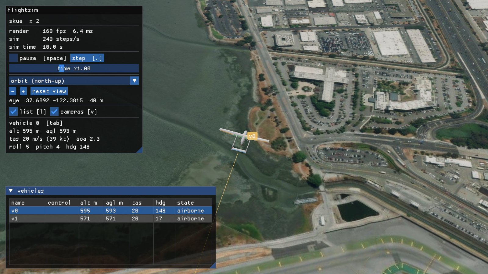
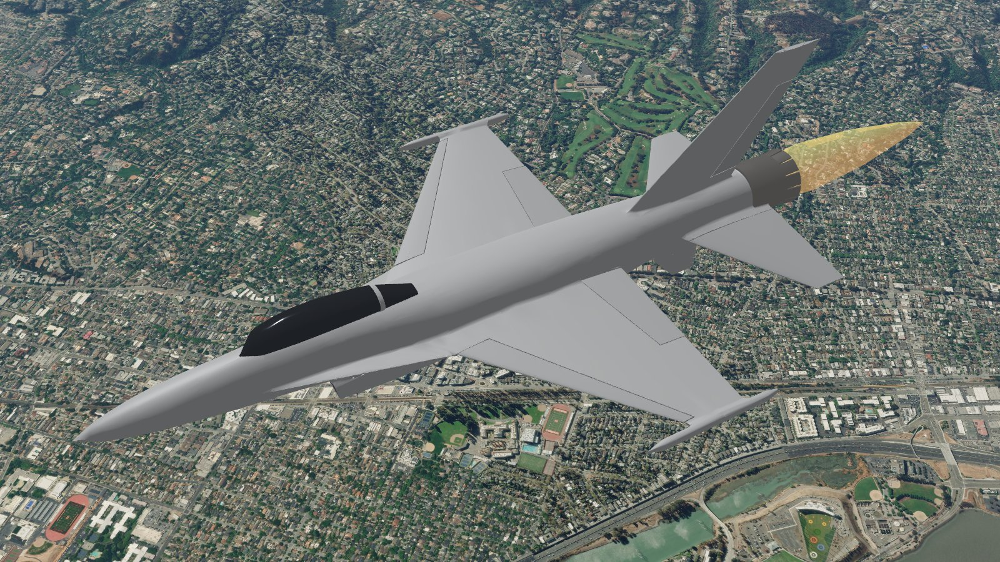
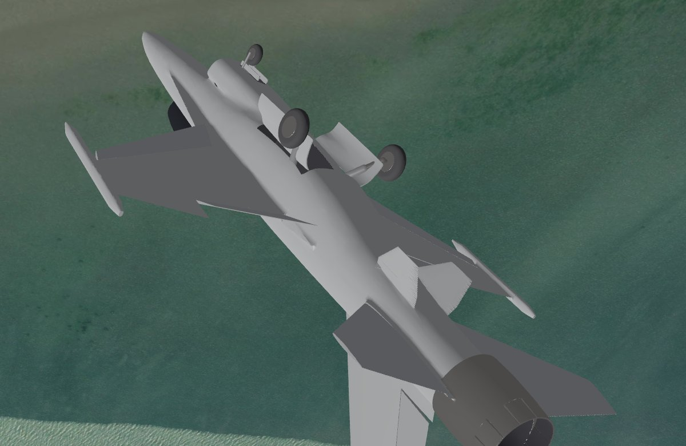
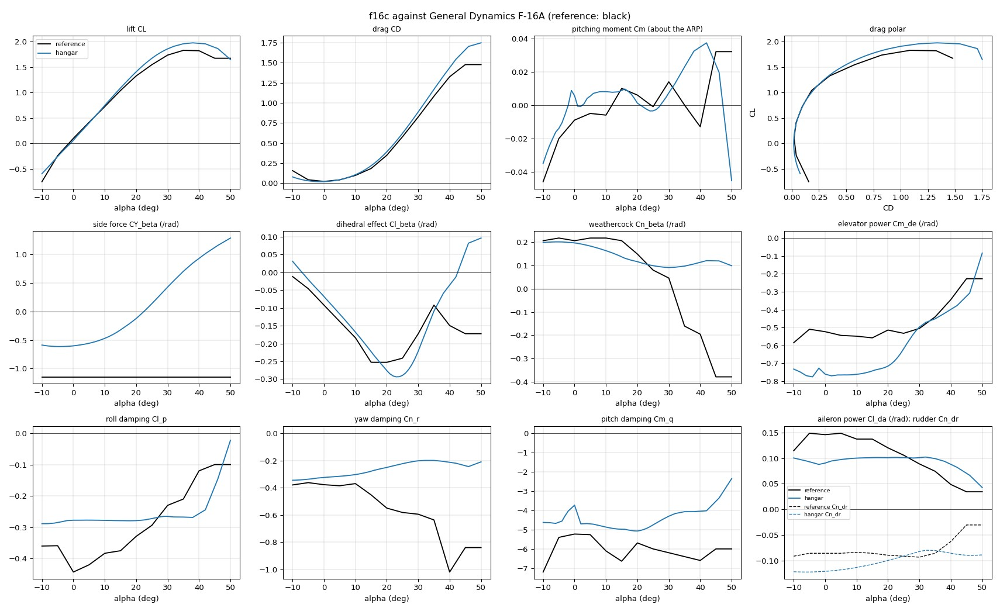
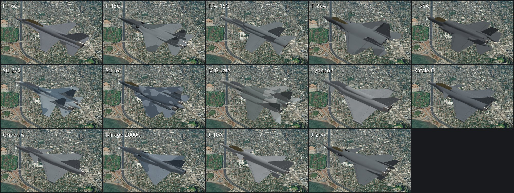
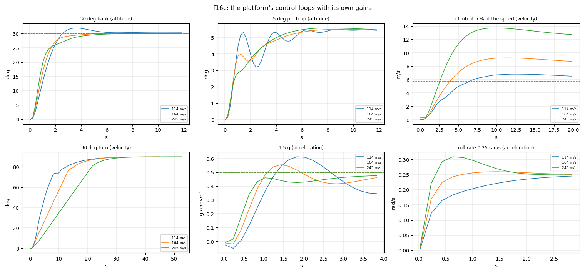

# hangar: JSBSim aircraft from a design file

This is the design pipeline guide. [Status](status.md) is the sole current capability and milestone table;
[development](development.md) documents build and validation practice, and [resources](resources.md) locates tools
and dependencies. Dated rebuilds, flight checks and visual measurements below are historical evidence for their
recorded configuration. They are not a fresh verification of current viewer compatibility or frame rate.
For current armed missile behavior, use the [native engagement API](sdk/engagement.md).

JSBSim flies an aircraft from tables of aerodynamic coefficients. For an
aircraft that only exists on paper, nobody has those tables. With hangar you
describe the aircraft in one TOML file: its surfaces, bodies, engine, gear
and masses. hangar then:

- computes the tables, mass properties and propeller;
- writes a JSBSim aircraft and a 3D model of it;
- flies it in the platform's own JSBSim, checking it against performance
  targets and handling-quality criteria.

The finished aircraft is `jsbsim:<name>` everywhere on the platform: in the
viewer, the C++ and Python SDKs, and scenario files. In the viewer its
control surfaces move with the simulation, its gear folds away, its
afterburner lights and its propeller turns (see [the 3D model](#the-3d-model)).

It builds light aircraft and fighters. For a fighter it adds afterburning
turbofans, vortex lift, supersonic drag and a fly-by-wire flight control
system, so the aircraft flies like the real one: the stick asks for load
factor and roll rate, and the angle of attack stays within its limit.
Fourteen of the best-known fourth- and fifth-generation fighters are
included, built from public data (see [the fighter library](#the-fighter-library)).







## Use

```bat
fsim hangar list                      the designs in aircraft\
fsim hangar new mine --like skua      start a design from another
fsim hangar mine geometry             one stage: look at aircraft\mine\out\threeview.png
fsim hangar mine --quick              every stage, coarse: a first look in half a minute
fsim hangar mine                      every stage, full tables (a few minutes)
fsim hangar mine calibrate            fit corrections to published performance
fsim hangar mine autopilot            tune the platform's control loops for it (in every full run)
fsim hangar mine performance          fly its performance and fuel tables (in every full run; rebuilds)
fsim demo --aircraft mine             watch it fly
fsim hangar f16c                      a fighter: NASA's wind-tunnel data as reference
fsim hangar tank370gal                a store: the same stages, each a store's own (Stores)
fsim hangar stores                    every store through them, a line each
fsim hangar effects                   what each model gives the viewer's effects, and what is missing (docs/hangar-effects.md)
```

`fsim python examples\simulation\python\control_surfaces.py` flies the C172 and the
Skua through a slalom. Watch it with
`fsim viewer --camera chase --chase-distance 20`; `tab` switches aircraft.
`fsim python examples\simulation\python\fighters.py` flies the fourteen fighters
together (`--chase-distance 60`). `fsim demo --aircraft typhoon` starts
eight of one type at a speed that suits it.

`aircraft\mine\out\report.html` collects everything on one page.

### Built again

What is in the repository is what the tool makes: a design run again with nothing changed leaves every file it
writes as it was, byte for byte (a file's date is kept when nothing else in it changes). Held three ways:

- `python tools/models/hangar/rebuild_all.py --jobs 7` runs every aircraft design through every stage, several at a time
  (about an hour on 16 cores; a fighter 15 to 40 minutes, a light aircraft two), and says for each how it ended, the
  checks that failed and - once all are done - which of its files the run changed. `--only f16c c172` and a list of
  stages narrow it. hangar holds the Python package's libraries open while it runs: for a long run point
  `PYTHONPATH` and `FSIM_BIN` at a copy of `build/<preset>/python` and `bin`, and the build stays free.
- The configured CI workflow (`.github/workflows/ci.yml`) runs every store through its stages, the effects' audit
  and one aircraft (the C172) through all of them, and fails if `git diff` shows a generated file changed. A
  successful hosted run is not established by the configuration; see [status](status.md) and backlog B-65.
- 2026-10-11: all 35 aircraft were built again with the tool as it is. They had drifted - the F-16C's files were of
  2026-09-26 (pitch gain 9.56; the tool gives 10.22), and most designs' flight models, damage data or models were
  not what a rebuild gave. Six of them built a second time, every stage, left all 868 generated files as they were.

Two things stopped a rebuild and are mended:

- The performance stage ended `command refused: crashed` (later `activity_ended`) on the F-35A and the Su-57, and
  on the F-16C too once flown at its spawn weight: a table point flown at the ground strikes it, and a wreck takes
  no command. Such a vehicle's run now reads as one on the ground, which the stage already knew how to count
  (`performance.py`: `Fleet.power`, `Fleet.hold`, `_grounded`).
- On Windows a file another program holds mapped cannot be opened for writing ("Invalid argument"); whatever watches
  the repository - a version-control client's status cache, an editor's index, a virus scanner - does that to a file
  just written, for tens of milliseconds, and one design in ten then stopped minutes into its run as a stage wrote
  its aircraft's file again. Every file hangar writes is now opened through `files.open_write`, which waits such a
  refusal out (20 s at most). `rebuild_all.py` asks git what changed only once every design is done, for the same
  reason.

What the rebuild shows and does not mend ([backlog](backlog.md), B-29): the tables' service ceiling is 5.1 to 5.4 %
under the flight test's on seven fighters (the check's band is 5 %), 6.2 % on the C-17A and 15 % on the Mirage 2000.
The tables' highest altitude is 0.95 of the flight test's ceiling, and at its spawn weight a fighter still climbs
there by the flight test's measure (the best excess power of 20 s level runs at any Mach number) but not by the
tables' (a band of speeds it holds level at): the tables' ceiling then comes out at their top row. The Su-25's short
period damping is 0.287 against MIL-F-8785C's 0.3.

## The loop

Each stage reads the design and what the stages before it wrote. It writes
`out/<stage>.json`, which holds its numbers and its checks, plus any images.
Every check is marked pass, warn, fail or info.

The loop: read the images and the checks, change the design, and run that
stage again. A stage costs seconds, except the full tables, which take a few
minutes. The tables are cached and rebuilt only when the geometry, or the
code that computes them, changes.

| stage | produces | checked against |
|---|---|---|
| geometry | three-view and 3D views; areas, MAC, aspect ratio, tail volumes | usual ranges for the category |
| aero | coefficient tables over α ±180° and β ±90°, and factors on them over Mach; section polars; derivative plots; the reference aircraft's coefficients beside the design's | signs and sizes of the stability derivatives, CL max, smoothness; the reference's lift, drag and pitching moment |
| mass | component weights, CG, inertia, static margin | target empty mass; Roskam's radii of gyration; margin 5–40 % MAC (fly-by-wire: from −15 %, full and with the tanks dry) |
| propulsion | propeller thrust and power tables, engine | peak efficiency, static thrust / weight |
| build | `<name>.xml`, `Engines/`; the fly-by-wire's gains | the fly-by-wire's short period, MIL-F-8785C; full nose-down control reaching 2° past the angle-of-attack limit |
| model | `<name>.glb`: the airframe as one closed solid, its moving parts on their hinges | no crack, pinch or loose piece; gear stowed inside; length, span and height against `[dimensions]` |
| verify | JSBSim's forces and moments at 150 random states, compared with the tables | largest error below 0.002 in any coefficient |
| fly | trim across the speed range; stall; climb and ceiling; top speed (a jet's also at its published height); dynamic modes; 40 runs from random states; six crashes into the ground. A fly-by-wire aircraft instead: top speed at sea level and at the published height, excess power, the ceiling at the best climb speed, sustained turn, the angle-of-attack limiter, a 3 g step from trim, a full-stick roll | `[targets]`, MIL-F-8785C level 1, no diverged run; crashes that stop without blowing up |
| ground | on its wheels, in the platform's own JSBSim: the circle it turns at 3 m/s with its steering full over each way, and the yaw acceleration its nose wheel gives it as the steering goes over - the profile's `ground_turn_radius_m` and `ground_yaw_accel_rad_s2`, which a taxi plans its corners by ([flight-autonomy.md](architecture/modules/simulation/flight-autonomy.md), 4.51) | the radius within half to ten times the geometric one (its wheelbase over the tangent of its steering limit); on its wheels throughout |
| calibrate | `calibration.toml`: extra drag, and the propeller pitch unless the design gives the real one; for a supersonic jet, the throttle ratio and the wave drag; for a subsonic one, where its wing's drag diverges | `[targets]` |
| autopilot | `autopilot.toml`: the platform's control loops tuned for it, from small steps flown at a reference condition, written into `<name>.xml` as `fsim/control` properties; the aircraft then flown through standard manoeuvres at the attitude, acceleration and velocity levels at three speeds (`out/autopilot.png`) | no manoeuvre loses control at the reference speed; overshoot and height hold ([The autopilot](#the-autopilot)) |
| report | `out/report.html` | |

The fly stage flies the same tests on a reference aircraft (`reference =
"jsbsim:c172x"` in `[targets]`) and prints its numbers beside the design's.

The flight tests (fly, verify, calibrate and the autopilot stage's
identification) command the actuators, and fly without the platform's
envelope protection ([control.md](sdk/control.md#envelope-protection)).
Protection eases an elevator commanded directly nose-down as the angle of
attack nears the profile's limit, and for a design without a limiting law
that limit is the stall the fly stage flew last time
([The profile](#the-profile)). Flown under it, each run's stall would
measure the previous run's, and the profile would never settle. Flown
without it, a second run of fly and autopilot finds what the first found
and leaves the `.xml` and `autopilot.toml` as they were. The autopilot
stage's manoeuvres keep protection, as a trainer's aircraft does.

A rebuild that changes nothing leaves the aircraft's files as they were:
the build writes them with LF line ends, as git keeps them, and
`<name>.xml` keeps the date in its header until something else in it
changes. So do `autopilot.toml` and a rotorcraft's `hover.toml` when a
stage identifies what they already hold. A file that git shows as
modified has really changed. Only `calibration.toml` is dated at every
calibrate run.

## The design file

Positions are in metres, in JSBSim's structural frame: x aft, y right, z up.
Wings and tails are given for the right half and mirrored. A fin or a body
is single unless `mirror = true`. Here is an excerpt of
`aircraft/skua/skua.toml`, with a `[targets]` section added:

```toml
[[surface]]
name = "wing"
kind = "wing"                    # wing, htail, canard, fin, vtail
airfoil = "naca4412"             # NACA 4/5-digit, or a .dat file beside the design
sections = [                     # leading edge, chord, twist about the leading edge (deg)
  { le = [0.550, 0.000, 0.120], chord = 0.360, twist = 2.0 },
  { le = [0.580, 2.000, 0.225], chord = 0.240, twist = 0.0 },
]
controls = [                     # span as a fraction of the half span
  { name = "aileron", channel = "aileron", span = [0.45, 0.95], chord_fraction = 0.25, limits = [-20, 20] },
]

[[body]]                         # superelliptic stations: width, top, bottom, exponent n
name = "pod"
stations = [ { x = 0.20, w = 0.26, top = 0.13, bottom = -0.13, n = 2.3 }, ... ]

[[engine]]
type = "electric"                # or "piston"
power_kw = 3.0
[engine.propeller]
diameter = 0.56
pitch = 0.30
[battery]                        # an electric aircraft's energy: the motors stop once it is spent
capacity_wh = 1170

[mass]
empty = 21.0                     # kg; components by name, or Raymer's statistics
[targets]                        # optional: what fly checks against
stall_speed_kcas = 27            # also max_speed_ktas, climb_rate_fpm, service_ceiling_ft;
                                 # operational_ceiling_ft for a published clearance (reached or not)
```

A fighter adds strakes, all-moving tails, surfaces that several channels
move, a turbofan and fly-by-wire. From `aircraft/f16c/f16c.toml`:

```toml
[[surface]]
name = "strake"
kind = "strake"                  # a sharp leading-edge extension: vortex lift
airfoil = "plate"                # also NACA 6A ("naca64a204"), "biconvex5"

controls = [                     # chord_fraction 1: the whole panel turns (pivot at 30 % chord);
                                 # mix: other channels it follows - here it rolls the aircraft too
  { name = "stabilator", channel = "elevator", mix = { aileron = 0.25 }, span = [0.27, 1.0], chord_fraction = 1.0, pivot = 0.30, limits = [-25, 25] },
]

[[engine]]
type = "turbofan"                # afterburner above 80 % throttle
thrust_dry_kn = 79.2
thrust_wet_kn = 129.4
bypass_ratio = 0.36

[flight_control]
type = "fbw"                     # load factor, roll rate and sideslip commands
n_max = 9.0
alpha_max_deg = 25.0

[targets]
max_mach = 2.05                  # at max_mach_altitude_ft: calibrates the wave drag
max_mach_altitude_ft = 40000
```

A turboprop drives a constant-speed propeller through a gearbox. From
`aircraft/c130j/c130j.toml`:

```toml
[[engine]]
type = "turboprop"
power_kw = 3458                  # the shaft power rating (4,637 shp)
psfc = 0.280                     # kg/(kW h) at the rating
thermodynamic_power_kw = 4474    # what the core makes unrated: flat-rated to a greater height
[engine.propeller]
diameter = 4.115
blades = 6
rpm = 1020                       # governed
gear_ratio = 14.0                # the engine's rpm over the propeller's
blade_angle = [15, 65]           # deg at 75 % radius: the governor's range

[targets]
max_speed_ktas = 362             # flown at max_speed_altitude_ft
max_speed_altitude_ft = 22000
```

A thrust-vectoring nozzle gives its travel, and how far its plane leans
outboard (0, pitch only, for the F-22A). From `aircraft/su57/su57.toml`:

```toml
[engine.nozzle]
position = [18.750, 1.250, -0.150]
vectoring = 15.0                 # deg each way
vectoring_cant = 32.0            # deg outboard: together they pitch, differentially they yaw and roll
```

The 3D model has its own keys (all optional):

```toml
[[intake]]                       # a body whose first station is the lip, open onto a dark duct
name = "intake"
lip = 0.035                      # m
rake = 12                        # deg: the lip's top ahead of its bottom (negative: behind)
sweep = 0                        # deg: its outboard edge behind its inboard one
duct = 1.6                       # m seen into; duct_rise and duct_taper bend it towards the engine
stations = [ { x = 4.40, w = 0.96, top = -0.56, bottom = -1.16, chine = -0.82, n_top = 4.0, n_bottom = 2.4 }, ... ]
                                 # any body: chine is the widest line's height, n_top and n_bottom
                                 # the exponents above and below it (a flat belly, a chined nose);
                                 # lean = 40 (deg) tips a section's top outboard, its walls sloping
                                 # (a stealth fighter's caret intakes)
[[body]]
name = "canopy"                  # a pod named canopy... is glass
frames = [5.45]                  # a frame round it at each x

[[surface]]
leading = [                      # leading-edge flaps or slats, on the angle-of-attack schedule
  { name = "lef", span = [0.28, 0.97], chord_fraction = 0.17, limits = [-2, 25], schedule = [1.38, 9.05, 1.45] },
]

[aircraft]
stands_in_for = ["f16"]          # a stock JSBSim aircraft drawn with this model (fsim hangar register)

[[gear]]
retract = "forward"              # forward, aft, inward, outward; hangar fits the angle, the
wheels = 2                       # trunnion's cant and the wheel's twist that stow the leg inside
axles = 2                        # a bogie: two axles one behind the other (axle_spacing, m)
bogie_deg = "over"               # the bogie turns on its pivot as the leg folds: degrees (nose up),
                                 # or "level" / "over": lying level stowed, upright or on its back
wheel_turn = "flat"              # or retract_deg, retract_axis: what is known of the real leg;
                                 # hangar fits only the rest
doors = false                    # an open well: the stowed wheel may stand out up to its radius
fairing = true                   # fixed gear: a spat over the wheel

[[strut]]                        # a high wing's lift strut, drawn only (its drag is in the
from = [0.99, 0.50, 0.15]        # extra drag area): its ends, mirrored unless mirror = false
to = [1.21, 2.50, 1.54]
chord = 0.16                     # m; thickness 0.35 of it unless given

[[drag_device]]                  # an airbrake, spoilers or surfaces deflected as one (rule R8):
name = "speed brake"             # one speedbrake opens them all
kind = "airbrake"                # plates: area (m2), their centroid opened, opened max_deg
area = 2.93
position = [9.3, 0.0, 1.0]
max_deg = 45                     # spoilers: surface, span, chord_fraction, hinge; surfaces:
                                 # channels = { rudder = 25 }; in_flight: opened on an approach

[operations]
crosswind_kt = 25                # the 90 deg crosswind it lands and takes off in, its source beside it
gear_kt = 250                    # its placards, KIAS, their source beside them: the most it operates its
flaps_kt = 250                   # gear at; the most with its landing flaps out, beyond flaps_above (the
                                 # setting before them); or placards_unknown = "why there are none"

[dimensions]                     # published: the model is checked against them
length = 15.06
span = 9.45
height = 5.09
```

Included designs:

- `aircraft/c172`: a Cessna 172P built from published dimensions, used to
  validate the methods.
- `aircraft/skua`: a hypothetical twin-boom pusher UAV.
- `aircraft/f16c`: an F-16C Block 52, checked against NASA's wind-tunnel
  data.
- Thirteen more fighters: [the fighter library](#the-fighter-library).
- Bombers, tankers, transports and special-mission aircraft:
  [support aircraft](#support-aircraft).

## Mass accounting

Every kilogram an aircraft weighs is in one of four ledgers, and in one only:

| ledger | declared in | in the flight model | changes in flight |
|---|---|---|---|
| empty weight | `[mass] empty` (kg). `[mass.component]` and `[[mass.item]]` place parts of it; they add nothing to it | `<emptywt>` | damage |
| fixed load | `[[mass.payload]]`, each with its `kind` | a named `<pointmass>` each | never |
| internal fuel | `[[mass.tank]]`: `capacity`, and `fill`, the part of it the aircraft spawns with (1 left out) | a `<tank>` each | burnt; drawn in from an external tank |
| stores | the fit's loadouts (`payloads.json`), on the stations of its store-station card - pylons, weapon bays, a cargo hold's pallet positions; a store weighs its card's `mass_kg`, a tank its `fuel_kg` besides | a `station <n>` point mass each, empty in the file | loaded, released, jettisoned; a tank's fuel drawn |

So an aircraft weighs `empty + fixed load + internal fuel + stores`, and spawns
at the first three: its stations are empty until a scenario loads them.

A fixed load is what cannot leave the aircraft as a thing of its own: its
people, what is built into it, and what is too small to be one. Its `kind`
says which:

| `kind` | what | examples |
|---|---|---|
| `crew` | the people who fly and operate it | pilot, weapon systems officer, mission crew, loadmaster |
| `passenger` | anyone else aboard | the C172's rear seats |
| `equipment` | mission equipment built into this model, permanently | the U-2S's and RQ-4B's sensors, the Skua's camera |
| `ammunition` | its guns' rounds: very small items, each | every fighter's |
| `baggage` | hand baggage: very small items | the C172's luggage |

**Everything else an aircraft carries is a store.** A missile, a bomb, an
external tank, a pod, a pallet of cargo: each has a store card
(`assets/stores/<id>.json`: its mass, its size, its class) and a JSBSim model
of its own (the card's `model`), hangs on a station of the aircraft's
store-station card, and is loaded by a loadout. The store management weighs it
on its station; released or jettisoned, or gone with the part of the aircraft
it was on, it flies on as that model - a vehicle like any other, with the
store's mass, its inertia, its drag. `cargo` and `store` are not kinds a
`[[mass.payload]]` may have: hangar refuses them, and says to make a store.

Every store is a design the pipeline builds as it builds an aircraft
(`aircraft/<name>/<name>.toml`, `fsim hangar <name>`: [Stores](#stores)), its
card the published figures the design holds:

| class | its design | its flight model (`aircraft/stores/<name>/<name>.xml`) |
|---|---|---|
| `aam` | `hangar missiles`: the table in `missiles.py` | its design's body and fins by a component build-up, tabled over Mach; its motor's grain and nozzle from the design's assumed phases (`Engines/`); native armed engagement adds ideal fin actuation through JSBSim force/moment hooks, rather than calibrated fin aerodynamics |
| `bomb` | `hangar storedesigns`: the Mk 82's profile and fins (`stores.py`) | the same build-up of its design, unpowered (before JSBSim's own `mk82`, which the platform no longer flies for the card) |
| `tank`, `pod` | `hangar storedesigns`: its class's shape at its card's length and diameter | a slender body; a tank's fuel a point mass the world sets as it leaves |
| `cargo` | `hangar storedesigns`: a box of its card's `length_m`, `width_m`, `height_m` | a block's inertia, a bluff body's drag (its `drag_cd` on each face), no parachute |

Every one is written by its design's build stage, and none by hand.

Its model for the viewer is its design's, as an aircraft's is
(`aircraft/<name>/<name>.glb`, the model stage).

The rules that keep a kilogram out of two ledgers:

- **What a station can carry is weighed on the station**, and nowhere else. A
  weapon bay's stations are stations like the rest: the F-22A, F-35A, J-20A
  and Su-57 spawn with their bays empty, as every fighter spawns with its
  pylons empty, and their internal missiles come with their loadouts. (Until
  this rule they carried them as a fixed load too, and a loaded bay weighed
  its missiles twice: 1,084 kg on the F-22A, 608 kg on the F-35A, 1,020 kg on
  the J-20A, 972 kg on the Su-57.)
- **Nothing that can leave is built into an airframe.** The EA-18G's three
  ALQ-99 jamming pods were bodies of its design - in its skin, its
  aerodynamics and its fixed load, 435 kg each, their stations kept from any
  other use. They are stores now (`an-alq-99`): its airframe is designed
  without them, its "jamming pods" loadout hangs them on stations 3, 6 and 9,
  and their drag is their stations' while they are carried.
- **Cargo is stores in a hold.** A transport's cargo floor is a row of
  stations (`assets/payloads/c130j-store-station.json`, `c17a-...`: one a
  pallet position, the last on the ramp; named "cargo bay <n>", so that they
  share the hold's doors - its ramp - and add no drag), each taking one store
  of class `cargo`: a loaded 463L pallet (`463l-pallet`, 2,268 kg), an
  airdrop bundle (`cds-a22`, 998 kg). A release sends it aft, out over the
  ramp (the station's `extraction_ms`). hangar cuts no bay into the skin for
  a station that takes cargo and hangs no rack there (`carriage.py`): the
  hold is the fuselage as it is drawn. The C-130J's design carried 5,000 kg
  of cargo as a fixed load; it carries none now, and its "airdrop" loadout is
  six bundles.
- **A tank's fuel is the tank's until it is drawn.** An external tank is hung
  full, its fuel part of its store's weight and not of the aircraft's own
  fuel; as the aircraft's tanks have room the fuel moves into them, off the
  store and into the tanks by the same amount.
- **A design's performance is flown as it spawns**: its fixed load aboard, its
  tanks as filled, no stores. The profile's speeds and tables are that
  weight's. The aircraft that carried what are now stores as fixed load or
  airframe were flown again without it - flight tests, autopilot
  identification, performance tables: the EA-18G (from its geometry on: its
  aerodynamics, mass, model, breakup pieces and radar cross-section table
  without the pods, and its calibration fitted again to the published clean
  Mach 1.8 - it reached Mach 2.27 with the pods' drag gone and the old fit),
  the C-130J, the F-22A and the J-20A. Two are the exception until hangar's
  performance stage flies them through: the F-35A's and the Su-57's
  profiles are still those flown with their bay missiles aboard (608 and
  972 kg heavier than they now spawn, 2.7 and 3.3 %: least speeds and tables
  on the safe side); their flight models were rebuilt from the mass stage on
  (the point mass gone, the gear's springs and the fly-by-wire's schedules
  for the lighter loaded weight). The stage's table flights end with the
  aircraft crashed on both (`command refused: crashed`) - the F-35A's on
  its design as it was, too: not a matter of its weight.

  The EA-18G's and the F-22A's reports carry one failed check since: the
  tables' service ceiling 5.2 % under the flight test's (the check's band is
  5 %). The tables' best climb falls under 100 ft/min by their highest
  altitude row - 95 % of the ceiling the flight test climbs to - where the
  flight test still climbs: two measures of the lighter aircraft that
  differ, why not yet found. The Vehicle Interface takes the tables': the
  lower.

What is not a store, and why: a U-2S's nose and Q-bay sensors and an RQ-4B's
sensor suite are fitted on the ground and stay for the flight (`equipment`);
a gun's ammunition is rounds of a few hundred grams (`ammunition`: its weight
does not yet fall as the gun fires). Flyable air-to-air stores support armed
strike, native motor state, guidance, seekers and fuzes; [engagement](sdk/engagement.md)
defines the current behavior and its game assumptions. Jettison releases an inert
body without an armed motor or fuze. The B-52H and H-6K have store stations and
loadouts; the UH-60's stations and carriage remain backlog B-32.

What checks them: hangar refuses a `[[mass.payload]]` without a kind, or of
a kind that is a store's (`mass.check_payload`).
`tools/models/hangar/tests/test_mass_accounting.py` holds every design, its flight
model and its fit to the rules, and every store card to having its flight
model and its viewer model; `tests/compatibility/python/test_mass_accounting.py` weighs
every aircraft in the simulator - as it spawns, with each loadout, unloaded
again, through ten minutes of a tank's fuel being drawn - and makes every
store card's model as a vehicle of its own, weighing what its card says;
`tests/simulation/test_stores.cpp` jettisons every store of every loadout of every
aircraft and weighs the vehicle each becomes.

A rotorcraft's weight is one figure (`[mass] weight_lb`, its tank full within
it: [Rotorcraft](#rotorcraft)), and a multirotor's its `mass_kg`.

## Methods

Every method is a published one. The tests in `tools/models/hangar/tests` check the
section and lattice methods against theory and published data, and run every
stage end to end through the platform (`ctest -R hangar`).

- **Sections.** Thin-airfoil theory gives the zero-lift angle and the
  pitching moment. The lift slope is corrected for thickness and Reynolds
  number. CL max follows DATCOM's leading-edge-sharpness trend. Past the
  stall come Viterna and Corrigan's model and then flat-plate values,
  covering the whole ±180° range. Flaps use Glauert's flap effectiveness and
  Raymer's flap drag.
- **Lifting surfaces.** A vortex lattice (Katz & Plotkin, ch. 12) with
  Prandtl–Glauert compressibility and Vatistas vortex cores. The lattice is
  decambered onto the viscous section polars (after Mukherjee &
  Gopalarathnam, J. Aircraft 43(3), 2006). Each strip then reads its full
  polar at its own induced angle. Past 30–60° of flow angle this becomes
  plain strip theory. The lift a strip's angle of attack makes acts where
  the lattice's loading puts it on the chord, not at the quarter chord a
  section alone has: aft on a wing root behind a strake or a canard, whose
  trailing vortices wash the front of the root down, and forward towards a
  swept wing's tips (Küchemann's centre and tip effects). So in the linear
  range the strips give the lattice's pitching moment as well as its lift.
- **Drag devices.** An airbrake's plates: a flat plate's normal force, 1.2
  of its area's dynamic pressure at 90 deg (Hoerner, Fluid-Dynamic Drag),
  times sin d, so a drag of 1.2 sin^2 d on its area, with that drag's
  pitching moment from the reference point's height. A spoiler's panels the
  same, and 0.7 of the lift of the wing behind them lost at 45 deg and beyond
  (an estimate after Hoerner, Fluid-Dynamic Lift), from the design's own lift
  table, with that lift's moment. Surfaces deflected as one: their drag from
  the design's own control tables. Written as functions of
  `fcs/speedbrake-pos-norm` (`drag.py`; [flight-autonomy.md](architecture/modules/simulation/flight-autonomy.md), 4.55).
- **Gear drag.** Retractable gear extended: Raymer's components (Aircraft
  Design: A Conceptual Approach, 12.5.6, Table 12.6), drag per frontal area
  - each leg's first axle's wheels 0.25 of their diameter by width, a
  bogie's further axles and a leg in the wake of one ahead of it 0.15, its
  strut, hinge to axle, 0.30 of its diameter by length - acting at their
  centroid, so with its pitching moment from below the reference point.
  Written over `gear/gear-pos-norm` (`drag.gear_drag`); the verify stage
  adds it as far as the gear is out. Doors, wells and the components'
  interference are not counted: a lower bound - ΔCD 0.003 (the RQ-4B) to
  0.013 (the Su-25), the C-17A's 0.0068. Fixed gear's stays in the drag
  area. Without it, gear down or up an approach was the same to the bit
  ([flight-autonomy.md](architecture/modules/simulation/flight-autonomy.md), B-13).
- **The landing configuration's stall.** Where a design has flaps, the fly
  stage flies a second stall at sea level: its flaps all out, its gear down,
  trimmed by flying while they come down (left alone they upset it), from
  1.3 times the clean stall, half its trim's power held (at idle its drag
  bled the speed so fast the height hold sank past the break first), its
  trim's elevator moved into the autopilot's integrator (summed with the
  trim, clipped, the KC-135R had a quarter of its elevator left). Then it
  flies a trim at 1.3 times that speed so configured and reads the attitude
  it would come down a 3° glide slope at. The profile gives that stall
  (`stall_flaps_cas_ms`) where it is slower than clean and that attitude
  leaves 6° under the tail's touching - the room the platform's flare needs:
  not the Su-25's (its elevator runs out with its flaps before its wing
  stalls) nor the H-6K's (5.5° on the slope, 5.25 of room). A design may
  record its published final approach speed instead (`[operations]
  approach_kt`): the B-52H's 135 KIAS, its best flare speed at airbrakes 4.
- **Induced drag.** By default each strip's lift is tilted by its own
  induced angle. That overstates the induced drag of the lattice's loading:
  by about 15 % on a plain wing of aspect ratio 6-10, and by a factor of 1.5
  to 2 on a swept or cambered transport wing, whose lift-to-drag ratio then
  comes out a quarter low (a B-52's 15 against 21.5). `[analysis]
  induced_drag = "trefftz"` takes it from the Trefftz plane instead: the far
  wake of every surface's trailing vortices, from the spanwise loading
  alone, as potential flow has it (a rectangle's span efficiency 0.95, an
  elliptic loading's drag within 1 %). The support aircraft use it; the
  fighters and the light aircraft still use the strips' tilt.
- **Bodies.** Slender-body theory as far as the flow stays attached (DATCOM
  4.2.1.1), then Allen and Perkins' crossflow drag (NACA TR 1048), plus skin
  friction. The wing–body dihedral effect comes from DATCOM. A fuselage and
  the intakes, nacelles and booms against it are one body to the air, their
  sections' union at each station; an intake's mouth swallows its air rather
  than pushing it aside, and turns it into the duct: the inlet's normal force
  at the lip. The area rule counts overlapping bodies once.
- **Derivatives.** Rate derivatives are central differences of the full
  nonlinear model, so they change through the stall. The α̇ terms come from
  the lag of the downwash at the tail (Nelson, *Flight Stability and
  Automatic Control*, ch. 3). Now and then one of a difference's two
  solutions lands on another branch, and the table gets a jump where a slope
  belongs: one point tens of times its neighbours. The A-10C's Cl_p was
  +4.35 at α −9° between −0.47 and −0.47; flown through, its roll ran away
  at 1,000°/s. A slope does not depend on the step it is measured over; a
  jump's does. So a point standing alone off its neighbours' line is
  measured again at half and at twice the step. Where the three agree it
  stands; where they do not, it takes its neighbours' line
  (`aero/tables.despike_rates`). Seventeen such points in nine aircraft were
  repaired on 2026-10-10; two that measure the same at every step stay (a
  B-52H at α 165°, an F-35A at 46°). A test scans every built aircraft.
- **Mass.** Component weights come from Raymer's general-aviation equations
  (ch. 15) or are given directly. Each component is spread over its own skin
  to give the inertia. Systems mass is placed to meet the empty CG.
- **Ground contacts.** Besides the wheels, the airframe gets contact
  points wherever a crash can meet the ground first: the extreme points of
  its convex hull in every direction, plus points along keels and surface
  edges. Each point's spring is sized from the mass it moves (small at a
  wingtip, where the aircraft rolls easily), so JSBSim's 120 Hz step
  integrates it stably. Points close together share that budget. The fly
  stage checks the result by crashing the aircraft six ways. A helicopter's
  are found and sized the same way (Rotorcraft, below). The wheels
  stay JSBSim's; flightsim's build of JSBSim fixes their force when one
  lands on its side, and makes an impact the step cannot resolve inelastic
  (THIRD_PARTY_NOTICES.md, "Changes to JSBSim"; docs/rotorcraft.md, 7). A
  multirotor's feet and tops are sized for the step too, as sets
  (Rotorcraft, below).
- **Gear.** The wheels share the weight at rest by the lever rule. The
  rudder command steers every steerable wheel the same way, so a wheel
  behind the CG (a tail wheel) is written to turn the other way to a nose
  wheel, and the aircraft yaws the way its rudder yaws it. (The U-2S's tail
  wheel, steering as a nose wheel does, steered it off the runway against
  its rudder.) The mass stage checks a tricycle's balance at its parked
  attitude, as Raymer (ch. 11) does: 5 to 25 % of the loaded weight on the
  nose wheel (8-15 % is typical), the empty aircraft on its nose wheel and
  not its tail, and a warning under 15° of tip-back off the vertical from
  the main wheels to the CG. The profile gives the attitude at which the
  aircraft, pivoting on its aftmost wheels, touches the ground behind them
  (`envelope/ground_pitch_max_deg`: the E-7A's 7.3°, the Rafale's 19.6°): a
  takeoff rotates short of it. A tail-wheel aircraft's - its steerable wheels
  behind all its others - gives too the attitude it rests at on its main and
  tail wheels, its struts at their static deflection
  (`envelope/tail_wheel_pitch_deg`: the U-2S's 3.99°): on the runway the
  platform holds its tail down there (flight-autonomy.md, 4.65). It gives too the tightest circle the aircraft
  turns on its wheels and how quickly a turn there builds, both flown by the
  ground stage. The tyres decide them, not the geometry alone: the C-130J's
  nose wheel at its 60° turned it on 25 m, where its wheelbase over the
  tangent of its steering limit gives 5.6, and a heavy's nose tyre yaws its
  inertia at 0.03 to 0.08 rad/s², most fighters' at 0.2 to 0.7 (the
  EA-18G's, the F/A-18C's and the Su-25's at 0.05 to 0.11). Where the
  ground stage has not flown, the profile gives the geometric radius.
- **Propeller.** Blade-element momentum theory with Prandtl's tip and hub
  losses.
- **Engines.** Piston engines use JSBSim's piston engine; hangar's control
  system adds mixture that follows the altitude. Electric motors use JSBSim's
  brushless DC motor.
- **Battery.** An electric aircraft's `[battery] capacity_wh` is its energy
  (ADR-29 FA-3b). The control system integrates the power its motors draw
  into the charge left (`fsim/battery/*`). That power is each motor's volts
  (the battery's, times its throttle) times the current the motor model
  takes, none of it returned to the battery. Once the battery is spent the
  motors stop; until then a flight is the same, bit for bit, as without
  one. The Skua's battery is its 6.5 kg pack: 1,170 Wh, 456 W at 22 m/s at
  3,000 m, two and a half hours.
- **Linear model.** Etkin & Reid's small-perturbation equations, built from
  the tables at the trim condition, the lateral ones in body axes with the
  trim angle of attack's kinematic terms (a roll rate turns the trim
  velocity into sideslip): without them a swept-wing transport's predicted
  dutch roll damping was a third of what JSBSim shows. The handling-quality
  checks use it. The 3-2-1-1 flight tests identify the same modes from
  JSBSim's own response as a cross-check.

For fighters:

- **Vortex lift.** A thin swept section does not stall like a light
  aircraft's. The sweep brings this in: none of it at 25° of leading-edge
  sweep, all of it from 35° (a strake, and a wing behind one, always). A
  line drawn at 35° made the F-35A's 34° stabilators stall like
  two-dimensional sections, so that turned fully nose-down they lifted less
  than at neutral. Past its attached-flow limit the leading edge keeps the suction
  it can hold (Carlson's attainable thrust, NASA TP-1500). What it loses turns
  into vortex lift where the edge is sharp (Polhamus' suction analogy, NASA
  TN D-3767), and past 45° of sweep where it is blunt too (the blunt-edged
  65° delta of the VFE-2 experiment). The suction a wing loses to its vortex
  is Polhamus' own: its lift times the angle less its planform's downwash,
  CL/πA. An edge beside the fuselage has less suction to lose: 1 − (a/d)⁴
  of it, at a distance d from the axis of a body a wide (Bryson's slender
  wing–body theory), and none inside the body. So a strake makes little
  vortex lift where it grows out of the fuselage's side. A sharp 60° delta
  gets within 7 % of Polhamus' lift up to 20°. The vortex bursts at an angle
  that rises with the sweep (Earnshaw & Lawford, ARC R&M 3424) and takes 18°
  more to reach the apex; a burst vortex keeps 40 % of its lift, so a 60°
  delta's lift peaks at 1.27 near 30° (Wentz & Kohlman measured about 1.3 at
  35°). A wing behind a strake shares the strake's vortex; a close-coupled
  canard delays the wing's burst. The
  circulation's force uses the local velocity, so the potential lift goes as
  Polhamus' sin α cos² α.
- **Past the stall.** A vortex-lifting aircraft flies two flows there, each
  solved on its own: the vortex flow, a lifting surface in the lattice's
  induced flow, and the separated flow, flat plates in strip theory. The
  wing moves from the one to the other between 45° and 70° of its angle of
  attack, and its tails and canards, in the flow it makes, with it. Each
  flow decides before it solves where a section leaves the vortex regime,
  so each has one solution. Decided while solving, as a lone section decides
  it, a section washed far down and still in the vortex regime and a plate
  hardly washed down at all were both solutions, and the tables jumped
  between them (the Rafale's drag by 0.5 between 55° and 60° in a 30°
  sideslip).
- **Controls.** Each control turns as a whole and stops at its own limits,
  so a canard can travel further than the elevons on its channel. An
  all-moving surface turns its whole section: the lattice gets the deflection
  that gives it sin(α + δ), not the linear sin α + δ cos α.
- **Wake.** The lattice's wake leaves the trailing edge along the free
  stream. It is solved at wake angles 2° apart and interpolated, so a tail
  in the wing's plane sees the wake rise above it.
- **Sideslip.** Simple sweep theory: the windward half of a swept wing
  lifts more, the dihedral effect that grows with lift.
- **Mach number.** Prandtl–Glauert on the lattice to Mach 0.9. From 1.2,
  linear theory per surface: Ackeret, and Stewart's slope for subsonic
  leading edges. Transonic values are faired between. The results are
  factors on the tables: lift, the neutral point's move, control power.
  The neutral point's supersonic move starts from where the lattice puts
  each surface's lift at Mach 0.9, already well behind a low aspect ratio
  surface's quarter chord.
  Drag adds skin friction falling with Mach, and wave drag from the area
  distribution (Sears–Haack times Raymer's E_WD, from Korn's
  drag-divergence Mach). Once the leading edge is supersonic, the edge's
  suction is lost. A flat pod - a rotodome - is a thick section of its own,
  and its drag diverges long before the wing's: as the two-dimensional
  section with its ellipsoid's fastest air (Lamb), at Korn's 0.87 − t.
- **Turbofans.** JSBSim's turbine. Thrust goes as the density to the 0.7
  (afterburner) or 1 (dry) up to 11 km, and as the density above it, where
  the temperature holds. It rises with the ram, 1 + 0.2 M², and is cut back
  once the compressor's inlet temperature passes the throttle ratio TR
  (Mattingly, Heiser & Pratt, *Aircraft Engine Design*, sec. 2.3). A dry
  engine of bypass ratio above 1 moves towards Mattingly's high-bypass
  lapse, δ₀(1 − 0.49√M), all of it from a bypass ratio of 2: a fifth of
  the static thrust at Mach 0.8 and 35,000 ft. A TF33 (1.42) goes two
  fifths of the way, to 0.29 of its static thrust at Mach 0.82 and 35,000
  ft, as the JT3D's cruise ratings give it. A flat-rated engine
  (`thermodynamic_thrust_kn`, its core's thrust above the rating, as the
  AE3007H's 8,917 lbf rated 7,600) keeps its rating at each Mach number
  until the core's, lapsing with height, falls below it. Weight and size
  come from Raymer. Calibration fits TR to a fighter's published top speed,
  and then the wave drag if TR alone cannot. A subsonic jet's engines run
  far below their TR at its top speed, which its wing's transonic drag rise
  sets: calibration fits Korn's airfoil technology factor κ_A in the
  drag-divergence Mach number (Raymer 12.5.10), from conventional sections'
  0.87 to supercritical ones' 0.95, and more wave drag when even
  conventional sections leave it too fast. A top speed below the wing's
  drag rise is none of the wing's doing (the E-3G's, its rotodome holding
  it): there calibration fits an extra drag area. On direct controls the test
  autopilot flies that top speed: trimmed, the height held, full thrust
  until the speed settles.
- **Turboprops.** The propeller's blade-element tables at every blade
  angle, with the tips' drag rise past Korn's divergence Mach number; the
  engine's shaft power lapses as Mattingly's turboprop (delta0, cut past
  its TR). The JSBSim file's governor turns the blades to hold the
  propeller's speed, and starts the engine running at its trimmed power.
  A propeller aircraft whose propellers leave nothing to fit (their pitch
  given, or constant-speed) is calibrated on its top speed alone.
- **The ground range.** On the ground a turboprop's lever goes below
  flight idle, where it sets the blade angle itself and the fuel control
  holds the propeller's speed (the C-130's: 96-103 %); at ground idle the
  blades are set for minimum thrust (the 54H60's +5 deg at its reference
  station, flight idle 17.5). With weight on the wheels, the throttle's
  first fifth is hangar's ground range - the C-130's lever spends 16 of its
  72 deg from ground idle to take-off between ground idle and flight idle.
  At 0 the blades stand where the propeller makes no thrust standing still
  at its governed speed (the C-130J's -5.15 deg at 75 % radius, taking 144
  hp; with the blades' twist that is +5.3 deg at 52 % radius, the 42-inch
  station, if that is where the 54H60's angles are measured - the sources
  do not say), and N1 holds that speed (52.5 %). The blades open with the
  throttle to the governor's low stop, N1 capped: at ground idle as far above
  it as brings the propeller back from 96 % of its speed, rising to the flight
  range's N1 where that takes over, at 0.2, without a step. Rolling
  at idle the flat blades brake, opening past 101 % of the propeller's
  speed to hold it. Governed at flight idle on its low stop, as before, a
  parked C-130J made 3,440 lbf a propeller and rolled from rest to 11 m/s
  in 5 s; now it makes -1 lbf and stands still. In the air nothing changes:
  the flight tests' reports are identical, value for value.
- **Flight idle.** A turboprop's flight idle is its ground idle's N1: the
  fuel control's least that turns the propeller at its governed speed with
  its blades flat - the core a little over its own need, next to no shaft
  power. In a descent at flight idle a T56's torque goes negative, its
  propellers driving it (its negative torque system; C-130 crews,
  c-130hercules.net, "C-130 descent technique"). hangar's flight idle was a
  guessed 60 %, a tenth of the core's power: the C-130J's propellers pushed
  26 kN at 70 m/s and it could not come down a glide slope; on 52.5 % they
  make 8 kN ([flight-autonomy.md](architecture/modules/simulation/flight-autonomy.md), 4.56).
- **Large aircraft.** A jet climbs best well above a propeller aircraft's
  speeds, at up to 2.8 times its stall speed. A heavy jet's stall run goes
  on until the stall breaks, and every crash test starts with the lowest
  point of the aircraft clear of the ground. The platform commands four
  throttles, so engines past the fourth (a B-52's) follow one of them, and
  the viewer shows each as the one it follows. A tank's `fill` is the fuel
  it carries everywhere: the JSBSim file, the mass and CG, the inertia. A
  fly-by-wire transport turns at Mach 0.6 within its load limit and rolls
  long enough to pass 90°.
- **Yaw damper.** A swept-wing jet on direct controls has a lightly damped
  dutch roll, most of all when slow (the KC-135R's 0.03 near its approach
  speed). `yaw_damper = true` under `[flight_control]` adds one: the yaw
  rate, washed out over 2 s so a steady turn keeps its own, against itself
  through the rudder, with at most half the rudder's travel. Its gain over
  dynamic pressure brings the dutch roll's damping to 0.3 in the full
  lateral model, washout and all. The flight tests identify the airframe's
  own modes (they take the surfaces as they moved for inputs), so the
  report adds the dutch roll with the damper on. Flown in JSBSim, the
  KC-135R's sideslip after a rudder doublet decays at 0.31 with it, 0.11
  without. Where the airframe's weathercock stability at the CG (Cn_beta)
  is short of 0.03 /rad - the U-2S's own, the slow long-winged design
  nearest the RQ-4B (the others have 0.017 to 0.16) - the damper feeds the
  sideslip back too, against
  itself through the rudder at most half its travel: its gain over dynamic
  pressure makes Cn_beta up to 0.03 with the rudder's yaw power, and the
  yaw-rate gain is designed with it on (`fcs.sideslip_gain`). Only the
  RQ-4B has one.
- **Fighter mass.** Raymer's fighter/attack weight equations. Radii of
  gyration are given per design (NASA's for the F-16).
- **Fly-by-wire.** Gains are placed from the linear model at each dynamic
  pressure and Mach number (`hangar/fcs.py`):
  - Pitch: angle-of-attack and pitch-rate feedback give the short period
    CAP 1 and damping 0.8. A load-factor command follows a model response.
  - On the wheels: the integrators are reset below 60 kt and while a wheel
    carries weight, and the stick moves the elevator over its travel
    directly, faded in and out over half a second with the weight on the
    wheels. On the runway the wheels, not the wing, set the load factor;
    reset only below 60 kt, the pitch integrator wound the tail to its
    nose-down stop within seconds. The load-factor command has no room
    there either: at the rotation speed the angle of attack left gives
    about 1 g. With neither, full back stick gave the F-35A 10° of its 30,
    and it lifted off at 188 m/s. The fighters now lift off at 96-111 m/s.
    The yaw law fades out the same way, and the pedals move the rudder over
    its travel directly (a ground law, as fly-by-wire airliners have): its
    sideslip feedback, on a runway the crosswind's, turned the nose into
    that wind, and as the C-17A's nose wheel unloaded towards its rotation
    the rudder won - 8.2 m off its line across 10 m/s, now 0.7.
  - Angle-of-attack limits: near a limit the command is cut to the load
    factor the aircraft pulls plus what the angle of attack left gives,
    counting its rise over the next 0.35 s. At the limit the integrator,
    five times as fast there, trims the elevator that holds it: a steady
    pull on a stable airframe such as the MiG-29A, a push on an unstable
    delta. (A feedforward faded out past the limit instead took about 10°
    of elevator per degree of angle of attack, on one side of the limit
    only; against its stabilator's rate limit the MiG-29A cycled between
    24° and 29° at its 26° limit.)
    Full aft stick asks for the lift at the limit beyond the gravity
    reference of the moment, so the limit stays in reach in a steep climb
    or inverted. Past the limit a push back gives all the nose-down travel
    4° beyond it, so an unstable canard delta pitching up fast is caught.
    The command rises at most 12 g/s: a full pull at once would pitch an
    agile airframe (the MiG-29A) faster than its nose-down control can
    stop.
  - Pitching moment: the elevator cancels the moment's departures from a
    straight line through the angle-of-attack envelope (a table over α and
    Mach), and the gains are designed on that line. A band of local
    instability, such as the F-35A's tail passing through the wing's wake
    at 2–5°, then no longer throws a 3 g step up to 70 % past its target.
  - Roll: a roll-rate command about the flight path, with bank hold. At
    angle of attack that roll is also a yaw, r = p sin α, and the rudder
    gives what the ailerons' own yaw and the inclination of the principal
    axis do not: sin α − η cos α − (I_xz/I_zz)(cos α − μ sin α) of the roll
    acceleration, where μ = Cn_δa/Cl_δa and η = μ I_xx/I_zz. That is next to
    nothing at a cruising angle of attack and half or more past 30°. At
    70 m/s the rudder's yaw acceleration is a twentieth to a fifth of the
    ailerons' roll acceleration, so the command is limited to what the
    rudder can coordinate. Its size is limited to what half the rudder's
    yaw holds while the aircraft pitches under the roll: the pitch rate's
    inertia coupling (I_yy − I_xx)/I_zz · pq, the angle of attack rising,
    and the yaw damping. While it grows, its rate of change is limited to
    the roll acceleration whose yaw all of it gives, unless even an
    uncoordinated roll to the rate asked for could not leave 2° of
    sideslip (at worst c²p²/8Y, c the rudder's share, Y its yaw
    acceleration). A roll stops unlimited. The rudder's yaw acceleration is
    the design points' (with canted vectoring nozzles, their yaw at the
    thrust there is now).
  - Yaw: a yaw damper on the rate of the sideslip, and sideslip from the
    pedals. The sideslip's rate is the yaw rate in the dutch roll and zero
    in a steady coordinated turn, a roll about the flight path and a steady
    sideslip, so the damper coordinates those for as long as they last. A
    damper on the washed-out stability-axis yaw rate stopped coordinating a
    sustained roll. Sideslip is fed back to the rudder where the airframe's
    dynamic directional stiffness is short of the law's dutch roll (1.5
    rad/s) - and the airframe is taken with the most its loadouts hang on
    it (`carriage.directional_load`): its stores' bodies turn its nose from
    the wind (Munk's couple, twice their Munk volume, less what their fins
    give behind the CG, as the world works a carried store's moment out). A
    Gripen's three 1,100 l tanks, its pod and its missiles take 0.028 /rad
    of Cn_beta, an F-16C's stores 0.030, a Mirage 2000's 0.028: about what
    a delta at 10 deg of angle of attack has left. Sized for the clean
    airframe (until 2026-10-11) the law had no feedback, and at full load a
    Gripen's sideslip in a sustained 45 deg turn grew from 2 to 10 deg in 45
    s and then departed; with it, 1 deg, steady. Clean, the aircraft is that
    much stiffer than the law asks. The direct-control aircraft's yaw
    damper counts its stores the same way (`fcs.sideslip_gain`).
  - Thrust vectoring: the nozzles turn with the surfaces - through their
    travel as the elevator goes through its own, differentially through half
    of it with the ailerons, and with the rudder when their plane leans
    outboard. Their power grows with thrust, the surfaces' with dynamic
    pressure, so each gain is a moment divided at run time by the power
    both give at the thrust the engines make, and the integrators hold
    moments: the loops respond alike at idle and in afterburner, and the
    nozzles add authority where the surfaces run out. At 70 m/s the F-22A's
    3 g step rises in 1.0 s instead of 1.8 s. The Su-57's canted nozzles
    add yaw to its rudder's, so the roll they can coordinate is faster: at
    70 m/s it rolls at 76°/s and reaches 90° in 2.0 s, where without them
    it rolls at 37°/s and does not get there in 3 s, at the same 4° of
    sideslip.

## The 3D model

The model stage writes `<name>.glb` from the same design:

- **Airframe.** One closed solid: every body and surface as a signed
  distance field, joined with fillets where a wing, fin or intake meets the
  fuselage, and meshed by hangar's native mesher (`tools/models/hangar/native`).
  Intakes open onto dark ducts; a nozzle's cavity, down to its turbine
  face, is lined with the hot section's oxidised metal (`liner`: dull,
  diffuse - seen from astern in daylight it is metal, not a black hole),
  and holds what a nozzle shows of its engine in heat-tinted `turbine`
  metal: the turbine's exhaust cone at its bottom and, in an afterburning
  engine, the flameholders - two rings on four spokes (an empty cup of
  liner was a tube, nothing in it for the heat haze to move over);
  canopies are glass in their frames.
- **Thin parts.** A body may end in a knife edge, with no width but some
  height (a pylon's leading or trailing edge, a tail cone's end), or in a
  flat one. The mesher measures a section by the box that holds it as well
  as by its own shape, so a fillet or a canopy frame near such an edge grows
  nothing away from it.
- **Control surfaces.** Each one, and each leading-edge flap, is cut from its
  surface with a 12 mm gap and turns on its own hinge. The gap's edges are
  square: beside a cut the mesher measures a point by how deep in the cut
  it lies, not by the skin the cut took away.
- **Landing gear.** Each leg swings about its trunnion and twists about its
  strut into a bay cut into the airframe. The bay opens where the leg passes
  through the skin; its two doors hinge on the edges either side of the
  opening, open first and close behind it. Each door opens until it hangs
  straight down from its hinge (90 deg for a flat one, less for one curving
  round a fuselage's side, which turned further would stand out sideways),
  or further where hanging would leave part of it inside the airframe;
  `door_deg` fixes the angle. The doors are hinged along x (side by side) or
  along y (one ahead of the other): the leg's swing chooses first, the other
  is taken when its open doors stay clearly further out of the airframe, and
  either gives way - as does a door opened 90 deg - when a door, meshed, is
  not one closed solid clear of the leg all the way. hangar fits the swing to the
  airframe - through as small an opening as it can - from what the design
  gives (the direction, and any of the angle, the trunnion's axis and the
  wheel's twist). On every leg the oleo slides up the strut as the unit
  compresses, a steerable wheel turns with the steering, and the wheels roll.
  A leg with `doors = false` folds into an open well, its wheel out of the
  skin by up to its radius (the B-52H's outriggers, in its thin wingtips);
  `doors = "leg"` hangs the well's door on the leg instead: the skin over
  the opening rides on the strut and closes it as the leg stows (the
  C-130J's and KC-135R's mains, the B-52H's trucks). `door_reach` lets a
  wide truck's doors move further out. A bogie
  (`axles = 2`) carries its wheels in pairs on a beam under the strut, each
  axle's pair rolling on its own; with `bogie_deg` the beam turns on its
  pivot as the leg folds (the H-6K's somersault into its gondolas).
- **Intakes.** An intake's duct opens through its lip and runs back towards
  the engine inside the airframe, never nearer its skin than 5 cm (a few
  mesh cells): a duct that climbs or swells faster than its cowl (the
  F-15C's) would otherwise break out through the top - a ragged dark hole.
- **Fairings.** `[[fairing]]` (a body's stations) is drawn and nothing else:
  no drag, no mass, no area. It smooths what the analysis does not need -
  the F-15C's tail booms' blunt fronts, faired into the wing's top.
- **Drag devices.** An airbrake's plates and a spoiler's panels (`[[drag_device]]`)
  lie on the skin where the design puts them, each hinged at its forward edge
  over a dark recess, and open by the speedbrake's position
  (`fsim:speedbrake:<rad>`). Spoilers are the wing's upper skin over their
  span and chord, in panels up to 2 m wide. An airbrake's plates share its
  area, placed by `place`: `dorsal` on top at each of `stations` (y), `ventral`
  underneath, `split` a pair above and below at each station (a split tail,
  the Mirage 2000's wing plates, a deceleron), `sides` either side of the
  fuselage at each station's height; without one, dorsal above the middle of
  its position's height, ventral below, sides otherwise. `length` sets a
  plate's length along x and `hinge_x` its forward edge (default: where its
  position, the plates' centroid opened, puts it); a plate too wide for the
  skin it lies on - over a seam, past the fuselage's edge - is narrowed and
  lengthened until it lies on one smooth piece. A set of control surfaces the
  flight controls deflect as a speedbrake (`kind = "surfaces"`) moves on the
  surfaces' own nodes: ailerons and elevators up, flaps down, twin rudders
  apart.
- **Propulsion.** Behind each jet a node (`fsim:afterburner`) the viewer
  draws the exhaust at - flame, glowing nozzle, heat haze, contrail - with a
  flame mesh of its own for anything that does not (shown only with the
  afterburner lit; a jet without one has the node all the same: it was only
  the augmented jets', and an airliner's or a bomber's engines left no
  contrail and no heat); nozzle petals
  open as the engine opens them. A round nozzle's petals have their space
  to themselves: whatever of a fuselage or nacelle runs on past their
  hinges, at about their size, is cut away, so no skin lies a hair from
  theirs or is opened through, and each petal carries a seal under the next,
  so the open nozzle shows no sky between them. The nozzle's burnt metal is
  painted by where it is - over its visible length, the case and any skin
  near it - not by which of two nearly touching surfaces is nearer, which
  left ragged patches of paint and metal that read as parts cutting through
  each other. A propeller turns at its engine's rpm. A vectoring nozzle
  turns, flame and all, as the flight controls turn it: a round one on a
  ball seal round its gimbal, a two-dimensional one's flaps cut from the
  airframe with a rounded nose that turns in the socket it leaves. Neither
  opens a gap at any deflection.
- **Surfaces for the viewer.** The model's manifest (`<name>.glb.manifest`)
  also lists the wings, strakes and canards - each section of the right half,
  its leading edge in body axes from the model's origin and its chord - for
  the viewer's vapour and wing tip vortices - and each jet's kind, `engine
  <index> <bypass ratio> <afterburner 0|1>`, for the exhaust it draws: a jet
  without an afterburner has a convergent nozzle and a cooler core, cooler
  the more of its air bypasses it.
- **Paint.** `paint.toml` beside the design gives its colours: a scheme
  (single, two-tone, camouflage or a cheat line), the radome, an anti-glare
  panel, the canopy's tint, a transport's cockpit windows. hangar draws it
  as a texture, with panel joints
  where the airframe has them - frames round the fuselage, spars and ribs on
  the wings and fins - and a little wear.

- **Breakup sections.** A design with a wing has its airframe split into the
  sections a structural kill breaks it into (`tools/models/hangar/hangar/shape/breakup.py`),
  by one rule for every one: a wing what lies in a `wing` surface's planform
  outboard of the fuselage at its root (its side's); the tail what lies in a tail
  surface's planform and the fuselage aft of the tail's roots (0.3 m ahead of
  them); the nose the fuselage ahead of the wing's root (0.6 m ahead of its
  leading edge), with a canard; the centre the rest. The airframe's mesh is split
  triangle by triangle, so the sections together are the airframe as it was,
  joined without a crack; each is closed over its break by a dark cap (a fan over
  each loop of its torn edges, found on the welded mesh). Each section is a node
  `fsim:section:<name>` (`nose`, `centre`, `left-wing`, `right-wing`, `tail`) at
  its break, and what is mounted on it is below it - a control surface where most
  of it is, what hangs under a wing with the wing (its pylons). The model stage
  lists the sections and how many parts each carries. A rotorcraft has none.

- **Vulnerable components.** What MS-7g's kill takes the presented areas of (Ball's
  method: engines, fuel, crew, flight controls) and where MS-7h draws a failed
  one's fire, placed from the design by one rule for every one
  (`tools/models/hangar/hangar/vulnerability.py`): a turbofan a cylinder ending at its
  nozzle's exit, as long and wide as published (`ENGINE_SIZES`: each engine's
  Wikipedia specifications, the same kind of source for every nation's; the WS-10's
  and AL-41F1's from the most specific public figures there are, their kind said;
  only the R-195 has none and keeps Raymer's statistical size); each tank its capacity at 800 kg/m3, a box through three
  quarters of a body's section or slabs between a wing's spars, grown from the
  tank's place until they hold the fuel (a long wing tank a chain of boxes, none
  longer than 1.5 m, each at its own station); each crew payload's people seated at
  its place (its mass over 100 kg); each control surface's actuator in the fixed
  structure at its inboard end. Each is then fitted inside the airframe's solid -
  as the mesher measures it, its centre moved in, its section shrunk, a tank grown
  back along its axis - and lies on the breakup section it is mounted on (a wing
  tank parts with its wing). They are the manifest's `component` lines (body axes
  from the origin: `component <kind> <box|cylinder> <section> <x y z> <half x y z>
  <name>`); not the model's shape - the model stage writes them whether it
  re-meshes or not, and an edit to them re-meshes nothing. The viewer reads them
  (`VehicleVisuals::Shape::components`). Fixed-wing designs only so far: a
  rotorcraft's engines, transmission and rotor wait.

- **Chaff and flare dispensers.** Where a type's cartridges leave it and the way
  they go (`tools/models/hangar/hangar/dispensers.py`, each group's sources and their kind
  in its `TYPES`): from what is public about the type - its photographs releasing
  flares (Wikimedia Commons), encyclopedias and the defence press, and where those
  say nothing, other games' documentation and forums (labelled so). The A-10C's
  under its wingtips and at its gear pods' aft ends; the B-52H's under its
  stabilizers; the Su-25's on its tail cone and its nacelles, firing up; the
  Typhoon's in its inner flaperons' fairings and at its outboard rails' aft ends;
  the Rafale's flares on top at its wing roots and chaff on its rear sides; the
  Su-57's in its tail sting, down and sideways; the F/A-18C's and EA-18G's under the
  engine trunks forward of the main gear; the F-35A's aft of its weapon bays; the
  J-10A's on its rear fuselage by the inboard flaps; the F-15C's, F-16C's, Gripen's
  and Mirage 2000's under the aft fuselage; the F-22A's, C-130J's and C-17A's on the
  aft fuselage's sides; the MiG-29A's on top; the Su-27S's on its tail boom. Nothing
  public places the J-20A's or the H-6K's: one rule, an estimate said so - a pair
  under the aft fuselage, 40 % of the way from the wing root's trailing edge to the
  tail's roots. A group is anchored to the design's own geometry (the fuselage at a
  station set by its main gear, wing root, end or that 40 %; a named body; a
  surface's span and chord fraction; the outermost stations' aft ends), one each
  side, each set on the airframe's skin by coming in from outside along the way it
  fires until the mesher's solid begins (an all-moving surface, cut from the solid,
  from its own section's thickness). A fighter, attack aircraft or bomber carries
  them; a transport, tanker or reconnaissance type only where something public
  shows its flares. The manifest's `dispenser <section> <x y z> <direction x y z>
  <name>` lines, written with the components; the counts the sources give are kept
  for MS-9a's payload card, which owns the cartridges.

- **Damage data.** What the world's damage chain (MS-7g's damage part) lays a
  warhead's fragments and blast across and holds a hit section's loads against,
  `<name>.damage.json` beside the model (`tools/models/hangar/hangar/damage.py`), one rule
  for every design, in the model's body axes from its origin:
  - each breakup section's mass, centre of mass and inertia from the mass model's
    items (each item's points classified by the sections' rule; the fuel and the
    stores apart, as they change in flight: the section's JSBSim tanks are listed);
  - its share of the aerodynamic force from hangar's own strip model (each strip's
    normal force as alpha rises 4 degrees, its side force as sideslip does; the
    bodies' lift the centre's) and the centres of pressure those shares act at;
  - its break and the axes its root bends about, and its strength: the bending it
    was built to carry at the design's ultimate load (1.5 times its limit, from the
    flight control's envelope or `LOAD_LIMITS` - FAR 25.337, the C-130's criteria,
    published figures, estimates said so) at its design mass, a wing's less only
    its own structure's relief (its tanks empty, the case its root is sized by), the
    nose's and the tail's the larger of their lift's and their weight's, the tail's
    yaw from its fins stalling at the corner speed (an estimate). So an intact
    aircraft fails at its ultimate load and not before;
  - the skin as panels (each surface's planform in strips no wider than 1.5 m,
    front and back halves of the chord, as thick as its section; each body as boxes
    1 m long round its sections), each on its section, the skin some 35 % of the
    section's structure (an estimate);
  - the vulnerable components with what the world needs of each: an engine's JSBSim
    index, a tank's index and the fuel its box holds, a control's channel.

  Not the model's shape: the model stage writes it whether it re-meshes or not
  (and leaves the file alone when nothing in it changed).

The checks: no open, pinched or misturned edge in any mesh; the airframe in
one piece; every moving part a closed solid; the stowed gear inside the skin;
no gear door ever touching a leg, open or closed; length, span and height
within 3 % of `[dimensions]`.

The model is made again only when something that shapes it changes: the
design's geometry, drag devices, mass (its origin is the empty CG) or paint, or the code
that shapes, meshes and paints it (`geometry/`, `shape/`, `model3d.py`,
`livery.py` and the mesher). An edit to the aerodynamics re-meshes nothing.
The mesher gives the same file, byte for byte, every time and on any number
of cores, so a `.glb` that git shows as changed has really changed.

A design that stands in for a stock JSBSim aircraft (`stands_in_for`) is
drawn for it too: `fsim hangar register` parks each stock aircraft, finds
where its main wheels touch, and writes `aircraft/models.txt` - which model
the viewer uses for each, moved so its wheels stand where the stock
aircraft's do.

The viewer's names for the moving nodes are in
[docs/sdk/viewer.md](sdk/viewer.md#moving-control-surfaces).

## Missiles

A missile is a design like any aircraft (`category = "missile"`), so one file is its picture and, later, its
aerodynamics (ADR-30, MS-7e: [docs/mission-systems.md](architecture/modules/simulation/adr-30-mission-systems.md)). The 24 air-to-air missiles on the store
cards (`assets/stores`) are written by one rule for every one of them - `python -m hangar missiles [<name> ...]`
writes `aircraft/<name>/<name>.toml` and its `paint.toml` from the table in `tools/models/hangar/hangar/missiles.py` - so
every nation's missiles are drawn the same way:

- **Held to the card:** the length, the diameter, the mass, and the span, tip to tip across opposite fins (an X's
  fins stand on the diagonals: the model's span check measures them so). A check fails the model outside 3 %.
- **Assumed from photographs, said so in each file:** the nose (an ogive radome so many calibres long, or an infrared
  seeker's glass dome on its cone), each surface group's place, chords and sweep, the motor's nozzle and burn, the CG.
  The surfaces fly in an X, as the missiles hang on their launchers.
- **Their moving parts:** all-moving fins, canards or wings, each an `fsim:` node mixing pitch, yaw and roll with
  the signs its place gives it (a canard's pitch reversed: `gain = -1`); a tail's ailerons; and the parts the
  airstream turns. A surface's `rolleron = { radius = m }` puts a rolleron at each of its tips' trailing edges - a
  notched wheel in the surface's plane (`fsim:rolleron:<radius>`) and the disc its spin blurs into
  (`fsim:rolleron-disc:<radius>`): an AIM-9M's, 8 cm across (assumed). `free_rolling = { turns_per_m = ... }` leaves
  the surface out of the airframe: the free-rolling surfaces of a rate are meshed together with the bearing ring they
  turn on (a band round the body under their roots, 6 mm proud of it) as one solid on the body's axis
  (`fsim:freeroll:<turns per metre>`): a Magic 2's tail, two turns a kilometre (assumed). A surface's
  `lattice = { width = m, cells = n }` draws it as a grid fin (`tools/models/hangar/hangar/shape/lattice.py`), in the
  airframe and in its control's piece alike: a box frame as long as its span and as deep as its chord along the flow,
  `width` across, round a diamond lattice of thin walls at 45 deg, `cells` across, its open cells facing the flow -
  an R-77M's tail, 0.15 m wide, three cells (assumed). Its walls are drawn a few mesh cells thick (`[model] cell_m`
  sets a design's cell: the R-77M's 1.5 mm), thicker than a real one's; its aerodynamics stay the surface's own.
- **The motor** (`[motor]`): its nozzle's exit cone cut into the boattail in the hot section's metal, its throat
  dark; a node at the exit (`fsim:afterburner:0`, no flame mesh) and the manifest's line `rocket <index> <smoke>
  <exit diameter m> <boost thrust kN>` - its smoke by the propellant: `minimum`, `reduced` (no aluminium: AP/HTPB)
  or `aluminised` - from which the viewer draws its plume. Its burn's phases (`[[motor.phase]]`, seconds and kN) are
  assumed game/model inputs; solver-derived motor calibration remains open (backlog B-36).
- **Paint:** light grey overall, a radar seeker's radome lighter; on US and NATO rounds a yellow band on the warhead
  and a brown one on the motor (MIL-STD-1168, STANAG 2953: `bands` in `paint.toml`); no bands where no published code
  for the maker's munitions was found.

The geometry, mass and model stages run (`fsim hangar <name> geometry mass model`); the aircraft's checks of tail
volumes and aspect ratio are not a missile's and are left out. `fsim hangar showcase <name> [--carrier f16c]
[--station N] [--target f16c] [--target-range 5000] [--live]` generates a native SDK scene and recording with
`flightsim-showcase <scene.json> <out.fsrec> [--live]`. A World flies the launcher, target and released store with JSBSim.
The launcher uses its own radar-track designation, prepares the station and supplies strike consent; the SDK
owns subsequent guidance, seeker observations, fuze decisions and damage. Unsupported stores, missing sensor
support or failed release stop the scene; there is no scripted missile path or scheduled detonation fallback.

The default encounter configures both aircraft at 250 m/s and 6,000 m altitude, heading towards each other.
After the launcher settles, an F-16C target is created 5,000 m ahead of its current pose. `--launch-s` requests
strike submission no earlier than 12 s by default; observations, preparation and consent determine the actual
release time. `--duration` records 40 s by default, `--target-range` sets separation at target creation in metres,
`--target-altitude-offset` the target's height relative to the launcher, and `--seed` the World's seed.
`--altitude <m>` sets the launcher's height; `--humidity <0..1>` sets the day's humidity over water in the
recorded environment (none: the viewer's typical day). These select the scene, rather than controlling a missile's
motion or outcome. See the [native engagement contract](sdk/engagement.md) for the model's assumptions and limits.

`--live` publishes the same native World and paces every World step against real time. Payload preparation,
stable flight, release, guided flight and the remaining aftermath all belong to the requested duration; the default
is 40 s from simulation time zero. Start one fullscreen viewer in a terminal first, waiting for the exact World
name, then launch the scene in a second terminal:

```powershell
# Terminal 1: keep this viewer open through the entire encounter.
.\fsim.cmd --preset ucrt64-release viewer --world "aim120c native encounter" --fullscreen --camera chase

# Terminal 2: publish and fly the native scene; --duration defaults to 40 s.
.\fsim.cmd --preset ucrt64-release hangar showcase aim120c --live
```

Hangar names this World `<name> native encounter`; a custom scene uses its JSON `name`. The live tool requests
camera focus on the carrier, then the actual released weapon, then the actual target after that weapon's native
fragment damage on that target. Keep the same viewer window open for the full run. Screenshots and replay frames support review
of individual states; they do not establish that the continuous live flight was observed. Completed live acceptance
and its remaining limits belong to the dated [viewer validation record](sdk/viewer-validation.md).

The scene's `rate_hz` selects recording samples only. It defaults to 30 Hz and accepts the positive integer
divisors of 30: 1, 2, 3, 5, 6, 10, 15 and 30 Hz. Native stepping keeps the SDK defaults, `dt = 1/120 s` and
`frameSkip = 4`: JSBSim integrates at 120 Hz, and the World steps guidance, fuzes and damage at 30 Hz. Changing
capture frequency does not change those cadences; 60 Hz and non-divisor rates are rejected.

Outputs are `aircraft/<name>/out/showcase.json`, `showcase.fsrec` and `showcase.fsrec.engagement.json`. The last
records the actual launch time and released weapon slot; the printed replay command uses that slot. Do not assume
that slot 1 is a missile in every scene. Old recordings generated by the retired scripted tool are historical
visual fixtures and should not be reused as evidence for native guidance or fuze behavior. The
[viewer validation record](sdk/viewer-validation.md) distinguishes its recorded scenes and hardware scope.

## Stores

Every store - the 24 missiles, the Mk 82, the 19 tanks, the 6 pods and the 2 cargo stores on the cards in
`assets/stores` - is a design in `aircraft/<name>/` and goes through the stages an aircraft does, by the same command
(`tools/models/hangar/hangar/storestages.py`). `[aircraft] card = "<id>"` names its card, whose published figures the design
holds; its name is the card's `model` (`jsbsim:<name>`), so the platform makes it, the viewer draws it and hangar
files it under one name.

```bat
fsim hangar storedesigns [<name> ..]   write the tanks', pods', bombs' and cargo's designs from their cards
fsim hangar missiles [<name> ..]       the missiles' (Missiles, above)
fsim hangar tank370gal [stage ..]      one store through its stages
fsim hangar stores [stage ..]          every store, several at once: a line each - its failed checks, its warnings
fsim hangar stores --force --jobs 1 --record docs/hangar-stores-build.md
                                       every output made again, one store at a time, and what each took and weighs recorded
```

`--force` makes a store's outputs again whatever is cached: its model meshed anew, its flight model's files removed
and written. Each run notes what its model and its flight model took to make and what they weigh (`out/model.json`,
`out/build.json`: `seconds`, `triangles`, `bytes`); `--record` writes every store's as a table -
[hangar-stores-build.md](hangar-stores-build.md) is the last full run's, with its `.json` beside it. `--jobs 1` runs
one store at a time, so that no store's time is another's.

A tank's, a pod's, a bomb's and a cargo store's design is written by one rule for its class
(`tools/models/hangar/hangar/storedesigns.py`), as a missile's is by `missiles.py`: its length, its diameter (a cargo store's
width and height) and its mass are the card's; its shape is its class's (`stores.py`: a tank's ogive, cylinder and
cone, with three fins when its card says `fins`; a pod's two half-spheres; the Mk 82's estimated profile and its four
fins; a cargo store's box), assumed and said so in the file. A store's design differs from an aircraft's in three
things: `category = "store"` (a missile's is `"missile"`); `[reference]` is its frontal area and its diameter, as its
flight model's, so it needs no `[[surface]]`; and `[store]` says what the build-up cannot read from its body -
`wake = <m>`, a pod's rounded tail's separated flow as a blunt base of that diameter, or `shape = "box"` with `width`
and `height`, a cargo store's bluff faces. `[model] triangles = <n>` sets its model's triangles at most - 6,000 for a
tank or a pod, 10,000 for the bomb: a body of a few metres is round to 1.5 mm in them, where an aircraft's 75,000
would be drawn for nothing on every station that carries one.

| stage | a store's | checked against |
|---|---|---|
| geometry | the aircraft's summary and views (no tail volumes or aspect ratio: not a store's) | its length, and its diameter or width, within 0.5 % of its card's |
| aero | its build-up from the design (`storeaero.py`: slender body, Barrowman, Jorgensen; `storedrag.py`: Hoerner) - what its flight model flies on and what its aircraft feels while it carries it; a cargo store's faces | the card's `drag_area_m2`, `munk_volume_m3`, `side_slope_m2` and `side_arm_m` equal to the design's (`fsim hangar storedrag` writes them) |
| mass | the aircraft's mass model: `[mass] empty`, its CG, its inertia from `gyration` (a thin shell's for a tank and a pod, a solid cylinder's for a bomb, a uniform block's for cargo: assumed) | its mass within 10 g of its card's (a tank's dry: its fuel is its station's) |
| propulsion | none - or a missile's motor as its flight model burns it (`storebodies.py`): its design's phases (assumed: none is published), the propellant their impulse takes at its smoke's specific impulse (245 s; an aluminised one's 255 s - assumed), a cylindrical grain with a bore in the body ahead of its nozzle (1,750 kg/m3, nine tenths of the body's radius, a bore of 15 % of its section: assumed); a pulse motor's coast a phase of 2 N | its grain behind the first three tenths of its body |
| build | `aircraft/stores/<name>/<name>.xml`, written: a tank's, a pod's and a cargo store's from its card (`storemodels.py`); a missile's and a bomb's from its design (`storebodies.py`), a missile's `Engines/<name>_motor.xml` and `_nozzle.xml` with it | its mass its card's within 20 g (a missile's its structure and its propellant); its inertia its design's within 2 % (a missile's with its grain, about its launch CG, which is the design's within 2 mm); a missile's and a bomb's lift and moment slopes over Mach the aero stage's within 0.5 % |
| model | `aircraft/<name>/<name>.glb`, the aircraft's mesher and paint; a cargo store's pallet, load and straps (`stores.py`) | the aircraft's: one closed solid, no crack, its length against `[dimensions]`. And its picture against its flight model, measured on the written file's own vertices: its nose and its tail from its origin are its CG's (within 4 mm or 0.3 % of its length), across it its card's diameter or its fins' reach tip to tip (within 3 %: a thin tip is meshed a few millimetres short; a rolleron stands out past its tip), its axis through its origin - the viewer hangs the model's origin where the simulation has the store ([viewer.md](sdk/viewer.md#where-a-picture-is-hung)) |
| verify | the platform makes it as a vehicle | what it weighs, its card's; its CG, the design's |
| fly | carried and released: hung on a station of an aircraft that takes it (one whose loadouts hang it, else any whose station takes its class and weight), jettisoned at 1,500 m and followed to the ground | the station's mass and the aircraft's change, its card's; the released vehicle as heavy and its mass constant (inert); no faster than a body falling from its release; its flight model holds; it reaches the ground and comes to rest. A missile's motor too: made on its own (the platform lights it) at 8,000 m and 250 m/s, it burns its design's propellant within 2 %, burns out at its phases' time, gains between 0.45 and 1.02 of the speed its impulse gives it without drag, and holds together |
| report | `out/report.html` | |

`calibrate`, `autopilot`, `performance` and `ground` say they are not a store's: it has no published performance to
fit, no loops, no tables and no wheels. A store has no vulnerable components, no damage data and no breakup pieces.

The build's staging copies a store's model with the aircraft's (`cmake/StageDesigns.cmake`): a design with a model
and no `<name>.xml` of its own beside it. Nothing of a store is kept in `assets/models`; the viewer looks there before
a design's folder, so a file left there would stand in for the design's (`tools/models/hangar/tests/test_stores.py` holds
every card to a design, each written file to its writer, each card's figures to its design and each model to its
budget).

A missile's and a bomb's flight model is a finned body's in body axes (`tools/models/hangar/hangar/storebodies.py`): its
normal and side force and their moments about its launch CG - the build-up's slopes over Mach times sin cos of its
incidence, and its crossflow's times sin |sin| - its damping in pitch, yaw and roll, and along it its card's drag area
with the transonic rise a carried store has. JSBSim takes the forces' moment about the CG from the launch CG (the
AERORP), so a missile steadies as its motor burns and its CG moves forward. A missile's `[mass] gyration` is over its
length (a slender rod's 0.289: `missiles.py`), a store's Roskam's over half of it (`storedesigns.py`); the mass and
build stages read each so. Nothing guides it and nothing moves its fins (`flight_control name="none"`): it is a body
that the world lights or leaves unlit, not a weapon ([backlog](backlog.md), B-36). Its file's empty CG is its
structure's, burnt out, so it says where its model's origin is (`fsim/model/origin-x-in`, its launch CG): the
platform measures its CG's place from there, and its picture stays on its airframe as its motor burns.

The writer was made again from the files it had once written (it was not in the repository): the twelve radar
missiles' files came out of it byte for byte (before each was given its model's origin, below). The twelve infrared missiles' changed, as they had to - their moments
had been taken about a point 1 cm behind their designs' CG (the dome ahead of the body had not been counted: 5 - 14 %
in the moment slope), and their inertia over the body's length without the dome. The Mk 82's is new: the platform had
flown JSBSim's own `mk82`, whose drag is on 2.54 ft2 (four times its frontal area) and whose pitch inertia is nine
times a body's of its mass and size; `io::AssetResolver::findAircraft` now looks in `aircraft/stores` before JSBSim's
aircraft, so a card's `jsbsim:mk82` is the one built from its design.

## The most an aircraft may weigh

A design declares its maximum take-off weight under `[mass]`: `max_takeoff`, kg - or `mtow`, which is also the weight
its structure is estimated for (Raymer's design gross weight: a transport's; a fighter's estimate stays on the weight it
spawns at, so its `max_takeoff` is a limit and nothing else). The build writes it into the flight model's envelope
(`fsim/envelope/max_takeoff_kg`; `VehicleProfile::envelope.maxTakeoffKg`), and the store management holds a load to it:
a station's load, or a whole loadout, that would take the aircraft past it is refused `over_max_weight` and nothing is
changed ([sdk/mission-systems.md](sdk/mission-systems.md)). 28 of the 35 declare one (2026-10-11), each with the figure's
source beside it - a fact sheet's where the design already cited one, else the type's Wikipedia article at the revision
named. Not declared: the J-10A (its article gives none), the C172, the Skua and the two multirotors (they carry no
stores), the two helicopters (no stations yet). A C-17A as it spawns (236.0 t) is refused its eighteen pallets (40.8 t
more: 265.4 t is its most) and takes its eighteen airdrop bundles; an A-10C with its internal tanks full (17.2 t) is
refused its three 600 gal ferry tanks (6.1 t: 23.1 t is its most - the Air Force's fact sheet's 51,000 lb; its Wikipedia
article's 46,000 lb is less than its empty weight, its fuel and those tanks). Either takes its load with less fuel
aboard, as the aircraft itself would: a start says what its tanks hold - `InitialConditions::fuelFraction`, each fuel
tank that fraction of what it holds (`fuel_fraction` in a scenario's `initial`, in `fsim_vehicle_spec` and in
`World.create_vehicle`; a reset is to the same); not given, the design's own fill. With half its fuel the C-17A takes
all eighteen pallets. What the limit does not hold: the fuel itself (a start heavier than the limit, an external tank's
fuel drawn into the aircraft's own tanks changes nothing), and a design that spawns heavier than its own limit.

## The carriage on the stations

An aircraft with a store-station card (`payloads.json` names it) gets its stations' carriage in its model
(`tools/models/hangar/hangar/carriage.py`), each station's on a node `fsim:station:<n>` the viewer shows once a store has
been there: a launcher rail along a missile's top (three quarters of its length, 0.12 by 0.10 m), or a rack (0.9 m
long) for anything else, and above it a pylon - a streamlined blade 0.12 m thick - up into the skin straight above,
found by a vertical ray against the airframe's own mesh. Where the skin is nearer than the launcher's depth, a rack
fills the gap and a rail is the airframe's own (a wingtip's launcher); a station in a weapon bay gets no pylon (its store
hangs in the bay, below). Each station is sized for the largest store the loadouts put there (none: an AIM-120's size on a rail,
a Mk 82's on a rack). Drawn only, the same way for every aircraft, and left out of the clean aircraft's RCS table
(`tools/models/rcs` skips the nodes). The manifest lists every station (`station <n> <x> <y> <z> <bay>`, its weapon bay's number or 0) for the viewer
to hang the stores on. The model stage reports which stations have carriage.

A multiple rack is several stations that name one `rack` in the card ("left pylon"): each a store's own place, loaded,
drawn and released by itself - and one beam along them with one pylon up into the skin over its middle, drawn with
each of its stations so that whichever is loaded shows them, and one pylon's drag between them (`ms::Host::carriageDrag`).
The B-52H's two under-wing pylons are such: six places each, two rows of three (one under the beam, one on each
shoulder) - the six a pylon its source gives the cruise missiles. Its bomb bay's rotary launcher is eight bay stations
round an axis; each store leaves from its own place (a real launcher turns the next one to the bottom). With a
loadout of twenty Mk 82s it is no longer a bomber whose full load is its fuel; the H-6K has its six pylons and a
CJ-10A on each - a bomb-class store (`stores.py`), a body on its station and an inert one once released: its turbofan,
its wings and its guidance are not modelled. The UH-60's stub wings are still bare: a rotorcraft's own pipeline draws no
carriage and writes no station lines ([backlog](backlog.md), B-32).

A station whose name says "bay" is in a weapon bay (the stations whose names agree up to "bay" share it: the F-22A's
"main bay 1" to "6"). Each bay is cut into the airframe's underside as a dark cavity
(`tools/models/hangar/hangar/shape/bays.py`): a box round its stations' stores - their length fore and aft, their fins'
span across and up - 0.1 m to spare, its ceiling just over them. Its doors are the skin the cut takes away, each a
shell of it 35 mm thick over its part of the opening, 12 mm short of each edge: a bay wider than 1.2 m has two, split
down its middle, each hinged along its outer edge; a narrower one a single door hinged outboard. Each turns down 100
deg (`fsim:bay:<bay>:100`) as the store management opens the bay. All estimated from the stations' places, the same
way for every aircraft - a real bay's sawtooth door edges, a side bay's doors hinged above, its trapeze are not drawn.
The model stage lists the doors. Each bay also has a cover (`fsim:cover:<bay>`): the same shell over its whole opening,
no gap - the bay shut, for the radar cross section (tools/models/rcs), which the viewer does not draw. A breakup section's
cap (above) has a material of its own, `break`, which the radar cross section leaves out.

## Validation: the Cessna 172P

The C172P was built from public dimensions, not from JSBSim's c172x tables;
its tail stands where c172x's tail arm and a three-view put it, and its lift
struts and wheel spats are drawn. Its propeller has the real McCauley's
57 in (1.448 m) pitch, and calibration fits one number, to the top speed:

- **Extra drag area, 0.235 m².** This stands for the struts, cooling and
  gaps the estimate does not see.

The stall speed, the climb, the ceiling and the dynamics are predictions.
Top speeds are flown: full throttle, the height held, until the speed
settles.

| sea level, 2400 lb | hangar c172 | POH | JSBSim c172x (stock) |
|---|---|---|---|
| stall, clean | 49.4 KCAS | 51 | 41.6 |
| maximum level speed | 122.7 KTAS | 123 | 131 |
| best rate of climb | 715 ft/min | 700 | 870 |
| service ceiling | 12,970 ft | 13,000 | 25,100 |

The dynamic modes at 1500 m and 1.9 times the stall speed, first as the
linear model predicts them and then as identified from JSBSim's response:

| mode | predicted | JSBSim response |
|---|---|---|
| short period ζ | 0.64 | 0.57 |
| phugoid period | 25.3 s | 25.7 s |
| dutch roll ω, ζ | 1.67 rad/s, 0.19 | 1.71 rad/s, 0.19 |
| roll time constant | 0.21 s | 0.22 s |

All modes are MIL-F-8785C level 1, and the spiral mode is stable. JSBSim
reproduces the tables to within 4×10⁻⁴ in every coefficient. None of the 40
runs from random attitudes and rates diverged.

## Validation: the F-16C

The F-16C was built from public dimensions and shaped to two three-views.
JSBSim's own `f16` carries NASA TP-1538's wind-tunnel data (Nguyen et al.,
1979), a reference measured from −20° to 90° angle of attack. It is in
black, hangar's F-16C in blue:



Lift and drag follow NASA's to 40° angle of attack. The mean error to 15°
is 7.1 % in lift and 7.4 % in drag, and from 15° to 40° it is 7.3 % and
9.2 %. The dihedral effect, the weathercock stability to 25°, and the
damping in pitch and yaw at low α also agree.

So does the pitching moment. Both moments are taken about NASA's moment
reference, 35 % of the MAC, which is also the design's reference point.
NASA's Cm stays within 0.015 of zero from 0° to 40°. hangar's stays within
0.015 of NASA's to 15° and within 0.05 to 40°. The neutral point is at
34.8 % of the MAC; NASA's is at 33.5 % from the same slope between −2° and
6°, and at 34.5 % between 0° and 10°.

It used to pitch up: Cm 0.037 above NASA's at 15° and 0.23 above at 40°,
the neutral point at 30.7 %. That showed once the F-16C was reshaped to its
three-views, whose ogee strakes start 1.2 m further forward. Two terms of
the model put the strakes' lift too far forward:

- **Where each strip's lift acts.** Each strip carried its lift at its
  quarter chord, as a section alone does. But the strakes' trailing
  vortices wash the front of the wing root down, and the lattice puts the
  root's load up to a quarter of its chord further aft. The strips kept the
  strakes' own lift ahead of the reference point, but not the load the
  strakes move aft on the wing. Each strip's lift now acts where the
  lattice's loading puts it (see Methods). This moves the neutral point
  4.1 % of the MAC aft, and takes Cm at 40° from 0.22 to 0.11.
- **The strakes' vortex lift beside the fuselage.** It counted the whole
  leading edge, also where the strake grows out of the fuselage's side.
  There the fuselage's cross flow takes the edge's suction, and with it the
  vortex. Only 1 − (a/d)⁴ of the suction remains (Bryson's slender
  wing–body theory). This takes Cm at 40° from 0.11 to 0.04.

The earlier, shorter strakes hid both errors. Today's model puts that
shape's neutral point at 37.8 %, 4.3 % behind NASA's.

hangar's F-16C also differs in these:

- At high angle of attack it keeps more directional stability than NASA's.
- Its all-moving tail is about 1.4 times as powerful below 20°.
- Its side force in sideslip is about half of NASA's.

JSBSim's `f16` applies Stevens & Lewis's aileron and rudder tables per
radian, although they are given per 20° and 30°. The comparison scales them
back (`reference_control_scale`).

Flown through its fly-by-wire:

| F-16C, clean | hangar | published |
|---|---|---|
| top speed, 40,000 ft | Mach 2.04 (calibrated: TR 1.20) | Mach 2.05 |
| sustained turn, Mach 0.9, 15,000 ft | 12.5 deg/s | about 13.5 deg/s |
| full aft stick, 350 kt | 6.7 g, α held at 25.4° | α limit 25° |
| full-stick roll, 350 kt | 267 deg/s | 308 deg/s (limit) |
| top speed, sea level | 868 kt | 795 kt |
| best rate of climb | 62,800 ft/min | 50,000 ft/min |
| service ceiling | 62,300 ft | 50,000+ ft |

The top speed at 40,000 ft is the calibration's one target. The rest are
predictions. The published sea-level speed is the airframe's limit, not
where thrust and drag meet.

## The fighter library

Fourteen fighters, each built the F-16C's way from public dimensions,
weights and engine data, and flown through its own fly-by-wire. Each is
`jsbsim:<name>` on the platform: in the viewer with moving control
surfaces, in the SDKs and in scenario files.



Each airframe is measured off a public three-view drawing and checked
against it silhouette by silhouette: side and top views overlap it 89-99 %,
front views 68-89 % (the drawings' pylons and stores count against them).
The landing gear stands where the drawings put the wheels, and folds the way
the real gear does.

Flown, beside the published figures (the J-20A's and the Su-57's are
estimates):

| aircraft | `jsbsim:` | top speed, Mach | climb, ft/min | ceiling, ft | α held (limit) |
|---|---|---|---|---|---|
| F-16C Block 52 | `f16c` | 2.04 (2.05) | 62,800 (50,000) | 62,300 (50,000+) | 25.4° (25°) |
| F-15C | `f15c` | 2.44 (2.5) | 63,200 (50,000) | 64,500 (65,000) | 30.2° (30°) |
| F/A-18C | `fa18c` | 1.81 (1.8) | 50,800 (45,000) | 60,000 (50,000+) | 35.0° (35°) |
| F-22A | `f22a` | 2.25 (2.25) | 62,000 | 60,400 (65,000) | 40.7° (40°) |
| F-35A | `f35a` | 1.60 (1.6) | 44,900 | 57,500 (50,000+) | 19.5° (20°) |
| Su-27S | `su27s` | 2.35 (2.35) | 64,300 (59,000) | 65,600 (60,700) | 26.3° (26°) |
| Su-57 | `su57` | 2.02 (2.0) | 56,200 | 58,100 (65,600) | 26.3° (26°) |
| MiG-29A | `mig29a` | 2.25 (2.25) | 64,000 (65,000) | 62,700 (59,000) | 26.4° (26°) |
| Typhoon | `typhoon` | 2.02 (2.0) | 72,500 (62,000) | 62,200 (55,000+) | 30.4° (30°) |
| Rafale C | `rafale` | 1.80 (1.8) | 60,400 (60,000) | 62,000 (50,000+) | 29.5° (29°) |
| JAS 39C Gripen | `gripen` | 2.00 (2.0) | 49,800 | 59,900 (50,000+) | 28.1° (28°) |
| Mirage 2000C | `mirage2000` | 2.20 (2.2) | 53,900 (56,000) | 58,600 (56,000) | 29.3° (29°) |
| J-10A | `j10a` | 2.21 (2.2) | 50,700 | 59,300 (59,000) | 30.2° (30°) |
| J-20A | `j20a` | 2.01 (2.0) | 51,100 | 58,700 (66,000) | 30.4° (30°) |

- The top speed at altitude is each design's one calibration target,
  flown where it is published: 40,000 ft for the five American designs,
  36,000 ft for the rest. Every other number is a prediction.
- The ceiling is where the best climb, at any Mach number the aircraft can
  hold level flight at, falls to 100 ft/min. A published 50,000 ft (and
  the Typhoon's 55,000) is a clearance, not where the climb runs out: the
  model must reach it (shown with a +).
- Handling at 350 kt, from trim: a 3 g step overshoots 5-24 % and reaches
  90 % in 0.6-0.9 s; full aft stick holds each limit within 0.5°, the
  F-22A's within 0.7°. In full pulls from sea level to 39,000 ft at
  210-500 kt (true airspeed) every limit holds within 0.8°, the F-22A's
  within 1.2°: its nozzles reach 40° at 210 kt, where its tails alone
  stopped short, and keep their power there, where the tails lose theirs.
- The F-22A and the Su-57 vector their thrust (see Methods, Fly-by-wire).
- Engines fitted to Mach 2.3-2.5 keep too much thrust at sea level (see
  [Limits](#limits)).

## Support aircraft

Bombers, tankers, transports and special-mission aircraft, built the same
way, on direct (hydraulic) controls or their own fly-by-wire. Each is
`jsbsim:<name>` on the platform.

| aircraft | `jsbsim:` | top speed, Mach | climb, ft/min | ceiling, ft |
|---|---|---|---|---|
| B-52H | `b52h` | 0.91 at 20,700 ft (0.906) | 9,300 | 52,900 (50,000) |
| H-6K | `h6k` | 0.92 at 19,700 ft (0.922) | 6,500 | 41,100 (42,000) |
| KC-135R | `kc135r` | 0.88 at 30,000 ft (0.86) | 7,100 | 40,900 (50,000 certified) |
| RC-135W | `rc135w` | 0.88 at 30,000 ft (0.86) | 6,400 | 38,700 (50,000 certified) |
| E-3G | `e3g` | 0.78 at 29,000 ft (0.78) | 3,700 | 34,200 (above 29,000) |
| E-7A | `e7a` | 0.81 at 35,000 ft (0.80) | 6,700 | 39,600 (41,000 certified) |
| A-10C | `a10c` | 0.57 at sea level (0.576) | 4,700 | 29,800 (45,000) |
| Su-25 | `su25` | 0.82 at sea level (0.796) | 17,000 | 52,400 (23,000 unpressurised) |
| C-130J | `c130j` | 361 kt at 22,000 ft (362) | 2,800 | 32,400 (28,000 at 70 t) |
| EC-130H | `ec130h` | 262 kt at 20,000 ft (261) | 2,300 | 24,500 (25,000) |
| C-17A | `c17a` | 0.87 at 28,000 ft (0.875) | 6,200 | 36,800 (45,000 certified) |
| KC-46A | `kc46a` | 0.86 at 26,000 ft (0.86) | 5,200 | 29,500 (40,100 certified) |
| EA-18G | `ea18g` | 1.80 at 40,000 ft (1.8) | 44,500 | 57,200 (50,000+) |
| U-2S | `u2s` | 0.82 at 60,000 ft (0.715) | 10,700 | 64,800 (70,000+) |
| RQ-4B | `rq4b` | 359 kt at sea level (340, height not given) | 3,600 | 45,200 (60,000) |

- The B-52H flies at 140 t, 40 % fuel, about its combat weight. Its wing
  droops to the tips as it does on the ground. Spoilers roll the real one;
  ailerons on the outer wing stand in for them. Its yaw damper takes the
  dutch roll's damping from 0.11 to 0.31. Even conventional sections'
  drag rise leaves it too fast, so it needs 5 times Sears-Haack's wave
  drag, beyond the usual 2-3 (a warning in its report). Its L/D peaks at
  19.7 (21.5 published). One all-moving tail stands for its stabilizer and
  narrow elevator: 15° nose down and 10° up, the stabilizer's published 9°
  and 4° with an estimated 6° of elevator. Its rigging is not published, so
  it is fitted: 3° leading edge up on the fuselage, so that at 240-300 KCAS
  at 14,000 ft it trims at 2.9-3.6° nose down, where the USAF's 2008
  accident report has the real one at 3-4°. Cruise then trims at 3° nose
  down, and the stabilizer holds half or full flaps at any speed up to
  cruise (the Fowler flaps pitch it up, as they do the real one).
- The H-6K is the Tu-16's airframe, measured off a Tu-16 three-view, with
  the H-6K's radar nose, its enlarged intakes for two D-30KP-2s, six empty
  pylons and a tail cone where the guns were. It flies at 59 t, 60 % of
  its fuel. Its main legs fold aft into the wing's gondolas, each bogie
  turning over onto its back as the Tu-16's do, into open wells: hangar's
  doors would wrap the tapering gondola's sides above their hinges, and
  swing in against the bogie. The published 1,050 km/h has no altitude;
  flown at 6,000 m (Mach 0.922), it needs Korn's factor at 0.94, nearly a
  supercritical section's. Its overall length, 35.9 m, is 3 % over the
  published 34.8 m, which is the fuselage's: the tailplane's tips reach
  past the tail.
- The KC-135R flies at 100 t, half its fuel: a tanker mid-mission. It
  climbs to 40,900 ft there; 50,000 ft is its certified altitude. Its
  boom, the boom's ruddevators and the fin's HF probe are drawn. The main
  bogies fold into open wells: hangar's doors for an inward swing split fore
  and aft, where a bogie's ends pass (the real ones close). Its yaw damper
  takes the dutch roll's damping from 0.10 to 0.35. Like the B-52H, it
  needs the most wave drag calibration allows for its top speed, which is
  also its limit Mach number.
- The RC-135W is the KC-135R's airframe with its signals-intelligence fit:
  the drooping hog nose radome, the cheek fairings along the forward
  fuselage, no boom. It flies at 111 t, 24 t of it mission systems, half
  its fuel.
- The E-3G is a 707-320B with four TF33s and the rotodome, 9.1 m across,
  on two struts. It flies at 150 t, full of fuel. Its rotodome's drag
  diverges from Mach 0.62, and calibration adds 2.4 m² of drag (CD
  +0.008: the rotodome's pressure drag, the antennas) for its published
  top speed. Its yaw damper takes the dutch roll from 0.07 to 0.26.
- The E-7A is a 737-700, measured off a four-view whose length label,
  31.20 m, is the -600's (scaled by its span, it measures the -700's 33.6
  m), with the MESA radar's plank and top hat on its back, the ventral fins
  and ESM pods on the wing tips. It flies at 60.3 t, 60 % of its fuel. The
  plank is a surface: its side force counts, and the ventral fins balance
  it, Cn_beta 0.09 and the dutch roll damped 0.21 by the airframe alone.
  Its main wheels fold inward and stack in the belly, open to it, as a
  737's do. Uncalibrated it flies Mach 0.813 at 35,000 ft against the
  published 460 kt (Mach 0.80 there): calibration would take the wave drag
  to its limit for 1.6 %. As with the KC-46A, hangar puts its neutral point
  far aft, at 65 % of the MAC: its CG is where 7 % of its weight rests on
  the nose wheel, 32 % of the MAC ahead of it. Its overall length, 35.1 m,
  runs past the published 33.63 m, the fuselage's: the stabilizer's tips
  reach 1.5 m past the tail cone.
- The A-10C flies at 17.2 t, full of fuel and ammunition. Its eleven
  pylons, the gun and the half-exposed main wheels need 1.2 m² of extra
  drag (CD +0.026) for its published 381 kt at sea level. Its high-bypass
  TF34s keep too little thrust up high for the published 45,000 ft: it
  climbs to 29,800 ft. Its thick, cambered sections' maximum lift is held
  to 1.8. Its yaw damper takes the dutch roll from 0.10 to 0.32.
- The C-130J flies at 60.4 t, full of fuel with 5 t of cargo: the mid
  weight its published top speed needs. Its published climb, 2,100
  ft/min, and ceiling, 28,000 ft, are at about 70 t (42,000 lb of
  payload): hangar flies every test at one weight. Its main wheels, in
  tandem, rise into open wells in the sponsons; its six-bladed propellers
  turn at the governed 1,020 rpm.
- The EC-130H is the C-130H airframe the C-130J shares, on four T56s and
  four-bladed 54H60 propellers, with the Compass Call antennas: pods under
  the outer wings, blisters on the aft fuselage, the spur array's struts
  under the tail. It flies at 59.6 t, 60 % of its fuel; its antennas and
  the spur's wires take 2.4 m² of extra drag (CD +0.015) for its published
  300 mph at 20,000 ft.
- The Su-25 flies at 13.1 t, full of fuel. It stands 5 deg nose-high on its
  gear (its height is measured so), its main wheels fold into open wells in
  the nacelles. Its main wheels stand the published wheelbase, 3.57 m,
  behind the nose wheel, and its estimated empty CG at 7.12 m. With the
  three-view's 7.25 m and the CG at 7.20 m the loaded CG stood 5 cm ahead
  of the main wheels: it sat on its tail at 19°. Now 6.8 % of its weight is
  on the nose wheel, 1.2 % empty. Its CG is tall, 2 m over the ground, so
  its tip-back is 7° (the check warns). Further forward, its elevator
  could not pull its wing to its most lift: at 7.05 m it stalled at 13°
  and 76 m/s, against 15° and 72 m/s now. The trade costs short-period
  damping, which the linear model puts at 0.29 against level 1's 0.30
  (the build fails it; the real one has no pitch damper). Its thrust line
  runs 0.33 m under the CG, so full thrust at a walking pace rocks it back;
  a takeoff eases the thrust as the nose rises. Its estimated zero-lift drag leaves out its ten pylons:
  calibration holds its sea-level top speed with the most wave drag it
  allows, and it climbs 17,000 ft/min against the published 11,400.
- The C-17A flies through its own fly-by-wire, with a transport's limits
  (+2.5/-1 g, 14 deg, 35 deg/s), at 236 t: full of fuel, no cargo. Its
  supercritical wing's drag diverges late: calibration puts Korn's factor
  at 0.93, near supercritical sections' 0.95.
- The KC-46A is the 767-2C with the boom and two wing refuelling pods, and
  no winglets (the real one has none), flown at 179 t, full of fuel. Its
  top speed is flown where the 767's VMO meets its MMO, 26,000 ft: at this
  weight the model cannot hold 35,000 ft. hangar puts its neutral point at
  67 % of the MAC, likely too far aft for a 767, with the trim drag that
  follows up high.
- The EA-18G carries the ALQ-218 receivers on its wing tips. Its typical
  jamming load - three ALQ-99 pods - is stores (its "jamming pods" loadout:
  [Mass accounting](#mass-accounting)), not part of its airframe. It flies
  through the F/A-18's fly-by-wire (7.5 g, 35 deg: the lower end of the
  published 35-40 with pods). Flown again without the pods: its calibration
  to the published (clean) Mach 1.8 is the clean airframe's now (wave-drag
  efficiency 2.0, throttle ratio 1.25; with the pods in its airframe the fit
  had taken the throttle ratio to the top of its range to make up their
  wave drag).
- The U-2S flies at 12.6 t, half its fuel. On its bicycle gear the main and
  tail wheels share the weight by the lever rule, both pedals brake the main
  wheel, the tail wheel steers with the rudder (Methods, Gear), and parked
  it stands 4 deg nose-high on its left wingtip skid (its height is
  measured so; it has no pogos).
  hangar has no buffet boundary: at 60,000 ft its F118 takes it to Mach
  0.82, past the 0.715 where the real one's Mach buffet holds it - the
  coffin corner. It is not calibrated. At half fuel it climbs to 64,800 ft,
  short of the 70,000 it reaches as the fuel burns: its estimated zero-lift
  drag, 0.014, is above the published 0.009.
- The RQ-4B stretches the RQ-4A's drawing to the published 47.6 ft and
  130.9 ft, on NASA's LRN 1015 section (a coordinate file beside the
  design). It flies at 10.5 t, 30 % of its fuel, on direct controls with a
  yaw damper (hangar's fly-by-wire tests are a fighter's). Its V-tail only
  just outweighs the bulbous nose in yaw (Cn_beta 0.004, a warning;
  negative below 45 m/s at the CG), yet its dutch roll is level 1, damped
  0.17 by the airframe alone. Its yaw damper's sideslip feedback makes the
  weathercock up: without it a turn at 60 m/s rolled in on full aileron
  slipped 25 deg, and across 10 m/s it departed (the platform's backlog
  B-14); with it, 15 and 19 deg on the roll-in, settled within 3 s. Set at -4
  deg, the tail trims the cambered wing to its stall, CL 1.65 at 76 KCAS.
  It climbs to 45,200 ft, not 60,000: the high-bypass lapse, flat-rated,
  leaves its AE3007H about 470 lbf there, where it needs some 700 (the
  real engine's thrust up there is not published). Its phugoid, at L/D
  27, is barely damped (a warning).

## The autopilot

Every vehicle on the platform can be flown at five levels above its
surfaces ([control.md](sdk/control.md)): attitude, acceleration, velocity,
position and behaviours, each a built-in loop commanding the one below it.
Their shared gains suit the stock c172x. Flown with them, every fly-by-wire
design sat in a standing pitch oscillation of 5-15° while only holding its
height, a 1.5 g step overshot by up to 1,500 %, and the B-52H, which then
trimmed at cruise with two thirds of its nose-down stabilizer, climbed out
of a height hold. The autopilot stage measures what the platform needs to
design each one its own, as a flight-test engineer would; the platform does
the design (steps 2 to 4 below, `src/simulation/flight_control/Laws.cpp`) whenever the
aircraft loads:

1. **Identify.** From level flight at a reference condition - 3,000 m, where
   the wing carries the weight at CL 0.35 (faster if that needs more than
   90 % throttle, and no more than 80 % of the top speed) - small steps at
   the actuator level: aileron 0.1, elevator 0.05, rudder 0.1, throttle
   0.15. First-order fits give the roll rate per unit aileron and its lag,
   the load factor per unit elevator and its lag, the sideslip the rudder
   holds, and the thrust per unit throttle with the engine's lag. Level
   flight at three speeds gives the elevator that trims a surface-controlled
   aircraft and the angle of attack it flies at. A fly-by-wire law is
   levelled at neutral stick, which holds its flight path; the rest by
   JSBSim's trim.
2. **Place the poles.** The bank loop's on G_p / (s (τ_p s + 1)), the pitch
   attitude's on the pitch rate the load factor gives (g G_n / tas), damping
   0.8; on surfaces at least a quarter of the proportional gain as rate
   damping, for the short period and dutch roll a first-order fit cannot
   see. The heading loop a fifth of the bank loop's speed (at most
   0.2 rad/s), the vertical speed a quarter of the pitch's (at most 0.35),
   the altitude a third of that.
3. **Schedule.** The gains hold at the reference and follow the airspeed
   elsewhere as the aircraft's answer to its controls does, so each loop
   keeps its damping: a fly-by-wire law's roll and load factor need no
   change; its pitch gains grow with tas (its pitch rate per g falls as
   1 / tas); surfaces' roll gains fall as (eas / tas)² (their roll rate grows
   as tas, their roll mode slows as tas / eas²).
4. **Feed forward** what the loops can know: a surface-controlled aircraft's
   trim law (the elevator that holds 1 g, growing with lift as n / eas²);
   the flight-path angle a vertical speed needs plus the angle of attack the
   wing flies at 1 g; the stick a load factor or a roll rate needs. On
   aircraft without a law the rudder takes out half the sideslip.

The attitude is flown over pseudo-controls ([control-architecture.md](control-architecture.md),
step 5b): the attitude loop asks the acceleration level for a roll rate, a
load factor and an acceleration along the path - the same poles, placed in
rates rather than deflections - and the acceleration level, designed from the
same plant, makes them with the aircraft's surfaces or its law.

What was measured goes to `autopilot.toml` beside the design - `[reference]`
and `[identified]`: the four responses, level flight's throttle, a
surface-controlled aircraft's trim law and the zero-lift angle; reviewable,
and deleted to fly the shared defaults - and, at every build, into
`<name>.xml` as its plant section. The platform designs the gains from it for
every vehicle of the type ([control.md](sdk/control.md#per-aircraft-gains)).
Gains written by hand in `autopilot.toml` (`[pid_attitude]` and so on) still
go into the aircraft as `fsim/control/<controller>/<parameter>`, and win;
a trainer's own setting still wins. The stage then flies the aircraft as
built - the platform taking the gains from its file and limiting commands
to its envelope, as it will for a trainer - through standard manoeuvres at
0.7, 1 and 1.5 times the reference speed: a 40 s velocity hold, a 30° bank
step, a 5° pitch step, a climb at 5 % of the speed, a 1.5 g step, a
roll-rate step and a 90° turn (`out/autopilot.png`).

Flown with the shared gains, 336 of the 558 manoeuvres (31 designs, three
speeds, the hold and five steps) lost control, never reached their target,
overshot it by more than half, or - holding - drifted over 100 m or
oscillated. With each design's own gains, 29 did, and flown over
pseudo-controls 20 do, all of them among the 29. What is left is mostly a
heavy's roll rate or load factor at 0.7 times its reference speed, which the
aircraft cannot give there, and four fly-by-wire 1.5 g steps that their laws
answer a little short of 90 %. The RQ-4B, whose engine sits high on its back
so that the thrust the airspeed hold adds in a pitch-up puts the nose down,
now reaches its pitch, if slowly. A bank step takes about the same time at
every speed: the loop asks for a rate, and the allocation makes it. The same
commands, before and after, are in [control.md](sdk/control.md#per-aircraft-gains).



At the reference speed:

| aircraft | reference, m/s | 30° bank: to 90 %, overshoot | 5° pitch | climb at 5 % of the speed | 90° turn settled | height held, 40 s |
|---|---|---|---|---|---|---|
| A-10C | 151 | 2.4 s, 0 % | 2.9 s, 12 % | 3.9 s, 13 % | 23 s | 2 m |
| B-52H | 153 | 5.9 s, 0 % | 5.3 s, 16 % | 7.3 s, 16 % | 46 s | 1 m |
| C-130J | 149 | 4.1 s, 0 % | 2.5 s, 13 % | 3.5 s, 15 % | 43 s | 0 m |
| C172 | 50 | 2.4 s, 2 % | 1.7 s, 18 % | 2.4 s, 13 % | 17 s | 1 m |
| C-17A | 203 | 2.8 s, 0 % | 2.2 s, 8 % | 4.0 s, 10 % | 58 s | 0 m |
| E-3G | 181 | 6.8 s, 0 % | 3.3 s, 12 % | 4.8 s, 14 % | 52 s | 2 m |
| E-7A | 173 | 4.0 s, 0 % | 3.2 s, 16 % | 4.4 s, 18 % | 50 s | 2 m |
| EA-18G | 174 | 1.7 s, 0 % | 2.7 s, 10 % | 4.8 s, 13 % | 22 s | 3 m |
| EC-130H | 108 | 4.1 s, 1 % | 2.8 s, 12 % | 4.1 s, 15 % | 32 s | 2 m |
| F-15C | 141 | 1.5 s, 1 % | 3.0 s, 10 % | 5.2 s, 14 % | 21 s | 3 m |
| F-16C | 164 | 2.0 s, 0 % | 3.1 s, 10 % | 5.3 s, 13 % | 21 s | 0 m |
| F-22A | 152 | 1.7 s, 1 % | 3.5 s, 11 % | 6.1 s, 14 % | 21 s | 1 m |
| F-35A | 179 | 1.6 s, 0 % | 2.8 s, 10 % | 5.0 s, 13 % | 23 s | 2 m |
| F/A-18C | 165 | 1.6 s, 0 % | 2.8 s, 9 % | 5.0 s, 13 % | 22 s | 3 m |
| Gripen | 140 | 1.6 s, 1 % | 4.1 s, 13 % | 6.5 s, 17 % | 22 s | 3 m |
| H-6K | 149 | 4.5 s, 0 % | 5.5 s, 17 % | 7.4 s, 20 % | 43 s | 4 m |
| J-10A | 157 | 1.8 s, 1 % | 4.4 s, 14 % | 7.1 s, 17 % | 22 s | 4 m |
| J-20A | 162 | 1.5 s, 1 % | 3.6 s, 11 % | 6.2 s, 15 % | 22 s | 4 m |
| KC-135R | 164 | 5.2 s, 0 % | 3.8 s, 14 % | 5.3 s, 16 % | 47 s | 2 m |
| KC-46A | 197 | 4.9 s, 0 % | 3.2 s, 13 % | 4.7 s, 16 % | 57 s | 0 m |
| MiG-29A | 155 | 1.6 s, 1 % | 2.8 s, 10 % | 4.9 s, 14 % | 21 s | 3 m |
| Mirage 2000C | 127 | 1.7 s, 1 % | 5.5 s, 15 % | 8.7 s, 22 % | 21 s | 1 m |
| Rafale C | 141 | 1.6 s, 1 % | 3.6 s, 13 % | 5.8 s, 16 % | 20 s | 3 m |
| RC-135W | 173 | 4.8 s, 0 % | 3.7 s, 13 % | 5.3 s, 16 % | 49 s | 2 m |
| RQ-4B | 101 | 3.1 s, 0 % | 8.3 s, 6 % | 8.6 s, 20 % | 30 s | 1 m |
| Skua | 28 | 1.7 s, 0 % | 1.3 s, 12 % | 1.7 s, 10 % | 15 s | 0 m |
| Su-25 | 164 | 2.4 s, 1 % | 3.2 s, 13 % | 4.6 s, 15 % | 26 s | 0 m |
| Su-27S | 147 | 1.6 s, 0 % | 2.6 s, 10 % | 4.4 s, 14 % | 21 s | 3 m |
| Su-57 | 148 | 1.7 s, 1 % | 3.7 s, 11 % | 6.3 s, 15 % | 21 s | 5 m |
| Typhoon | 139 | 1.6 s, 1 % | 4.7 s, 16 % | 7.4 s, 19 % | 21 s | 2 m |
| U-2S | 91 | 2.6 s, 0 % | 2.6 s, 15 % | 3.3 s, 16 % | 29 s | 0 m |

## The profile

The build also writes what the platform should know of the aircraft, its
*profile* ([control-architecture.md](control-architecture.md), section 7).
It goes into the flight control section beside the gains, as sections
`fsim/<section>/<field>`, each marked with its version and provenance hangar
(`hangar/profile.py`).

hangar writes only what it knows; a field it does not know it leaves out,
and the platform treats it as unknown:

| Section | From |
| --- | --- |
| `identity` | the design's category (fighter, transport, ...) and its law: fly-by-wire or surfaces |
| `effectors` | the law again, for what the stick means: a load-factor and roll-rate demand, or the surfaces. Also the effectors the design has: flaps if it has a flap channel (which writes their position in degrees and, as JSBSim's `fcs/flap-pos-norm`, as a fraction of their travel: how the platform knows a flap command is done), retractable gear, wheel brakes, and pitch trim where the elevator channel sums one; a speedbrake where it has drag devices, and whether all of them may be opened on an approach (`speedbrake_approach`: airbrakes and surfaces, not spoilers that dump lift) |
| `envelope` | the pitch attitude its tail touches the ground at on its wheels (`ground_pitch_max_deg`: Methods, Gear); a tail-wheel aircraft's attitude on its main and tail wheels (`tail_wheel_pitch_deg`); the crosswind it lands and takes off in at most (`crosswind_max_ms`, from the design's `[operations] crosswind_kt`: [flight-autonomy.md](architecture/modules/simulation/flight-autonomy.md), 4.54); its placards (`gear_cas_max_ms`, `flaps/cas_max_ms` and `flaps_threshold`, from `gear_kt`, `flaps_kt` and `flaps_above`: 4.57); the `[flight_control]` limits the design states (g, angle of attack, roll rate), and, for an aircraft without a limiting law, the stall its flight tests flew (its speed and angle). An aircraft whose law will not let a stall be flown has its least speed from the performance tables: their stall at the lowest altitude, at the weight it spawns at (the platform's energy management keeps a margin over it: [flight-autonomy.md](architecture/modules/simulation/flight-autonomy.md), 4.16). A fly-by-wire design's also says which of them its law enforces (`law_load_factor`, `law_alpha`, `law_roll_rate`): the platform's envelope protection clamps setpoints to those and adds no limiter of its own ([control.md](sdk/control.md#envelope-protection)) |
| `propulsion` | the engines, their type, afterburning, and the thrust lag the autopilot identified |
| `plant` | the autopilot's `[reference]` and `[identified]` tables in `autopilot.toml`: the responses to aileron, elevator, rudder and throttle there, each with its lag; and the trim law and zero-lift angle the gains use |
| `performance` | the flight tests' stall speed, maximum speed, ceiling and climb (`out/fly.json`); its stall in its landing configuration (`stall_flaps_cas_ms`: below); a published final approach speed where the design records one (`approach_cas_ms`, from `[operations] approach_kt`: the platform's recovery flies it, [flight-autonomy.md](architecture/modules/simulation/flight-autonomy.md), 4.63) |
| `applicability` | the design's `[applicability]` declarations (below) |
| `tables` | the performance stage's tables (`out/performance.json`; below) |

The platform reads the profile once per aircraft type. It drives what a
vehicle offers: the support effectors that exist, and the envelope's ranges
for commands that ask. It also chooses the vehicle's adapter (fly-by-wire or
direct).

### Performance and fuel: the tables

The `performance` stage (`hangar/performance.py`; ADR-29 FA-3a,
[flight-autonomy.md](architecture/modules/simulation/flight-autonomy.md)) flies what the platform plans
with. It flies at seven altitudes: fractions 0, 0.2, 0.4, 0.6, 0.75, 0.85
and 0.95 of the service ceiling the flight tests found, the lowest at
100 m. It adds the height where the design publishes its top speed, where
the flight tests fly it. It flies three weights, the tanks a tenth, half and
wholly full of their capacity, and adds the weight the aircraft file starts
it at where that is none of them (a B-52H's tanks start 40 % full). An
aircraft without fuel, the electric Skua, flies one weight. Every
condition flies at once in one world, through the platform's own velocity
loop with the envelope protection off:

- **Full power, level**, from 1.2 times the stall: the excess power at each
  speed, the top level speed, the best climb and its speed. Where the
  aircraft cannot fly level at 1.2 times the stall (near its ceiling), the
  run starts faster, at 1.8 or 2.6 times. The throttle holds full power on
  the thrust axis while the loop flies the vertical speed on the others (its
  airspeed hold would pace the acceleration). The run's first 8 s are left
  out of its curve while the engines spool up: a turboprop's excess power
  climbs from 7 to 11 m/s over the first 6 s. An electric motor needs no
  spool-up, so only its first second is left out (ADR-29 FA-3b). A light
  electric aircraft is past its best-endurance and best-range speeds within
  that second: the Skua accelerates from 16 to 19 m/s in it.
- **Short runs where that run did not fly**, flown as the flight tests fly
  their ceiling runs: 10 s level at the speed, then 20 s at full power, the
  excess power the energy height's rate over the last 10 s. A short run
  counts only where it held its height at 1 g, as the flight tests count
  theirs. They go where the long run left gaps:
  - Below a retry's start, at 1.2 to 2.6 times the stall: near its ceiling
    an aircraft's best climb may lie between 1.2 and 1.8 times the stall.
  - Past a drag rise the run could not accelerate through, for a design
    that flies supersonic, at the flight tests' Mach numbers. High and
    heavy, a fighter accelerating level stops in the transonic drag rise:
    the F-35A loaded at 14 km stops at Mach 1.16, yet holds Mach 1.45 once
    it is there. From these runs come the top speed where full power holds
    level beyond the rise and the best climb there. Up high a fighter's
    best climb is supersonic, so its service ceiling depends on them. The
    top a level acceleration reaches from below is kept too, as
    `reach_tas_ms`: a height-holding mode reaches no faster.
- **Idle, level**, from the top down: the excess power at idle (the descent
  rate and the deceleration at each speed). It also gives the stall, read
  as the flight tests read theirs: the lowest speed before the break. The
  break is any of:
  - the limit angle of attack (a law holding it within half a degree);
  - the angle of attack falling 2° back from a peak near the limit;
  - a sink passing 4 m/s;
  - 20 m of height lost (a light, slow aircraft glides down gently).

  The last three count only below 1.5 times the stall expected: high up,
  at idle, an aircraft sinks well above its stall. Each weight's stall
  comes from the highest lift coefficient any weight's run reached at that
  altitude. A lift coefficient does not depend on the weight, and a light
  aircraft's loop can oscillate at low dynamic pressure and end its run
  early: the light C-17A's did at 98 m/s and 3° of its 14°.
- **Level flight at sixteen speeds**, a weight at a time, along each
  condition's band: from the slowest speed the full-power curve flew with
  0.25 m/s to spare (never below 1.15 times the stall, nor the envelope's
  least speed, which the velocity loop flies no slower than) to 97 % of the
  top. At each point: the fuel flow (every engine's: the state reports four
  at most, and until FA-3e the B-52H's eight burned half in its tables), the
  throttle and the angle of attack,
  counted only where the point held its speed within 2 % and its height
  within 1 m/s. From them come the best-endurance speed (the least fuel
  flow) and the best-range speed (the most distance per kilogram), each
  refined by a parabola through its neighbours and kept within the band. A
  band narrower than 5 % is none: that condition is at its ceiling and is
  not flown. An aircraft that flies on a battery (`[battery]`: the Skua) has
  the power its battery gives in place of the fuel flow, and its best speeds
  are the least power's and the most distance per joule's. An electric
  aircraft's band begins at 1.15 times the stall, its least speed: its
  full-power run is past its slow speeds within the second it is recorded
  from, and each point there is flown and held (or counted as none).

Each condition flies at its weight. The fuel stays frozen (JSBSim's fuel
freeze) except in the level points' last ten seconds, when the engines
report what they burn. The velocity loop holds a vertical speed, not a
height: a fighter accelerating through Mach 1 at 100 m sinks at 2 m/s, into
the ground. So the vertical speed asked of it follows the height (0.1 m/s
per metre, at most 3 m/s), and the excess power counts the climb or sink it
makes. A run that came within 10 m of the ground counts as nothing flown
level: a fighter flies gear up, and on its belly its wheels report nothing.

The platform reads each condition's level points at their fraction of its
band, from its least speed to 97 % of its top. Each point's excess power
comes from the runs' curves at the point's own speed: linear between the
curve's samples, and a curve's end value stands 3 % past its end (a run is
recorded from half a second in). Sixteen points keep the excess power
within about 1 % of the full-power run's own curve where the flight tests
climb. Eleven points lost 9 % near the top speed, where the curve falls
steeply.

The stage checks the tables against the flight tests within 5 %, at the
same altitude and at the weight the aircraft spawns at, as the tests fly.
It reads the tables as the platform reads them:

- **The top level speeds and a fighter's best climb.** A fighter's top Mach
  number and best climb are checked at the weight its run had burned down
  to. Those tests fly for minutes at full afterburner on full tanks, so the
  stage flies them again as they were flown and reads the fuel there.
- **The stall.**
- **The climb.** Each of the flight test's climbs is flown again at full
  power holding the climb rate, and the excess power is read off the climb
  and the speed's change. The flight test's own airspeed hold lets the speed
  bleed off while it averages and counts that as climb (4 % on the C172). A
  climb flown below the envelope's least speed (the Skua's above 1,500 m) is
  beyond the tables, and is shown as such.
- **The service ceiling.** For a straight wing, the reference is the flight
  test's two highest climbs extended, as the tables find theirs. The ceiling
  the test reports fits a line through its three highest climbs, the third
  often far below, and reads low where the climb falls ever more slowly
  with height.

The tables must also agree with themselves, where no flight test reaches.
At every altitude flown at every weight, the lighter aircraft climbs better,
with 2 % to spare, and its ceiling is higher. A run gone wrong unseen breaks
one of these rules, as a belly slide at 100 m did before the clearance
above.

The stage then rebuilds the JSBSim file with the tables in its profile
(about 20-50 s a design; 1,000 to 1,800 properties).

### Applicability: what the aircraft physically is

The platform's discovery tells a physically unsupported capability (hover on
an F-16C) from one not built yet, and every such exception rests on a
declaration in the design with its public source
([flight-autonomy.md](architecture/modules/simulation/flight-autonomy.md), section 5):

```toml
[applicability]
vertical_flight = false         # holds a point in the air (rule R1)
ground_contact = "wheels"       # wheels, skids or legs (R2, R11)
carrier = "none"                # none, catapult_arrested or deck (R3 to R5)
retractable_gear = true         # (R6)
flaps = true                    # a flap function (R7)
drag_devices = "devices"        # none, devices (spoilers, airbrakes), or surfaces the
                                # flight control system deploys as a speedbrake (R8)
releasable_stores = "weapons"   # none, weapons, palletized or dispensers (R9)
aerobatic = true                # cleared for aerobatic manoeuvres (R10)

[applicability.sources]
vertical_flight = "USAF F-16 fact sheet: a conventional take-off and landing fighter"
# ... one for each field declared
```

- **No evidence, no exception.** A field without its source is refused at
  build; a field left out is not declared, and what it governs stays
  applicable. A type fact still open (the flap function of the canard deltas)
  is left out, with a comment saying why.
- **The model and the type agree.** Where the model lacks a feature the type
  has, the model is extended; the feature is never declared absent to match
  the model. The build fails a declaration the design contradicts (a
  rotorcraft that does not fly vertically, gear that does or does not retract,
  what it stands on), and the platform's `test_applicability` checks each
  declaration against the aircraft file (the family, the effectors, the wheel
  brakes, an aerobatic type's `n_max` of 6 g or more).
- hangar writes the fields as `fsim/applicability/<field>` (flags 0 or 1, the
  others' codes from 1) and each source into the file header as
  `<reference refID="fsim/applicability/<field>" title="<source>"/>`, which
  the platform reports as the evidence.

## Rotorcraft

A design whose `[aircraft] kind` is `"helicopter"` or `"multirotor"` goes
through a pipeline of its own (`hangar/rotorcraft`), the record of which is
[rotorcraft.md](rotorcraft.md) (ADR-27). Four are built: the Crazyflie 2.0
(`cf2`), the IRIS+ (`iris`), the UH-1H (`uh1h`) and the UH-60A (`uh60`).

```bat
fsim hangar uh60                      build, model, fly, performance, report
fsim hangar cf2 model                 one stage
fsim python examples\...              any SDK script flies jsbsim:uh60 like any aircraft
```

| Stage | Writes |
| --- | --- |
| `build` | the JSBSim aircraft: a helicopter's rotors on JSBSim's rotor model, its engine and governor, its control system's mechanics (a stabilizer bar, a mixing unit, a scheduled stabilator) in the flight control system; a multirotor's motors as speed states driving direct thrusters, its mixer, rotor drag and ground effect. And its profile: identity, effectors, propulsion, envelope (with the wind it hovers, lands and lifts in at most, from any side: the design's `[operations] wind_kt`, its source beside it - flight-autonomy.md, 4.66), and the `hover` section from `hover.toml` |
| `model` | `<name>.glb`, from the design's shape (below) and the flight model's rotors, with its checks |
| `fly` | in the platform's own JSBSim: the hover's trim, the published trims (the UH-60A's 1 to 140 kt), step responses, and the hover plant identified into `hover.toml` - each axis's acceleration per unit command, damping and lag, and the hover's trims - from which the platform designs the rotorcraft loops; then builds again |
| `performance` | the performance tables (ADR-29 FA-3b; `hangar/rotorcraft/performance.py`), flown with the fly stage's hold and written into the profile's `tables` section, as a fixed wing's are (below) |
| `report` | `out/report.html` |

The `performance` stage flies the tables in five parts:

- **The rows.** Four altitudes, 100 m to 3,000 m: the rotorcraft here fly low,
  and their models' power does not fall with the air's density, so no ceiling
  is flown. The weights are a helicopter's tank a tenth, half and wholly
  full, and a multirotor's one weight.
- **The top level speed**: the fastest level trim that holds its speed and
  height within the power and the tilt the platform's velocity loop flies
  within (docs/rotorcraft.md: 30 degrees, a helicopter's 20, and 0.8 of the
  design's bank and pitch limits; ADR-29 FA-3e - the multirotors had flown
  to the full pitch limit, to speeds the platform does not fly). Its speeds
  are along the nose, as the velocity loop flies an airspeed. A
  helicopter's engines must stay short of their limit with the rotor
  governed; a multirotor's collective must stay short of full. It is found
  by doubling from 1 m/s until a trim fails, then halving the bracket eight
  times. Where full power cannot hold the hover, the least level speed is
  found the same way.
- **Level at sixteen speeds** from the hover to 97 % of the top: the power (a
  helicopter's engines', a multirotor's battery's) and a helicopter's fuel
  flow, the fuel flowing for each point's last 5 s. From them come the
  best-endurance speed (the least fuel flow or power) and the best-range
  speed (the most distance per kilogram or joule).
- **A helicopter's full-power climb** at each speed, the height free. The
  collective holds the engines at 99.5 % of their limit. The power rises to
  it from the level point's over 15 s: at once, a UH-60A at 130 kt pitched
  48° nose down chasing its speed.
  - The climb is averaged over half a minute. Between 95 and 120 kt the
    hold rings in a UH-60A's full-power climb, a ten-second cycle of ±3 m/s
    of speed, and the average is the climb.
  - A climb counts where it held its speed within 5 % and 0.5 m/s, the
    average's two halves agree within 0.5 m/s, and the rotor stayed
    governed.
  - A multirotor's rotors are direct thrusters here, their thrust unmoved by
    a climb's inflow, so a full-power climb would say nothing true: none is
    flown.
- **None of a wing's stall or idle.**

The checks: the hover's power against the fly stage's (a helicopter) or the
design's hover draw (a multirotor); the power at the published trims' speeds
(the UH-60A's) against the fly stage's trims; the lighter burning less at
every altitude and speed; and a burn flown at the best-endurance speed
against the tables, for ten minutes or half what is left. The Crazyflie's
battery lasts seven minutes.

The design file carries the flight data - `[mass]`, `[rotor.main]` and
`[rotor.tail]` or `[rotors]`, `[engine]`, `[controls]`, `[airframe]`,
`[ground]`, `[envelope]`, `[targets]` - each number with its source; the four
in `aircraft\` are the examples. The energy on board (ADR-29 FA-3b):

- **A helicopter's fuel.** `[fuel] capacity_lb` is the tank, full as it
  spawns and part of `[mass] weight_lb`, at the c.g. `[engine]
  sfc_lb_per_shp_h` is the fuel the engines burn per shaft
  horsepower-hour. Empty, the engines give no power.
- **A multirotor's battery.** `[battery] capacity_wh` is its energy, and
  `hover_endurance_min` is the published flight time, taken as a hover's.
  The power it draws is that hover's, scaled by the rotors' speed cubed.
  Spent, the motors stop.

A multirotor stands on its feet and, upside down, on its rotors' hubs and its
top (`[ground]`, below). hangar sizes their springs and dampers for the
platform's 120 Hz step (`contact_set` in `hangar/rotorcraft/multi.py`); a
design gives none, and one that still gives `spring_n_per_m` or
`damping_n_per_mps` is refused.

- **Why.** JSBSim applies a contact's force, as it is at the step's start,
  for the whole step. It integrates the velocity with Adams-Bashforth 2 and
  the body rates with forward Euler. A contact too stiff or too damped for
  that adds energy: the Crazyflie's feet, at 60 N/m and 1.2 N s/m each, made
  it hop parked and bounce higher than it fell (rotorcraft.md, 7).
- **The rule.** The contacts that stand together - the feet, or the tops -
  move the airframe as one set of modes: heave, roll and pitch. Their springs
  put the set's fastest mode at ω·dt = 0.6 (72 rad/s at 120 Hz), inside
  Adams-Bashforth 2's stable range with a margin. Their dampers damp that
  mode at ζ = 0.7: less leaves a bounce, and more, applied for a whole step,
  reverses the speed it damps. This is the fixed-wing rule (Methods, Ground
  contacts) for contacts that act together: a fixed wing's structure
  contacts are sized one by one, on the mass each moves.
- **How it was chosen.** Flown in the platform, parked and dropped from 1 cm
  to 30 cm level, on the back, tilted, on an edge and nose first: at
  ω·dt = 0.6 with ζ from 0.6 to 0.8 every case came to rest, none leaving
  the ground as fast as it struck it. Softer springs left the IRIS+ rocking
  on its side (still at 0.06 m/s 30 s on at 0.5); stiffer, 0.65, let the
  Crazyflie leave the ground as fast as it struck it, and damped at 1.0,
  faster.
- **The check.** The build reports the legs' static deflection under the
  weight and warns past a quarter of their length. The Crazyflie's legs sink
  2.9 mm of their 18 mm (22.9 N/m and 0.445 N s/m on each of its nine
  contacts); the IRIS+'s 4.1 mm of their 54 mm (its feet 903 N/m and
  17.6 N s/m, its tops 854 N/m and 16.6 N s/m).
- **Where the feet stand.** The feet's contacts are placed that deflection
  below the drawn feet, so at rest the feet the viewer draws stand on the
  ground (they were drawn 2.9 and 4.1 mm into it). The model stage checks
  where the contacts settle against the drawn airframe's skin (2 mm).

A helicopter on the ground (docs/rotorcraft.md, 7):

- **Its gear.** `[ground] contacts_in` are its skids' or wheels' contacts,
  with the design's springs and dampers. A skid's contacts, given one spring
  and one damper, take them in proportion to the weight each carries (the
  lever rule between its two stations, the design's values their mean), as a
  fixed wing's wheels do: standing, each sinks alike, and the aircraft sits
  as drawn.
- **Its airframe.** Besides the gear, `build` gives it structure contacts as
  a fixed wing gets them (Methods, Ground contacts): the extreme points of
  its drawn airframe's convex hull, the ends of its struts (a tail skid) and
  its rotors' hubs, the main rotor's at the top of what turns on its mast.
  Each is sized for the step on the mass it moves. A part that reaches
  within 0.15 m of the ground the aircraft stands on (a skid, its cross
  tubes) is the gear, which gives way with it, so the hull is found without
  it. The belly the skids stand over is part of the hull.
- **The rotors' drive.** JSBSim applies a rotor's aerodynamic torque to the
  airframe as though the airframe held the rotor's speed. The flight control
  system's rotor speed already takes the difference between the engine's
  torque and the rotors'. An external moment about the main rotor's shaft
  gives back the rest, so the airframe takes the engine's torque, and never
  an air-driven rotor's. The rotor speed stops where FGRotor's does (1 rpm
  and 130 %).
- **The blades striking the ground.** When the main rotor's disc reaches the
  ground (the hub's height against the disc's edge at the shaft's tilt),
  the flight control system cuts the engine and brakes the rotor to a stop,
  until a reset.

A rotorcraft's shape is drawn as a fixed wing's is:
`[[body]]`, `[[surface]]` (a control on one moves: the UH-60A's stabilator
follows the simulation's), `[[strut]]`, `[[gear]]` (wheels roll, oleos slide
with the simulation's gear), measured from a three-view, with `paint.toml`
for the livery. What a rotorcraft adds:

| Key | Is |
| --- | --- |
| `[[part]]` | one of the mesher's primitives joined to the airframe: `cylinder` (a, b, r[, round]), `capsule`, `box` (centre, half, axes[, round]), `ellipsoid`, `torus`, `revolve`, and `plate` - an outline `[[u, v], ...]` in the plane of `axes = [u, v]` through `origin`, given a `thickness`, its edges rounded by `round`: a circuit board, a frame's arms, a landing leg. `material` is one of hangar's (skin, dark, metal, ...), or `colour = "#rrggbb"` paints it flat in its own; `fillet` (m, 0.02) blends its joint to the rest |
| `[model] cell_m` | the mesher's cell, where some 1,500 along the aircraft would be coarser than its parts (the Crazyflie's 0.15 mm) |
| `[model.main_rotor]`, `[model.tail_rotor]`, `[model.propeller]` | how the rotors look - their size, hub, shaft, blades, chord, twist and sense are the flight model's: `airfoil`, `root` (r/R), `pitch_75_deg` or a propeller's `pitch_m`, `chords` (r/R, fraction), `precone_deg`, `tip = { from, sweep_deg }`, `hub` (`propeller`: a spinner; otherwise grips and a hub, with `bar` for a stabilizer bar or `absorber` for a bifilar), `hub_radius`, `grip_radius`, `colour`, `tip_colour`, `tip_fraction`, a tail rotor's `top_blade` (`aft` or `forward`: which way it turns), and `offset_m`: the hub drawn that far along its shaft from the flight model's point, on the same line of thrust (the UH-60A's tail rotor) |
| `[ground] feet_m` | a multirotor's feet where they are drawn, one per rotor (x forward, y left, m), `leg_height_m` below the c.g.; without it, under the rotors `leg_spread` of the way out. `top_m`: its top, which with the rotors' hubs it lands on upside down. Their springs and dampers are hangar's, sized for the step (above) |
| `[dimensions]` | `length_m`, `main_rotor_diameter_m`, `tail_rotor_diameter_m`, or a multirotor's `rotor_diameter_m`: the drawings', which the model is checked against |

Each rotor is a node the viewer turns at the rpm the simulation reports for it
(`fsim:propeller:<engine>`), holding its blades and a blur disc that swap
above the rpm where a blade moves a third of the way to the next between
frames. The model stage checks: the airframe closed and in one piece; its
length and its rotors' diameters within 3 % of `[dimensions]`; each rotor's
node at its hub (1 mm), on the flight model's line of thrust (1 mm) and turning
about its shaft the way the rotor turns (0.1 deg) - worked out from the flight
data and the glTF frame's definition, not from the code that wrote the node;
its blades and disc there; and the flight model's ground contacts on what is
drawn - a helicopter's on its skids' bottoms or its tyres', a multirotor's on
its feet (the airframe's signed distance there, 2 mm).

## Limits

- **Speed range.** Subsonic tables, with Mach factors to about Mach 2.6.
  The factors come from linear theory, not from a transonic or supersonic
  solution of the flow.
- **Propeller wash.** The propeller's slipstream over the wing and tail is
  not modelled.
- **Stall and spin.** Past the stall the numbers are estimates. They come
  from empirical section data and, at high angles of attack, from strip
  theory. This is enough for an agent to meet the stall and recover, not for
  spin research.
- **Reynolds number.** The tables use one Reynolds number per strip, at
  one cruise speed (`[analysis] speed`), whatever the altitude. Laminar separation bubbles below
  Re ≈ 2×10⁵ are not modelled.
- **Engines.** Piston, electric, and turbofans with or without an
  afterburner. Thrust
  lapse comes from one published model, not from each engine's own data. An
  engine fitted to Mach 2.3-2.5 at altitude keeps too much thrust at sea
  level: the F-15C and Su-27S reach 990-1,070 kt there, where the real ones
  are held near 800 kt.
- **High angle of attack.** Forebody vortices, and the fin's shielding by
  the wing, are not modelled. Past about 30° a fighter keeps more
  directional stability than the real one. Thrust vectoring adds control,
  but the angle-of-attack limits stay the aerodynamic ones (the Su-57's
  26°, the F-22A's 40°): no post-stall manoeuvres such as the cobra.
  At 70 m/s, the edge of 1 g flight, the rudder can coordinate only a slow
  roll, and the roll command is held to it (see Methods, Fly-by-wire). A
  full-stick roll holding height sideslips 4-16° there, where it
  sideslipped 20-35° before (the F-35A, Gripen, J-20A, Typhoon), and takes
  2-3 s to 90° of bank, where it took 1.3-2.4 s; six of the fourteen do not
  reach 90° within the test's 3 s (four did not before). The F-22A, whose
  nozzles let it pull to its 40° limit while rolling, is directionally
  unstable there and still sideslips 22° (58°, and a departure, before).
  From 90 m/s none passes 11°. The F-35A's limiter holds 20°,
  though full nose-down stabilator brings its nose down to 38° (the real
  one flies to 50°).
- **Tails on booms.** The lattice carries a horizontal tail across the gap
  between two booms (Su-27, MiG-29) as if it were one surface, so those
  aircraft come out stable where the real ones are close to neutral.
- **Balance.** Real fighters' CGs are rarely published. The deltas' are
  placed up to 11 % of the MAC behind the neutral point the model finds,
  as far aft as their main wheels allow: at least 15° of tip-back, a sixth
  or less of the weight on the nose wheel. The Mirage 2000's wheels stop
  it at 0.4 %. Full nose-down control still reaches 8-20° past each
  delta's angle-of-attack limit there (the build stage checks it). The
  F-35A's CG sits where its main wheels leave a fifth of the weight on the
  nose wheel, 8.8 % of the MAC behind its neutral point. A
  design placed from the neutral point says so in its file; when the
  model's neutral point moves, its CG moves with it, as far as its wheels
  allow.
- **Post-stall tables.** From 45° to 70° of angle of attack a fighter's
  tables blend two estimates, the vortex flow and the separated flow (see
  Methods): smoothly, and alike in sideslip either way. The vortex flow
  carries more normal force than the flat plates, so for most of the
  fighters it falls by a sixth to a third from a peak near 46° to a low near
  60-70°, and drag dips by up to 0.3 after a hump near 50° before it rises
  towards 90°. A fin in a sideslip of about 25° can still stall two ways;
  the tables average the two sideslips there.
- **Leading-edge devices.** The flight controls move them on the F-16's
  published schedule (NASA TP-1538), standing in for each type's own; the
  simulation reports where they are (`leadingEdgeFlapRad`) and the 3D model
  follows. The aerodynamic tables do not model them; they stand for the wing
  as its schedule flies it.
- **Gear kinematics.** Each leg folds the way the real one does where that
  is well documented (the F/A-18's main gear aft, the Typhoon's and the
  Mirage 2000's mains inward, every Rafale leg forward), and otherwise by
  hangar's default: a nose gear aft, a main gear forward. The swing itself
  is fitted to the airframe, not taken from drawings.
- **Layouts.** Swing wings do not move. There is no flying wing in the
  library yet.
- **The autopilot.** One set of gains per aircraft, designed at one
  condition and scheduled on airspeed alone: not on configuration (flaps,
  gear), weight, or Mach beyond what the true and equivalent airspeeds carry.
  First-order fits stand for the aircraft's answer to its controls; the
  loops are PID loops, not a certified autopilot. At 0.7 times their
  reference speed the heavies roll and pull slowly - there the roll rate and
  the load factor the aircraft can give are the limit, not the loops. The
  loops know nothing of the flaps: the B-52H balloons 90-230 m when its
  flaps come down at approach speeds under the velocity loop (its crews
  lower them in a descent).

## For Claude

`.claude/skills/aircraft-design/SKILL.md` describes the working loop: which
images to read after each stage, which numbers to question, and how to fix
the usual problems.
