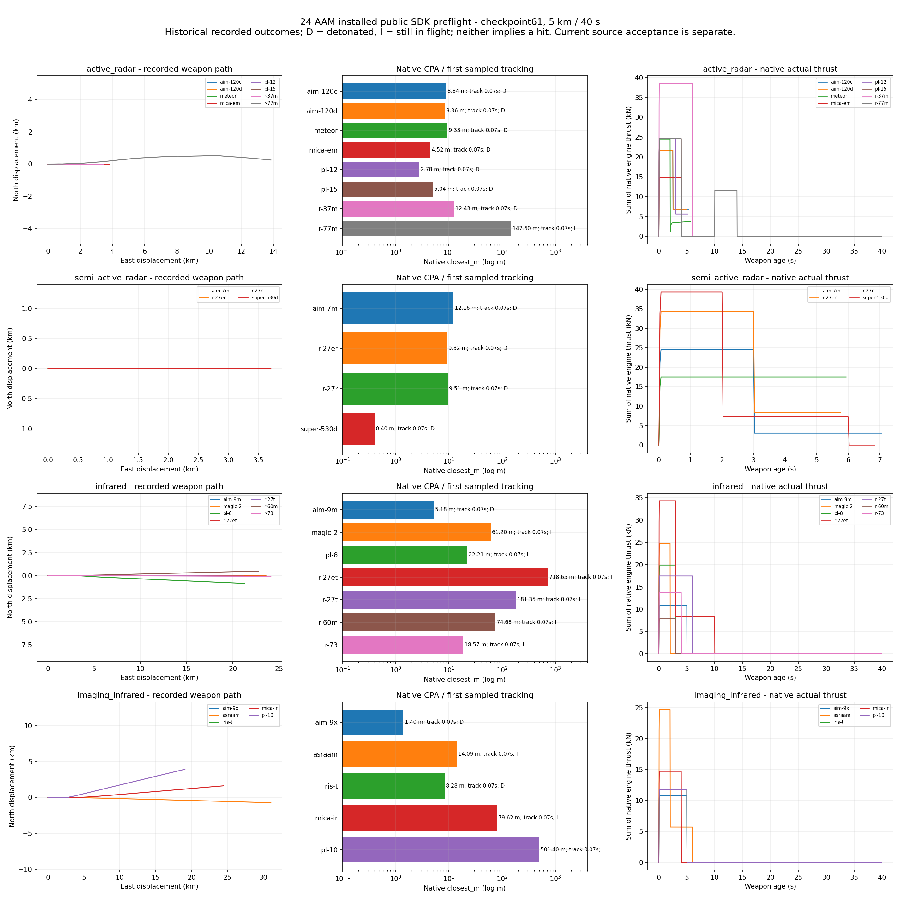

# AAM model capability atlas

**Frozen baseline, 2026-11-02.** References to "current" source/cards below
describe the captured baseline epoch in the companion JSON. Recorded outcomes,
model-order descriptions and hashes remain historical and do not validate later
source bytes. The implemented continuation is documented in the
[thermal receiver](../../../sdk/weapon-thermal-image.md),
[RF receiver](../../../sdk/weapon-radio-receiver.md) and
[body-IMU strapdown](../../../sdk/weapon-navigation-strapdown-v2.md) contracts.
Current all-model, installed and visual acceptance remains separate; this atlas
supplies no completion or equipment-calibration credit.

Installed public SDK preflight recorded at checkpoint61, before final source/campaign acceptance. Current card/source descriptions are separately hashed and are not retroactively validated by these historical runs.

The JSON retains every component descriptor and every referenced parameter value, unit, basis, uncertainty, note and source. The CSV is a compact per-model view. Source card capabilities and the historical SDK observations have independent hashes.

Population: **24 AAM cards**, 52 verified raw records (24 one-worker + 24 four-worker + 2 long-range + 2 launcher-loss). Current cards match checkpoint61 coverage hashes for **3/24** models. Matching a card does not certify a newer DLL.

## Recorded 5 km observations

D = native detonation; I = still in flight at the fixed 40 s horizon. These labels do not assert a hit or a kill. First track is a sampled flag, not contact-identity confirmation. Every record preserves its raw SHA-256 in JSON/CSV.

| Model | Sensor | Selected carrier/station | Fit scope | CPA m | First track age s | Terminal | Peak Mach | Feedback |
|---|---|---|---|---:|---:|---|---:|---:|
| AIM-120C-7 AMRAAM | active_radar | ea18g/5 | Authored loadout | 8.837 | 0.067 | detonated | 2.263 | 0 |
| AIM-120D AMRAAM | active_radar | f16c/1 | Compatibility diagnostic only | 8.361 | 0.067 | detonated | 2.235 | 22 |
| AIM-7M Sparrow | semi_active_radar | fa18c/4 | Authored loadout | 12.163 | 0.067 | detonated | 1.963 | 0 |
| AIM-9M Sidewinder | infrared | f15c/1 | Authored loadout | 5.184 | 0.067 | detonated | 2.979 | 0 |
| AIM-9X Block I Sidewinder | imaging_infrared | f16c/2 | Authored loadout | 1.400 | 0.067 | detonated | 3.044 | 0 |
| AIM-132 ASRAAM | imaging_infrared | typhoon/1 | Authored loadout | 14.090 | 0.067 | in_flight | 3.581 | 0 |
| IRIS-T | imaging_infrared | gripen/1 | Authored loadout | 8.277 | 0.067 | detonated | 3.169 | 0 |
| R.550 Magic 2 | infrared | mirage2000/1 | Authored loadout | 61.201 | 0.067 | in_flight | 2.706 | 0 |
| Meteor | active_radar | gripen/2 | Authored loadout | 9.325 | 0.067 | detonated | 1.824 | 25 |
| MICA EM | active_radar | rafale/2 | Authored loadout | 4.518 | 0.067 | detonated | 2.587 | 0 |
| MICA IR | imaging_infrared | rafale/1 | Authored loadout | 79.616 | 0.067 | in_flight | 2.583 | 0 |
| PL-10 | imaging_infrared | j20a/3 | Authored loadout | 501.396 | 0.067 | in_flight | 2.810 | 0 |
| PL-12 | active_radar | j10a/2 | Authored loadout | 2.782 | 0.067 | detonated | 2.350 | 0 |
| PL-15 | active_radar | j20a/4 | Authored loadout | 5.036 | 0.067 | detonated | 2.389 | 0 |
| PL-8 | infrared | j10a/1 | Authored loadout | 22.210 | 0.067 | in_flight | 2.533 | 0 |
| R-27ER | semi_active_radar | ea18g/5 | Compatibility diagnostic only | 9.315 | 0.067 | detonated | 1.939 | 0 |
| R-27ET | infrared | ea18g/5 | Compatibility diagnostic only | 718.647 | 0.067 | in_flight | 2.231 | 0 |
| R-27R | semi_active_radar | mig29a/3 | Authored loadout | 9.507 | 0.067 | detonated | 2.111 | 0 |
| R-27T | infrared | ea18g/5 | Compatibility diagnostic only | 181.354 | 0.067 | in_flight | 2.127 | 0 |
| R-37M | active_radar | f16c/3 | Compatibility diagnostic only | 12.435 | 0.067 | detonated | 2.258 | 0 |
| R-60M | infrared | ea18g/5 | Compatibility diagnostic only | 74.683 | 0.067 | in_flight | 2.576 | 0 |
| R-73 | infrared | mig29a/1 | Authored loadout | 18.568 | 0.067 | in_flight | 2.558 | 0 |
| R-77M | active_radar | su57/5 | Authored loadout | 147.600 | 0.067 | in_flight | 2.367 | 0 |
| Super 530D | semi_active_radar | mirage2000/2 | Authored loadout | 0.403 | 0.067 | detonated | 2.032 | 0 |

## Physical and numerical configuration

All rows below refer to current source card parameters, not a recovered historical SDK card snapshot. `gimbal` is the inherited card pointing limit; `period/delay/rate` are the executing finite sensor parameters. Acquisition reference distance normalizes engineering signal assumptions and is not a V3 hard range gate. Each source link identifies the card; exact role-to-key mappings and full provenance are in JSON.

| Source card | Gimbal deg | Period / delay s | Servo rad/s | Native motor phases (s:kN) | Equivalent TVC | Fuze arm s / radius m | Warhead | Link |
|---|---:|---|---:|---|---|---|---|---|
| [aim-120c](../../../../assets/stores/aim-120c.json) | 60 | 0.02 / 0.01 | 6 | 2.5:22, 5.5:7; timed | not configured | 1 / 11.4721 | fragmentation | uplink |
| [aim-120d](../../../../assets/stores/aim-120d.json) | 60 | 0.02 / 0.01 | 6 | 2.5:22, 6.5:7; timed | not configured | 1 / 11.4721 | fragmentation | two-way |
| [aim-7m](../../../../assets/stores/aim-7m.json) | 60 | 0.02 / 0.01 | 6 | 3:25, 9:3.5; timed | not configured | 1 / 13.3166 | fragmentation | none |
| [aim-9m](../../../../assets/stores/aim-9m.json) | 45 | 0.02 / 0.01 | 6 | 5:11; timed | not configured | 1 / 10.0708 | fragmentation | none |
| [aim-9x](../../../../assets/stores/aim-9x.json) | 45 | 0.02 / 0.01 | 6 | 5:11; timed | 0.175rad / 4rad/s | 1 / 10.0594 | fragmentation | none |
| [asraam](../../../../assets/stores/asraam.json) | 45 | 0.02 / 0.01 | 6 | 2:25, 4:6; timed | not configured | 1 / 10.1623 | fragmentation | none |
| [iris-t](../../../../assets/stores/iris-t.json) | 45 | 0.02 / 0.01 | 6 | 5:12; timed | 0.175rad / 4rad/s | 1 / 10.3764 | fragmentation | none |
| [magic-2](../../../../assets/stores/magic-2.json) | 45 | 0.02 / 0.01 | 6 | 2:25; timed | not configured | 1 / 10.5637 | fragmentation | none |
| [meteor](../../../../assets/stores/meteor.json) | 60 | 0.02 / 0.01 | 6 | 2:25, 25:3; atmosphere-fed cycle | not configured | 1 / 10.4641 | fragmentation | two-way |
| [mica-em](../../../../assets/stores/mica-em.json) | 60 | 0.02 / 0.01 | 6 | 4:15; timed | 0.175rad / 4rad/s | 1 / 10.4641 | fragmentation | uplink |
| [mica-ir](../../../../assets/stores/mica-ir.json) | 45 | 0.02 / 0.01 | 6 | 4:15; timed | 0.175rad / 4rad/s | 1 / 10.4641 | fragmentation | uplink |
| [pl-10](../../../../assets/stores/pl-10.json) | 45 | 0.02 / 0.01 | 6 | 5:12; timed | not configured | 1 / 10.3166 | fragmentation | none |
| [pl-12](../../../../assets/stores/pl-12.json) | 60 | 0.02 / 0.01 | 6 | 3:25, 6:6; timed | not configured | 1 / 11.4721 | fragmentation | uplink |
| [pl-15](../../../../assets/stores/pl-15.json) | 60 | 0.02 / 0.01 | 6 | 4:25, 6:0, 4:12; commanded reserve | not configured | 1 / 11.7434 | fragmentation | uplink |
| [pl-8](../../../../assets/stores/pl-8.json) | 45 | 0.02 / 0.01 | 6 | 3:20; timed | not configured | 1 / 10.3166 | fragmentation | none |
| [r-27er](../../../../assets/stores/r-27er.json) | 60 | 0.02 / 0.01 | 6 | 3:35, 7:9; timed | not configured | 1 / 13.245 | rod connected ring | uplink |
| [r-27et](../../../../assets/stores/r-27et.json) | 45 | 0.02 / 0.01 | 6 | 3:35, 7:9; timed | not configured | 1 / 13.245 | rod connected ring | none |
| [r-27r](../../../../assets/stores/r-27r.json) | 60 | 0.02 / 0.01 | 6 | 6:18; timed | not configured | 1 / 13.245 | rod connected ring | uplink |
| [r-27t](../../../../assets/stores/r-27t.json) | 45 | 0.02 / 0.01 | 6 | 6:18; timed | not configured | 1 / 13.245 | rod connected ring | none |
| [r-37m](../../../../assets/stores/r-37m.json) | 60 | 0.02 / 0.01 | 6 | 6:40, 10:0, 6:15; commanded reserve | not configured | 1 / 14.746 | fragmentation | uplink |
| [r-60m](../../../../assets/stores/r-60m.json) | 45 | 0.02 / 0.01 | 6 | 3:8; timed | not configured | 1 / 8.87083 | rod | none |
| [r-73](../../../../assets/stores/r-73.json) | 45 | 0.02 / 0.01 | 6 | 4:14; timed | not configured | 1 / 9.72029 | rod | none |
| [r-77m](../../../../assets/stores/r-77m.json) | 60 | 0.02 / 0.01 | 6 | 4:25, 6:0, 4:12; timed | not configured | 1 / 11.7434 | rod | uplink |
| [super-530d](../../../../assets/stores/super-530d.json) | 60 | 0.02 / 0.01 | 6 | 2:40, 4:8; timed | not configured | 1 / 12.4772 | fragmentation | none |

The current equivalent nozzle is explicitly configured only where the autopilot descriptor binds `thrust_vector=jsbsim_nozzle_v1`; hardware wording alone is not execution. Native fin limits, mixer coefficients, mirrored geometry and each authored control surface are retained per model in JSON. Fin force/moment curves, finite actuators and optional nozzle forces act through native flight dynamics. R-77M uses the operating-point constrained control path; its actual geometry and finite bounds remain authoritative.

Meteor phase table values above are authored inputs: actual sustainer thrust is computed by the atmosphere-fed cycle, and must not be interpreted as constant 3 kN. PL-15/R-37M alone use commanded pulse reserve; R-77M retains its authored timed dual-pulse schedule.

## Fin mechanics and measured actuator response

Limits and lag/rate below describe current source. Peak movement and fin count come from the historical one-worker raw diagnostics and are not current-binary validation. Zero or small movement is retained without implying authority at every flight condition.

| Model | Current authored fin stops deg | Current lag s / rate rad/s | Recorded native fins | Peak recorded absolute fin deg |
|---|---|---|---:|---:|
| aim-120c | [-20, 20] | 0.04 / 4 | 4 | 14.402 |
| aim-120d | [-20, 20] | 0.04 / 4 | 4 | 14.408 |
| aim-7m | [-20, 20] | 0.04 / 4 | 4 | 5.830 |
| aim-9m | [-20, 20] | 0.04 / 4 | 4 | 7.656 |
| aim-9x | [-20, 20] | 0.04 / 4 | 4 | 5.345 |
| asraam | [-20, 20] | 0.04 / 4 | 4 | 5.952 |
| iris-t | [-20, 20] | 0.04 / 4 | 4 | 5.171 |
| magic-2 | [-20, 20] | 0.04 / 4 | 4 | 10.380 |
| meteor | [-20, 20] | 0.04 / 4 | 4 | 20.000 |
| mica-em | [-20, 20] | 0.04 / 4 | 4 | 2.759 |
| mica-ir | [-20, 20] | 0.04 / 4 | 4 | 4.592 |
| pl-10 | [-20, 20] | 0.04 / 4 | 4 | 20.000 |
| pl-12 | [-20, 20] | 0.04 / 4 | 4 | 7.472 |
| pl-15 | [-20, 20] | 0.04 / 4 | 4 | 20.000 |
| pl-8 | [-20, 20] | 0.04 / 4 | 8 | 20.000 |
| r-27er | [-20, 20] | 0.04 / 4 | 8 | 15.586 |
| r-27et | [-20, 20] | 0.04 / 4 | 8 | 11.355 |
| r-27r | [-20, 20] | 0.04 / 4 | 8 | 11.454 |
| r-27t | [-20, 20] | 0.04 / 4 | 8 | 7.870 |
| r-37m | [-20, 20] | 0.04 / 4 | 4 | 20.000 |
| r-60m | [-20, 20] | 0.04 / 4 | 4 | 8.811 |
| r-73 | [-20, 20] | 0.04 / 4 | 8 | 9.092 |
| r-77m | [-20, 20] | 0.04 / 4 | 4 | 20.000 |
| super-530d | [-20, 20] | 0.04 / 4 | 4 | 13.802 |

Exact source roles are `actuator.parameter_refs.lag_s`, `actuator.parameter_refs.rate_rad_s`, `autopilot.parameter_refs.tvc_limit_rad` and `tvc_rate_rad_s` when present, plus each design `surface[i].controls[j].limits/channel/mix`. The JSON resolves those roles to the full parameter record; native diagnostic actual/demand angles remain separate.

## Shared assumptions and differentiation

The finite V3 sensor period is 0.02 s and processing delay is 0.01 s for all 24 current cards; gimbal rate is 6 rad/s for all 24. These are shared engineering assumptions, not 24 independent hardware measurements. Family-specific association, RF versus passive IR observables, source signatures, card reach normalization, guidance load/loft limits, native motor phase tables, geometry, fin mixing, warhead/explosive masses and fitted link direction differ. The JSON `parameter_comparison` lists the exact values and model groups for every common role, including unchanged values.

The `imaging_infrared` association family does not establish a full image-plane focal-array/recognition simulation. SARH uses the actual illuminator path and frequency with a declared monostatic-RCS bistatic proxy where no bistatic table exists. Signal/noise, IR spectrum, clutter, servo, false-alarm and covariance parameters carry disclosed assumed uncertainty; real receiver performance remains uncalibrated.

## Supplemental 30 km pulse evidence

| Case | Model | CPA m | Native second ignition age s | Actual second-pulse thrust | Terminal |
|---|---|---:|---:|---|---|
| long_range | pl-15 | 8.587 | 26.600 | True | detonated |
| long_range | r-37m | 7.968 | 27.633 | True | detonated |
| launcher_loss | pl-15 | 8.723 | 26.600 | True | detonated |
| launcher_loss | r-37m | 8.019 | 27.667 | True | detonated |

The launcher-loss cases remove the launcher after the declared delay; surviving autonomous navigation and native second-pulse thrust are recorded. The radio remains closed rather than inventing a new owner or return link. These supplemental records do not make short 5 km shots reserve-pulse validation.

## Production mechanism map

- [src/simulation/mission_systems/components/implementations/seeker/EngineeringSeekerV3.cpp](../../../../src/simulation/mission_systems/components/implementations/seeker/EngineeringSeekerV3.cpp): Finite stabilized pointing, scheduled exposures, delay, noise and thresholded detection; RF radar equation and SARH illumination legs; IR band radiometry and extinction; unassociated noise contacts are not target identities. Source anchors: `EngineeringSeekerV3::sample`, `sourceAspectCosineV3`, `rfSnr`, `irSnr`, `bandFraction`, `detectionProbability`.
- [src/simulation/mission_systems/components/implementations/guidance/MeasuredPnGuidanceV2.cpp](../../../../src/simulation/mission_systems/components/implementations/guidance/MeasuredPnGuidanceV2.cpp): Measured terminal directions and original-epoch admitted launcher estimates; no passive target range invented. Source anchors: `MeasuredPnGuidanceV2::updateMeasured`.
- [src/simulation/runtime/world/WorldEngagements.cpp](../../../../src/simulation/runtime/world/WorldEngagements.cpp): Native scene physics, actual body source aspect and frequency-specific RCS; delayed attribution uses captured epoch. Source anchors: `World::prepareEngagements`, `World::sampleOnRailSeeker`.
- [src/simulation/mission_systems/weapon/OperatingPointControlV1.cpp](../../../../src/simulation/mission_systems/weapon/OperatingPointControlV1.cpp): Operating-point actuator-aware constrained prediction and bounded nonlinear sequential allocation; physical native fin response remains authoritative. Source anchors: `operatingPointCommandsV1`, `predict`, `sequential`, `faceStep`.
- [src/simulation/runtime/world/World.cpp](../../../../src/simulation/runtime/world/World.cpp): Admitted native actuator state, actual aerodynamic control curves, inertia, nozzle force and moments feed control. Source anchors: `World::preStep`.
- [tools/models/hangar/hangar/thrustvector.py](../../../../tools/models/hangar/hangar/thrustvector.py): Explicit equivalent axial nozzle; finite angular rate and stops; native propulsion owns force and torque. Presence is descriptor-bound, not inferred from hardware prose. Source anchors: `inputs`, `install`.
- [tools/models/hangar/hangar/storecontrol.py](../../../../tools/models/hangar/hangar/storecontrol.py): Generated physical fin mixing and native control metadata; exact symbol availability is indexed separately below. Source anchors: `_operating_point`.
- [src/simulation/mission_systems/weapon/PulseManagerV1.cpp](../../../../src/simulation/mission_systems/weapon/PulseManagerV1.cpp): PL-15/R-37M explicitly opt in; reserve policy uses own navigation velocity and admitted seeker timing, native age and fuel. Original phase impulse remains native. Source anchors: `fsim/commanded-dual-pulse-v1`, `pulseInputsValid`.
- [src/simulation/runtime/world/WorldWeaponControls.cpp](../../../../src/simulation/runtime/world/WorldWeaponControls.cpp): No native true-airspeed fallback; own-navigation ground-relative speed supplies reserve policy. Source anchors: `World::applyWeaponPulseV1`.
- [cmake/JsbsimPatches.cmake](../../../../cmake/JsbsimPatches.cmake): Opt-in one-shot native pulse latch, age and finite fuel/energy guards. Legacy timed models retain their normal schedule. Meteor cycle generation is separate. Source anchors: `fsim/commanded-dual-pulse-v1`, `pulseInputsValid`.
- [tools/models/hangar/hangar/ductedrocket.py](../../../../tools/models/hangar/hangar/ductedrocket.py): Separate native booster and fuel-fed sustainer; captured airflow, heating value, pressure/combustion losses, fuel-valve lag/rate and net momentum thrust. Ideal-gas equivalent cycle, not a proprietary measured map. Source anchors: `inputs`, `cycle`, `install`.
- [src/simulation/mission_systems/weapon/FuzeAdapter.cpp](../../../../src/simulation/mission_systems/weapon/FuzeAdapter.cpp): Swept captured motion and separate arming/contact/proximity mechanisms; detonation is not evidence of damage. Source anchors: `makeFuzeAdapter`.
- [src/simulation/mission_systems/damage/Damage.cpp](../../../../src/simulation/mission_systems/damage/Damage.cpp): One finite physical fragment/ring population, captured victim motion, sequential material crossings, drag and blast; connected-ring topology is explicit. Source anchors: `emitFragmentFieldV1`, `assessSceneV1`.
- [src/simulation/runtime/world/WorldDamage.cpp](../../../../src/simulation/runtime/world/WorldDamage.cpp): Physical bursts continue over captured native intervals, including after the source weapon is removed; outcome/source identity remains native. Source anchors: `World::detonateAt`, `World::advanceDetonationEffects`.
- [src/simulation/mission_systems/weapon/WeaponLink.cpp](../../../../src/simulation/mission_systems/weapon/WeaponLink.cpp): Private endpoint-bound modeled RF delay, capacity, loss and assessment lifecycle; preserves generic DMS layout. Source anchors: `WeaponChannelV1`.
- [src/simulation/runtime/world/WorldWeaponLinks.cpp](../../../../src/simulation/runtime/world/WorldWeaponLinks.cpp): Exact variant/carrier direction profiles; accepted delivered platform Fusion feeds updates; live autonomous navigation survives launcher loss while communication closes. Source anchors: `World::bindWeaponLinkV1`, `World::sampleWeaponLinkV1`.
- [src/simulation/mission_systems/weapon/NavigationV1.cpp](../../../../src/simulation/mission_systems/weapon/NavigationV1.cpp): Resolved ECEF position/velocity inertial-error propagation with held sampled white acceleration error, bias walk, exact ZOH covariance and optional Joseph GNSS update; not full strapdown attitude/gyro mechanization. Source anchors: `NavigationV1::advance`, `NavigationV1::estimate`.

## Shared radio policy

`include/fsim/WeaponLink.h::WeaponLinkProfileV1` declares 0.2 s update/report cadence, 0.05 s latency, 64,000 bit/s, 1 GHz, 200 km nominal clear-path envelope, 0.5 s queue bound, 2 s information age and 5 s assessment timeout. Queue/report/assessment capacities are 64/128/16; terminal retention is 30 s. Default stochastic loss and jitter are zero; path blockage and finite scheduling still apply. These shared engineering values are not measured AIM-120D or Meteor link specifications. Exact variant/carrier direction alone is sourced.

## Navigation and primary-reference check

`NavigationV1` propagates own resolved ECEF acceleration with finite sampled inertial errors, per-axis position/velocity/bias/held-white-error covariance, exact zero-order-hold propagation and optional GNSS Joseph updates. Initialization and admitted GNSS exposures use noisy ownship position/velocity; unaided propagation cannot reset itself from later truth. AIM-120D alone currently enables GNSS aiding; family membership does not grant it. Shared engineering defaults are 0.01 s IMU and 1 s GNSS exposures, acceleration noise density 0.03 m/s^2 sqrt(s), initial acceleration-bias sigma 0.01 m/s^2, bias-walk density 0.0001 m/s^2/sqrt(s), release position/velocity sigmas 5 m / 0.5 m/s, and GNSS sigmas 3 m / 0.1 m/s. The method document records nonzero screening intervals. This is a resolved inertial-error model, not full strapdown INS or a complete missile IMU. It omits gyro/attitude mechanization and its associated error coupling.

- [Harkegard (2002), Efficient Active Set Algorithms for Solving Constrained Least Squares Problems in Aircraft Control Allocation](https://rt.isy.liu.se/research/reports/2002/2426.pdf): Primary university-hosted author paper, title and abstract checked. Actuator position/rate constrained least squares is a standard allocation formulation; this paper does not establish global stability of this simulator or a missile fit.
- [Johansen, Fossen and Berge (2004), Constrained Nonlinear Control Allocation with Singularity Avoidance using Sequential Quadratic Programming](https://www.fossen.biz/publications/2004%20Johansen%20et%20al%20TCST.pdf): Primary author-hosted paper checked. Local convex quadratic subproblems approximate a nonlinear allocation problem; its illustrated marine application is not missile calibration.
- [PX4 official Control Allocation documentation](https://docs.px4.io/main/en/concept/control_allocation): Official open-source project documentation checked. Geometry-specific torque/thrust-to-actuator translation is separate from the core rate controller. This is an architectural comparison, not a claim that PX4 code is used here.
- [Sola (2017), Quaternion kinematics for the error-state Kalman filter](https://arxiv.org/abs/1711.02508): Primary author paper checked. Rotation/quaternion error-state treatment explains part of full IMU estimation that the current resolved ECEF navigation model deliberately does not implement.
- [PX4 official Using the Navigation Filter (EKF2)](https://docs.px4.io/main/en/advanced_config/tuning_the_ecl_ekf): Official documentation checked. Its body-fixed delta-angle/delta-velocity inputs, quaternion and gyro-bias states provide a concrete contrast with the current resolved acceleration error model.

Literature was checked from primary author/university or official project sources. It supports the method context and the distinction between constrained allocation, resolved navigation error and full attitude-aware estimation; it supplies no validation of this simulator's proprietary missile constants.

## Evidence limits

- Installed public SDK preflight recorded at checkpoint61, before final source/campaign acceptance. Current card/source descriptions are separately hashed and are not retroactively validated by these historical runs.
- Historical checkpoint61 SDK DLL/module provenance is bound by checkpoint61-installed.json and checkpoint61-fleet.json; current source production hashes do not establish binary identity with that historical SDK.
- Current card and checkpoint61 coverage hash differences are explicitly listed; the old data must not be used as final validation of newer card/source bytes.
- The preflight uses non-isolated Referee diagnostic metrics. Actor inputs remain public Agent/C2 paths. Truth metrics in this atlas must not populate actor observations.
- The 5 km scene is a fixed test scenario, not a uniform aircraft installation or an equipment range/lethality comparison. Compatibility-only selected carriers are labeled individually.
- Closest_m is the native recorded closest-approach metric. Detonated is a native terminal report, not a hit/kill/calibration assertion. In-flight at 40 s is retained as an observation horizon outcome.
- Acquired/first tracking does not certify contact identity. All models were exposed to the same declared countermeasure exercise; one scene cannot validate real ECCM.
- Shared finite receiver cadence, servo/noise/radiometric settings and other assumed constants are not exact fitted hardware. Parameter-level basis, uncertainty, source and note are retained in the JSON.
- No actual image-plane reconstruction, imaging target recognition, proprietary waveform, equipment covariance, measured motor map or full-envelope calibration is established merely by an imaging/RF family label.
- R-73 authored hardware prose mentions thrust vectoring, but its current autopilot descriptor does not bind the equivalent native nozzle. This atlas reports it as not configured, not an implemented TVC claim.
- R-77M has authored dual-pulse thrust phases on a native timed schedule; it does not opt into the PL-15/R-37M commanded reserve policy.
- AIM-120D/F-16 and Meteor/Gripen are the only exact two-way profiles here. Other return capabilities remain unsupported. RF payload, timing, capacity and loss settings are engineering assumptions.
- Navigation is a resolved ECEF inertial-error model, not full strapdown INS: no gyro/attitude integration, coning/sculling, attitude misalignment or separately estimated gravity/Earth-rate mechanization. Optional GNSS is enabled only for AIM-120D. Full hardware INS error is unvalidated.
- No global closed-loop stability, proprietary calibration, real-world probability of kill or superiority over another simulator is inferred from these records. Final cold source/build/install/visual campaign acceptance is separate.

## Provenance

| Receipt | SHA-256 |
|---|---|
| build/architecture-reviews/sim-m03-complete-20261102/checkpoint61-fleet.json | `ad05c74eb0add6f6c7c72a62f0dd4f554efe8803bbdaa4b8f5cc164727ff848d` |
| build/architecture-reviews/sim-m03-complete-20261102/checkpoint61-coverage.json | `825a242f6f73b49f4cc255ad59d7afa8583a311c059312aeb9929070058451f4` |
| build/architecture-reviews/sim-m03-complete-20261102/checkpoint61-installed.json | `13b38d75a8ea22bea4347cc37c264e1ca3b4f150c3e888a2f8e83d978d37c094` |

The JSON additionally hashes every current card, authored design and production source cited here. All original raw records are read-only. Artifact preparation used standard NumPy/Matplotlib from D:/ENV; no simulation, native build or GUI run was performed.
