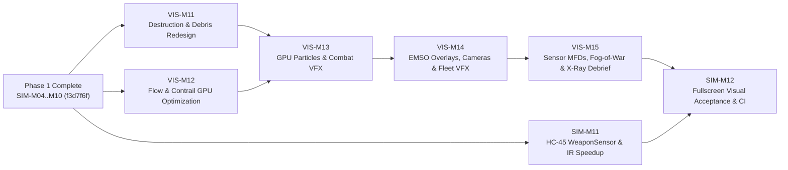

# Phase 2 Roadmap: Destruction Redesign, VFX & Visualization Performance, Visual Expansion, and Simulation Runtime Optimization

Date: 2026-11-26
Baseline: `main` at `f3d7f6f` (Phase 1 simulation roadmap **SIM-M04 → SIM-M10** complete and pushed)
Status: **Approved & Active** (user confirmed full scope including VIS-M15 visual showcase; physical-desktop visual testing unblocked via global `desktop-gui` MCP on `WinSta0\Default`)

---

## 1. Executive Summary & Architectural Diagnosis

Phase 1 (**SIM-M01 → SIM-M10**) established the complete native simulation core: 6-DOF JSBSim flight dynamics, signal-level radars & track fusion, 24/24 flyout-derived DLZ/WEZ tables, RF electronic attack/ESM/COMINT, 19/19 optical/IR/LRF sensors, 18/18 MS-11 families, external OMS/A-GRA/UCI adapter, 1v1/4v4 autonomous encounters, 11/11 aircraft guns with B-33 mass conservation, B-37 loaded-store RCS, and B-50 Mk 82 ballistic cross-checking.

A code-level audit of the current simulation runtime and Vulkan/VSG Viewer reveals **four high-impact bottlenecks and architectural defects** that Phase 2 must resolve before formal upper-layer MA/DRL integration and production visual acceptance:

| Area | Current Root Cause (Verified in Source) | User-Visible Symptom | Target Phase 2 Fix |
| --- | --- | --- | --- |
| **1. Vehicle Destruction & Breakup** | `World::separatedAt` / `World::launchPiece` (`src/simulation/runtime/world/WorldDamage.cpp:1635-1840`) spawns a **full JSBSim 6-DOF vehicle** per broken airframe section (`jsbsim:<aircraft>-<section>`), snaps cleanly along ≤5 pre-cut section seams ("Lego-block breakup"), lacks mid-air fuel-ullage / sympathetic weapon cook-off (`B-58`), lacks spark/shrapnel/debris clouds (`B-55`), and freezes ground-impact wrecks at 1 m penetration (`B-54`). | Artificial floating wing/tail chunks, sudden vehicle-slot/XML load hitches, no catastrophic mid-air explosion or burning tumbling debris field, poor ground crash slide/wreckage. | **VIS-M11 (Destruction & Debris Redesign)**: Retire `jsbsim:<piece>` breakup vehicles; introduce a deterministic lightweight 6-DOF tumbling rigid-body debris system (`DebrisField`), multi-tier destruction states (damaged → breakup → catastrophic mid-air ullage/cook-off disintegration → ground skid/crater/burning hull), and GPU spark/shard/scorch VFX. |
| **2. Explosions, Fire & Smoke Lag** | `FlowSolver.cpp:124,142` runs NVIDIA Flow on a **separate Vulkan device** (`enableExternalUsage = NV_FLOW_FALSE`) with full **CPU NanoVDB readback** (`readbackEnabled = NV_FLOW_TRUE`), CPU repacking (`FlowVolumes::pack`), and full 3-D atlas re-upload (`FlowVolumes.cpp:529`, `B-61`). `flow.frag:21-24,97-119` draws pages **back-to-front** at native 4K with up to `160 × (1 + 5 + 3) = 1,440` sparse 3-D texture lookups per pixel per overlapping page (`B-60`), retains ghost leaves (`keepSpeed`), has no ground boundary (`B-53`), and stalls on first pipeline use (`B-62`). | Severe frame-rate drops and 9–13 ms stutter spikes during explosions and large fuel fires; ground fires clip through terrain. | **VIS-M12 (Volumetric Fire/Explosion & Contrail Performance)**: Shared-device Vulkan GPU interop (zero CPU readback/re-upload), front-to-back offscreen volumetric pass with early ray termination + bilateral depth-aware upsampling, precomputed 3-D shadow/transmittance light grid, terrain/ground collision & pool spread (`B-53`), and startup pipeline warm-up (`B-62`). |
| **3. Contrails, Smoke & Vapour Lag** | `contrail.frag:35,173-200` runs a **4-part full-resolution raymarch** (`10+10+6+10 = 36` steps + 8-octave Henyey-Greenstein + 3-D noise) on every overlapping trail segment for contrails, missile smoke, fires, and fuel mist with zero distance LOD; `Airflow.cpp:705-760` reallocates sample vectors and re-uploads buffers every frame; `Trails.cpp:63-79` does $O(N)$ `erase(begin())` + full vertex rewrite. | Severe GPU fill-rate collapse when multiple jets, missiles, and burning trails overlap on screen. | **VIS-M12**: Shared half-res volumetric buffer + depth-aware bilateral upsample for `Airflow` & `FlowVolumes` & `WingVapour`, screen-space projected-width LOD (analytic ribbon/billboard beyond distant threshold, full volumetric close-up), ring-buffered GPU SSBO updates (zero per-frame heap churn), and early transmittance cutoff. |
| **4. Missing Combat VFX, Tactical Visualization & Runtime Hotspots** | SIM-M05→M10 added guns, flares/chaff, jamming, optical/IR, SAR/weather, and Mode 5 IFF, but the Viewer draws **no gun tracers/muzzle flashes/impacts**, **no countermeasure flare/chaff visuals**, **no tactical sensor/link/DLZ overlays**, and misses rotorcraft/prop effects (`B-59`) & 8-engine exhaust (`B-57`). On the simulation side, **HC-45** serial `WeaponSensor` & on-rail IR reticle rasterization drop 2-missile / IR-loadout 4v4 RTF to `0.29x–0.47x`. | Invisible bullets/flares/chaff in engagements; limited tactical situational awareness in Viewer; slow multi-missile/IR-loadout simulation steps. | **VIS-M13 (Combat VFX & GPU Particle System)**, **VIS-M14 (Tactical Overlays, Camera Suite & Fleet VFX Parity)**, **SIM-M11 (HC-45 Parallel WeaponSensor & IR Reticle Acceleration)**, and **SIM-M12 (Visual Acceptance, CI & Calibration Ledger)**. |

---

## 2. Guiding Architectural Principles (Non-Negotiable)

1. **SDK Remains Sole Simulation Authority**: All destruction triggers, component failures, ullage/cook-off detonations, projectile hits, flare/chaff trajectories, sensor tracks, and link deliveries originate in `fsim::session::World` and flow across versioned additive IPC/recording schemas. The Viewer never invents hits, explosions, or sensor truth.
2. **Real-Time Fullscreen Performance Budget**: Target **≥ 60 FPS sustained (≥ 120–160 FPS target on desktop RTX-class GPUs) at primary display resolution (up to 3840×2160) with zero 15 ms+ hitch spikes**, while keeping full Earth imagery, terrain, clouds, sunlight, shadows, contrails, and volumetric explosions enabled.
3. **Zero ABI / Permission Regressions**: Preserve `WorldLayout v9` backward compatibility (additive sidecars/events only), frozen C/C++/Python ABI, `fsim::Agent` `truth == 0` boundaries, and `sdk_boundary` 0-error compliance.
4. **Public Literature & Open-Source Reference Alignment**: Align every new VFX, debris, and performance subsystem with established graphics/physics literature and mature open-source methods (NVIDIA Flow external-device interop, Frostbite/Guerrilla Games froxel & half-res bilateral volumetric compositing, Jolt/Bullet rigid-body tumbling aero drag, MIL-HDBK-2069 / Ball aircraft survivability & ullage overpressure, OpenSceneGraph/VSG indirect GPU particles).
5. **Physical-Desktop Fullscreen Visual Verification Loop (`desktop-gui` MCP)**: All visual milestones (`VIS-M12`, `VIS-M11`, `VIS-M13`, `VIS-M14`, `VIS-M15`, `SIM-M12`) execute real-time (`1x`), fullscreen, primary-display (`3840×2160` on host NVIDIA GeForce RTX 5070 Ti) Vulkan runs via the interactive-desktop **`desktop-gui` MCP** (`WinSta0\Default`, DXGI Desktop Duplication `dxcam-dxgi`, single GUI slot) with complete scene layers enabled (Earth imagery, terrain, clouds, sunlight, aircraft shadows, exhaust, contrails, and Flow explosions/smoke). Every visual sprint records before/after `--stats` GPU pass timings and reviewed 4K captures rather than relying on offscreen-only smoke checks.

---

## 3. Phase 2 Milestone Roadmap Overview

| Milestone | Title | Priority | Primary Focus | Backlog / Carryover Closed |
| --- | --- | --- | --- | --- |
| **VIS-M11** | **Vehicle Destruction & Lightweight Debris Architecture Redesign** | **P0** | Replace `jsbsim:<piece>` Lego-split with multi-tier physical destruction (damaged → fracture → catastrophic mid-air ullage/cook-off disintegration → ground skid/wreck) + deterministic 6-DOF tumbling rigid-body `DebrisField` + scorch/shrapnel/spark visuals | **B-54**, **B-55**, **B-58** |
| **VIS-M12** | **Volumetric Fire/Explosion & Contrail/Trail GPU Optimization** | **P0** | Eliminate Flow CPU readback via Vulkan external-device interop; front-to-back offscreen volumetric pass + half-res depth-aware bilateral upsample; precomputed shadow volume; distance-adaptive contrail LOD + ring-buffer SSBOs; Flow ground collision & pool spread; startup shader warm-up | **B-52**, **B-53**, **B-60**, **B-61**, **B-62**, **B-63** |
| **VIS-M13** | **Unified GPU Particle Engine & Missing Combat VFX** | **P1** | Compute-driven GPU particle/ribbon renderer for gun tracers, muzzle flash, armour/skin impact sparks, high-velocity burning debris embers, pyrotechnic IR flares (bright core + corkscrew smoke trail), chaff cloud bursts, sonic shockwave rings, and ground dust/water splash plumes | New SIM-M05→M10 visual parity |
| **VIS-M14** | **Tactical Visualization Overlays, Multi-Camera Suite & Fleet VFX Parity** | **P1** | Toggleable 3-D tactical & EMSO overlays (radar scan cones, EA jamming & burn-through cones, ESM CRLB triangulation ellipsoids, Link 16/Mode 5 IFF pulses, 3-D DLZ/WEZ envelopes, SAR/weather swaths), multi-camera director suite (chase/weapon-cam/cockpit HUD/PiP), rotorcraft & prop VFX, 8-engine B-52H exhaust, high-DPI MonitorGui | **B-43**, **B-57**, **B-59** |
| **VIS-M15** | **Physical-Fidelity Showcase: Live Sensor MFDs, Fog-of-War Split-View & X-Ray/Debrief** | **P1** | Turn Phase 1's hidden physics into visual crown jewels: live cockpit/tactical **MFD Suite** (FCR B-Scope with jammer strobes/notch, RWR threat ring, HSD/Link 16, SMS/CG shift, live **EO/IR/EOTS thermal + LRF** pod view, **SAR/Weather** display, **live missile seeker-head PiP**), **Referee Truth vs. Strict Agent Fog-of-War** dual-reality view, **3-D RCS polar lobe / internal X-Ray cutaway** (tanks, CG, THOR penetration, `FragmentFieldV1` terminal replay), and **Tacview-grade `.fsrec` event-timeline debrief** | Full Phase 1 physics visual showcase |
| **SIM-M11** | **HC-45 Multi-Missile & IR Reticle Simulation Acceleration** | **P1** | Parallelize `WeaponSensor` across `VehiclePool` workers, optimize/cache `ThermalReticleReceiverV1` & on-rail seeker sampling (Standby early-out, frustum/LOD decimation, SIMD rasterization), pushing 4v4 + multi-missile + IR loadouts to ≥ `2x–5x` real-time with bit-identical determinism | **HC-45** |
| **SIM-M12** | **Whole-Program Fullscreen Visual Acceptance, CI & Calibration Closure** | **P2** | Execute physical-desktop fullscreen Vulkan visual acceptance across SIM-M01→VIS-M15 (statistical Flow/VFX image gates `B-63`), bring `.github/workflows/ci.yml` green (`B-65`), close remaining hangar/flight items (`B-32`, `B-34`, `B-48`, `B-64`), and advance empirical calibration ledger (`B-36`, `B-50`, `B-66`, `B-67`) | **B-63**, **B-65** + selective hangar/calibration |

---

## 4. Detailed Milestone Specifications

### VIS-M11 — Vehicle Destruction & Lightweight Debris Architecture Redesign

#### Problem Statement
Current destruction in `World::separatedAt` / `World::launchPiece` (`src/simulation/runtime/world/WorldDamage.cpp:1635-1840`) has four severe design flaws:
1. **Heavyweight JSBSim Child Vehicles**: Every broken section loads a separate JSBSim XML aircraft (`pieces/<ac>-<section>.xml`), allocates a full `VehiclePool` slot, runs 100 Hz full aerodynamics, and pollutes entity lists & IPC state.
2. **"Lego-Block" Visual Breakup**: Airframes snap cleanly into ≤5 intact-looking geometric sections (wing, tail, nose) with flat seam planes, capped at 60 m/s separation velocity (`kThrownMostMs`), looking rigid and unnatural.
3. **No Catastrophic Mid-Air Disintegration (`B-58`)**: Even a direct proximity-fuze hit from a 20 kg warhead or a fuel-tank vapour explosion cannot disintegrate an aircraft into a fireball + burning wreckage cloud; sympathetic store/magazine cook-off is absent.
4. **Abrupt Ground Impact Freeze (`B-54`, `B-55`)**: Ground crash fires only after 1.0 m penetration and freezes the fuselage instantaneously on the spot with no skid/slide, no water vs. soil distinction, and no burning wreck hull lifecycle.

#### Target Architecture & Deliverables
1. **Native Destruction State Machine (`src/simulation/mission_systems/damage/Destruction.h/.cpp`)**:
   - Extend `VehicleDamage` with explicit physical destruction tiers driven purely by native damage mechanics (never scripted):
     - **Tier 0 (`Intact`)**: Normal flight.
     - **Tier 1 (`Damaged`)**: Component failures, skin perforations, hydraulic/fuel leaks, localized fire trails; per-section damage intensity `0..1` published in additive visual damage sidecar for procedural scorching/charred-metal shader blending.
     - **Tier 2 (`StructuralBreakup`)**: Root overload or severe localized blast detaches 1–2 major structural assemblies + bursts 10–30 ragged fracture shards/sparks while degrading parent aerodynamics/mass smoothly **without spawning JSBSim child vehicles**.
     - **Tier 3 (`CatastrophicKill`)**: Triggered by fuel-tank ullage overpressure ignition (Ball survivability / hydrodynamic ram), centre-fuselage catastrophic overpressure, or sympathetic on-board weapon/ammo cook-off (`B-58`). Emits a high-energy detonation + fuel-mist fireball (`FlowVolumes`), a radial cloud of 30–80 tumbling burning debris fragments & embers, retires the intact aircraft mesh cleanly (no lingering whole Lego wings), and marks the vehicle destroyed in native `EngagementEvent`.
     - **Tier 4 (`GroundWreck` / `WaterImpact`)**: Replaces the 1.0 m penetration hard-stop (`B-54`) with gear/belly ground-contact detection -> sliding/tumbling Coulomb friction deceleration along terrain slope (or water entry deceleration & splash plume), progressive hull breakup on high-energy dive impacts, and a persistent charred wreck that draws down remaining fuel into a shrinking ground pool fire (`B-53`).
2. **Lightweight Deterministic 6-DOF Rigid-Body Debris Field (`src/simulation/runtime/world/DebrisField.h/.cpp`)**:
   - Replaces `launchPiece` JSBSim spawning with a fixed-capacity deterministic rigid-body pool (e.g., up to 512 active tumbling chunks across the world, zero JSBSim overhead, < 0.05 ms/step CPU).
   - Each debris body tracks ECEF position, velocity, unit quaternion orientation, angular velocity, mass, reference drag area (tumbling flat-plate / bluff-body $C_D \approx 1.0\text{–}1.3$ with aerodynamic pitch-tumbling torque), burning flag + remaining fuel burn time, and visual mesh/shard archetype (`airframe_hull`, `wing_fragment`, `panel_shard`, `burning_chunk`).
   - Publishes compact `ipc::DebrisRecordV1` sidecar frames (additive, zero break to `WorldLayout v9`) and records into `fsrec` for exact replay!
3. **Viewer Destruction Rendering (`VehicleVisuals` + Procedural Damage Shader)**:
   - Support per-section damage scorching/blackening and visibility bitmasks on the main aircraft shader (when a wingtip or tail shears off, hide that sub-mesh & reveal a charred fractured stub cap rather than spawning a duplicate clean glTF).
   - Render `DebrisField` chunks via instanced draw calls (1 draw call per shard archetype) with glowing hot edges & attached smoke/ember trails (routed to the lightweight GPU particle trail system rather than expensive per-shard Flow emitters!).
   - Optional pilot ejection sequence (canopy jettison + rocket seat + parachute) on `CrewLost == false` catastrophic/unrecoverable aircraft loss (visual-only or native state-coupled, strictly respecting `Agent` boundaries).

#### Acceptance Gates (VIS-M11)
- Zero `jsbsim:<piece>` vehicles spawned during mid-air kills or ground crashes; `VehiclePool` slot count stays constant during breakup.
- Deterministic unit + integration tests (`tests/simulation/test_destruction_debris.cpp`) verifying:
  - Tier 1 → Tier 2 → Tier 3 transitions on native `AIM-120C` / `M61A1` hits (ullage ignition, sympathetic store cook-off, mass/momentum conservation).
  - Ground belly-slide vs. steep dive impact outcomes (`B-54`, `B-55`) and fuel burn-down on burning wrecks.
  - Replay bit-identical `DebrisField` trajectories.
- Fullscreen visual capture verifying natural mid-air disintegration, tumbling burning debris field, and ground slide/fireball (no floating Lego wing artifacts).

---

### VIS-M12 — Volumetric Fire/Explosion & Contrail/Trail GPU Optimization

#### Problem Statement
Profiling and source inspection of `FlowSolver.cpp`, `FlowVolumes.cpp`, `flow.frag`, `Airflow.cpp`, and `contrail.frag` explain why explosions and contrails cause severe frame-rate drops and stutters:
1. **Flow Dual-Device + CPU Readback Bottleneck (`B-61`)**: `FlowSolver` creates its own Vulkan device (`enableExternalUsage = NV_FLOW_FALSE`), stalls on NanoVDB CPU readback (`readbackEnabled = NV_FLOW_TRUE`), repacks leaves on CPU threads into a 3-D atlas, and re-uploads the full 3-D texture to VSG's Vulkan device every frame.
2. **4K Back-to-Front Raymarch Explosion (`B-60`)**: `flow.frag` renders directly at full swapchain resolution (3840×2160) back-to-front with up to 160 steps × 9 sparse hash/atlas fetches per step per overlapping page — zero early occlusion across pages!
3. **4-Part Full-Res Contrail Raymarch (`Airflow.cpp` + `contrail.frag`)**: Every contrail, missile smoke, and fire-smoke segment marches 36 steps × 8 scattering octaves at native 4K resolution with no distance LOD and per-frame CPU vector churn.
4. **First-Use Shader/Upload Hitch (`B-62`) & Missing Ground Boundary (`B-53`)**: First launch/fire/vapour frame spikes 13–19 ms; ground fires pass through terrain.

#### Target Architecture & Deliverables
1. **NVIDIA Flow Zero-Copy Vulkan External-Device Interop (`src/visualization/vfx/flow/FlowSolver.cpp`)**:
   - Enable `NvFlowDeviceDesc::enableExternalUsage = NV_FLOW_TRUE` and initialize Flow on the **Viewer's existing Vulkan `VkDevice` / async compute queue** (using Flow's Vulkan external context API) — eliminating second-device GPU preemption (`B-61`) AND eliminating NanoVDB CPU readback/repack/re-upload completely!
   - Sample Flow's GPU-resident sparse virtual texture / NanoVDB buffer directly from the Viewer's volumetric shader (or perform a GPU-only compute pack directly into the render atlas with zero PCIe round-trip).
   - Add **tighter leaf-pruning & adaptive solver step throttling** (prune velocity-only invisible air blocks with `smoke < 1e-4 && temp < 1e-3`, cap distant fires at 30 Hz simulation with temporal interpolation, keeping active leaf count 3–5× lower without coarsening visible fire detail).
   - Add **ground-plane collision & spreading pool-fire boundary** (`B-53`) using Flow's collider emitter / plane boundary at local terrain elevation, sizing pool area physically from spilled fuel mass.
2. **Unified Half-Resolution Volumetric Render Pass + Depth-Aware Bilateral Upsample (`src/visualization/render/VolumetricPass.h/.cpp`)**:
   - Render **Flow fire/smoke**, **Airflow contrails/missile smoke**, and **WingVapour** into a shared **half-resolution (or configurable 0.5×–0.75×) offscreen RGBA16F volumetric target** (`premultiplied front-to-back under-blending`, `B-60`), then composite onto the full-resolution scene via a **depth-aware bilateral upsample + temporal anti-aliasing (TAA/reprojection)** pass (matching Frostbite / Guerrilla Games / Flight Simulator volumetric pipelines).
   - **Impact**: Immediately cuts fragment shading workload by **4×** at 4K while preserving razor-sharp aircraft silhouettes (via full-res depth edge rejection)!
3. **Precomputed Volumetric Lighting & Early-Out Raymarching (`flow.frag`, `contrail.frag`)**:
   - Replace the per-step `5 + 3 = 8` shadow raymarch loops inside `flow.frag` with a **single lightweight GPU compute pass** that pre-integrates sun & sky optical depth into a coarse 3-D light/transmittance grid once per Flow step (cutting per-step texture lookups from **9 → 1**, a **~6–8× shader speedup**!).
   - Switch `FlowVolumes` page ordering to **front-to-back** with `VK_BLEND_FACTOR_ONE_MINUS_DST_ALPHA` under-blending and hardware early-Z / stencil opaque-transmittance culling (`through < 0.01`), eliminating hidden back-page marching (`B-60`).
   - Add **distance-adaptive LOD** for `Airflow` contrails & missile trails (`contrail.frag`):
     - Close (`projectedWidthPx > 12`): full volumetric wake tubes + Crow wave + 3-D noise (half-res volumetric pass, early transmittance stop).
     - Medium (`3..12 px`): 2-part single-plume volumetric march (skipping resolved twin-tube & curtain passes, 4 scattering octaves).
     - Far (`< 3 px`): single-step analytic Gaussian extinction ribbon (1 lookup/pixel instead of 36!).
   - Replace per-frame `std::vector` churn in `Airflow.cpp` & `Trails.cpp` with fixed circular ring buffers (`B-52` also resolved cleanly with explicit nozzle/tip/CG attachment configuration) and dirty-range GPU buffer updates.
4. **Startup Pipeline & Descriptor Warm-Up (`B-62`)**:
   - Pre-compile and execute a 1×1 dummy dispatch/draw of Flow, Exhaust, WingVapour, Airflow, and GPU Particle pipelines during Viewer startup so the first missile launch, high-G turn, or detonation produces **0 ms pipeline-compile hitch**.

#### Acceptance Gates (VIS-M12)
- Measured GPU profiler telemetry (`GpuTimer` in `Viewer`) at 3840×2160 fullscreen:
  - Peak 1.27 t ground fireball + smoke: **≥ 120–160 FPS**, `FlowVolumes` GPU pass `< 1.2 ms` (down from `3.0 ms + 4.4 ms` contention), 99th-percentile frame time `< 8.5 ms` (eliminating `9–13 ms` spikes).
  - 4v4 multi-aircraft contrails + 4 burning missile trails + 2 aircraft fires simultaneously in frame: **≥ 90–120 FPS**, `Airflow` GPU pass `< 1.5 ms`.
  - First missile launch / vapour / detonation frame time delta `< 1.5 ms` above steady state (`B-62`).
- Existing `flightsim-flow-calibrate check` (CCPS fireball, photographed detonations, API RP 521 jet flames) remains within calibration tolerances, with statistical image comparison replacing brittle pixel-exact checks (`B-63`).

---

### VIS-M13 — Unified GPU Particle Engine & Missing Combat VFX

#### Problem Statement
Phase 1 delivered native gun ballistics (`SIM-M10`), flares & chaff (`World::activeFlares_`, `Dispenser`), RF jamming (`SIM-M05`), and optical/IR tracking (`SIM-M06`), but the Viewer currently lacks visual representation for nearly all of these combat events — bullets are invisible, flares/chaff are invisible, hits show no sparks, and detonations have no blast wave or debris embers.

#### Deliverables
1. **Compute-Driven GPU Particle & Ribbon System (`src/visualization/vfx/particles/GpuParticles.h/.cpp`)**:
   - Single indirect-draw Vulkan compute particle pool (up to 65,536 active particles, GPU-side physics update + frustum culling + depth-buffer soft-particle collision, `< 0.3 ms` GPU cost for 20k particles).
   - Supports three rendering primitives: camera-aligned soft sprites, velocity-stretched streaks/sparks, and connected glowing ribbons.
2. **Combat VFX Powered by Native SDK / IPC Events**:
   - **Aircraft Gun Visuals (SIM-M10 parity)**:
     - Muzzle flash light & volumetric flash cone at the gun barrel nozzle on firing.
     - High-visibility tracer streaks (velocity-aligned additive HDR ribbons, e.g., every 1-in-3 or 1-in-5 rounds, synced to `World::stepGunProjectiles` via additive `ipc::ProjectileSnapshotV1` sidecar).
     - Metallic ricochet sparks & aluminium skin-tear burst on `ipc::EngagementKind::Hit`; soil/dust/water impact puffs on ground/water strikes.
   - **Countermeasure Visuals (MS-9b / SIM-M05 parity)**:
     - **IR Flares**: intense HDR blackbody flare core (matching `Decoy::intensityWSr`) with dynamic point-light illumination on nearby aircraft + helical burning white smoke ribbon trail.
     - **Chaff Clouds**: brief metallic glint burst + expanding radar-dipole micro-glitter / faint dispersal cloud matching `Decoy::sigmaM2` bloom time.
   - **Detonation & Destruction Secondary VFX**:
     - Expanding translucent condensation/refraction **blast shockwave sphere/ring** on warhead detonation & catastrophic kill.
     - Dense ballistic **sparks, burning embers, and glowing slag trails** driven by `DebrisField` burning chunks.
     - Ground impact **ejecta / dirt column / water spray geyser** (using terrain/water surface classification, `B-55`).

#### Acceptance Gates (VIS-M13)
- Gun burst tail-chase showcase clearly displays muzzle flash, tracer stream, airframe impact sparks, and progressive damage/breakup at ≥ 60 FPS (target ≥ 120 FPS).
- 1v1 / 4v4 BVR engagement showcase displays live flare curtains, chaff bursts, missile plumes, proximity-fuze shockwave + Flow fireball + burning debris shower.
- Zero simulation logic duplicated in Viewer: all tracers, flares, chaff, hits, and debris consume native IPC/recording data exclusively.

---

### VIS-M14 — Tactical & EMSO 3-D Overlays, Multi-Camera Suite & Fleet VFX Parity

#### Deliverables
1. **Toggleable 3-D Tactical & Electromagnetic Spectrum (EMSO) Overlays (`src/visualization/ui/TacticalOverlays.h/.cpp`)**:
   - Strictly read-only presentation of native IPC / Mission / Fusion / WeaponDiagnostics records (never computing sensor math in the client):
     - **Radar Scan Volumes & Active Beams**: translucent azimuth/elevation scan wedges, STT lock beams, AWACS rotodome sweeps, and dynamic detection-range envelopes reflecting real target RCS (`B-37` clean vs. externally loaded contrast).
     - **EA Jamming Lobes & Burn-Through Pockets**: render `ALQ-99` / `Compass Call` / `ALQ-135` directional RF jamming cones together with the live shrinking radar burn-through pocket ($10\log_{10}(1 + J_0 / N_0)$).
     - **ESM / RWR DF Rays & 3-D CRLB Geolocation Ellipsoids**: visualize moving-platform bearing-only DF rays from `ALR-56M` / `ALQ-218` intersecting on emitters alongside the live Gauss-Newton Fisher-Information CRLB uncertainty ellipsoid shrinking as baseline grows.
     - **Link 16 / DMS Datalink, C2 Consent & Mode 5 IFF Pulses**: animated RF transmission pulses along `Dms` nets, Mode 5 `1030/1090 MHz` interrogation/reply rings, and PNT GNSS-jamming drift rings (visually contrasting pure INS `AN/ASN-109` vs. jammed `MAGR-2K`).
     - **Dynamic 3-D DLZ / WEZ Envelopes & HUD Weapon Sights**: project real 5-D flyout-derived `launchZoneV2` (`R_aero`, `R_max`, `R_ne`, `R_min`) arcs around designated tracks, plus live McCoy/STANAG 4355 **gun LCOS funnel** and wind-compensated **Mk 82 CCIP** ground impact crosshair.
     - **SAR Spotlight Footprints & Weather Radar Swaths**: ground-projected `ASARS-2` / `EISS-SAR` collection boxes and `AN/APN-241` precipitation reflectivity cells.
2. **Multi-Camera & Director Suite (`src/visualization/scene/CameraController.cpp`)**:
   - Smooth chase cam, orbit cam, tactical free-cam, **missile/weapon-follow cam** (auto-switching on launch or terminal homing), **cockpit/HUD view** (pitch ladder, airspeed/altitude/Mach tapes, target TD box, DLZ caret, gun funnel, CCIP pipper), and **split-screen Picture-in-Picture (PiP)** (e.g., shooter view + incoming missile terminal view).
3. **Fleet VFX & UI Parity (`B-43`, `B-57`, `B-59`)**:
   - Rotorcraft (`UH-1H`, `UH-60`) exhaust manifests, rotor downwash dust/water ring near ground, and blade-tip condensation helices (`B-59`).
   - Propeller heat haze & tip vortices (`C-130J`, `C172`, `B-59`).
   - Support up to 8 engines (`VehicleState::kMaxEngines` additive extension or multi-nozzle mapping) and per-engine `exhaust_k` turbine exit temperatures (`B-57`, e.g., `B-52H`, `F-22A` F119, `Mirage 2000` M53).
   - Collapsible / responsive `MonitorGui` layout fitting high-DPI displays (`1600×900 @ 150%`, `B-43`).

#### Acceptance Gates (VIS-M14)
- All tactical & EMSO overlays toggle cleanly with zero frame-time regression when off (`0.0 ms`) and `< 0.5 ms` when active in 4v4.
- `UH-1H`, `UH-60`, `C-130J`, and `B-52H` visual parity verified; `MonitorGui` fits cleanly at 150% DPI without clipping (`B-43`).

---

### VIS-M15 — Physical-Fidelity Showcase: Live Sensor MFDs, Fog-of-War Split-View & X-Ray/Debrief

#### Problem Statement
Phase 1 invested heavily in reality-aligned physics — signal-level radars, jamming & CRLB geolocation, multi-band optical/IR/LRF radiometry, SAR & weather radar, physical thermal-reticle missile seekers, finite fin controls, B-33 mass/CG conservation, B-37 loaded-store RCS, Project THOR / `FragmentFieldV1` terminal ballistics, and strict `fsim::Agent` Fog-of-War isolation — yet nearly all of this fidelity is invisible in an ordinary external 3-D camera view. **VIS-M15 turns the simulator's physical depth directly into interactive, visual-first, strictly SDK-data-driven displays.**

#### Deliverables
1. **Dockable / Toggleable Fighter Avionics MFD Suite (`src/visualization/ui/AvionicsMfdGui.h/.cpp`)**:
   - **FCR (Fire Control Radar B-Scope / PPI)**: real range-azimuth display driven by native `amtiDetections` / `amtiTracks` / `RadarStatus`, showing live beam sweep caret, Doppler notch zone, tentative vs. confirmed track symbols, ground clutter floor, and vertical **EA jammer strobe bars** across jammed azimuths!
   - **RWR / EW Azimuth Threat Display**: real threat ring driven by own-platform `contacts("rwr")` (search / lock / illumination / missile-seeker / jammer priority symbology + bearing-only strobe vectors, never leaking truth range).
   - **Live EO/IR / EOTS / IRST Targeting Pod Display (FLIR MFD)**: offscreen sensor-camera render from the aircraft's optical gimbal (`AN/AAQ-40`, `OEPS-27`, `OSF`, `AN/AAQ-37 DAS`) in authentic **White-Hot / Black-Hot** thermal contrast driven by physical aerodynamic skin heating ($T_{\text{skin}}$), afterburner blackbody plumes, burning solid-rocket motors, and flares — overlaid with authentic pod symbology (`PASSIVE - NO RNG` vs. active `LRF` measured slant range & closure).
   - **Live Missile Seeker-Head Terminal PiP**: renders the live view from an in-flight missile's actual `WeaponDiagnosticsV1` / `WeaponThermalBandV1` / `ThermalReticleReceiverV1` telemetry (showing target hot-spot vs. dispensed flares on `AIM-9X`, or active radar range-Doppler gate + chaff return on `AIM-120C`).
   - **SAR Spotlight & Weather / Terrain MFD**: renders native `ASARS-2` / `EISS-SAR` spotlight ground imagery (including jamming-degraded NESZ noise floor), `AN/APN-241` green/yellow/red/magenta `dBZ` weather radar sweep, and `AN/APQ-166` terrain-clearance elevation profile.
   - **HSD (Horizontal Situation Display) & SMS (Stores/Mass/CG Page)**: Link 16 peer tracks, package formation, C2 tasks/overrides/consent queue, fuel playtime rings, station/bay inventory, gun magazine counter, and live mass/CG indicator moving in real time as stores release and gun ammunition fires (`B-33`).
2. **"God View vs. AI Fog-of-War" Dual-Reality Mode (`src/visualization/ui/FogOfWarView.h/.cpp`)**:
   - One-key toggle (or split-screen comparison) between **Referee Truth** and **Strict Agent Knowledge (`truth == 0`)**:
     - Left/Truth: actual stealth `F-35A`, terrain-masked bandit, incoming missile, true ECM emitter.
     - Right/Agent: only what the bound `fsim::Agent` legally perceives — fused track covariance ellipsoids (`fusedTracksV1`), delayed Link 16 tracks, bearing-only RWR/IRST lines (`range = NaN`), jammed radar sectors, and pending C2 `ROLE_QB` consent banners.
   - Makes the multi-agent autonomy & DRL research realism immediately transparent to engineers, reviewers, and demos.
3. **Engineering X-Ray Cutaway, 3-D RCS Polar Viewer & Terminal Kill-Cam Replay**:
   - **Airframe X-Ray / Physics Inspection Overlay**: translucent hull mode revealing internal fuel tanks (live fuel level & burning leaks), engine thermal cores, control-surface & missile finite-fin deflection vectors, live CG marker (`B-33`), and an interactive **3-D RCS polar lobe shell** around any selected aircraft (toggle clean vs. `external tanks` / `ALQ-99` pods / closed stealth bays to visually inspect `B-37` RCS physics in 3-D!).
   - **Tacview-Grade `.fsrec` Debrief Timeline & Terminal Kill-Cam Replay**:
     - Interactive recording scrubber with color-coded event markers (Detect, Lock, Jam, C2 Consent, Launch, Chaff/Flare, Gun Burst, Proximity Fuze, Component Kill, Catastrophic Breakup) and instant camera jump.
     - **Replay-only** slow-motion (`0.05×–0.2×`, strictly outside 1× live visual runs) terminal inspection drawing native `FragmentFieldV1` fragment rays, proximity-fuze initiation geometry, Kingery-Bulmash blast overpressure shell, Project THOR skin entry markers, and struck internal components!

#### Acceptance Gates (VIS-M15)
- Every MFD, EMSO view, Fog-of-War view, X-Ray overlay, and Kill-Cam replay consumes strictly native SDK/IPC/`fsrec` data with zero duplicated simulation math.
- Verified in `Fog-of-War` mode that zero truth-only entities or true target IDs appear in Agent-scoped MFD/3-D views.
- Live 4v4 showcase with MFD suite + 1 PiP sensor view maintains ≥ 60 FPS (target ≥ 90–120 FPS) at primary display resolution.

---

### SIM-M11 — HC-45 Multi-Missile & On-Rail IR Reticle Runtime Acceleration

#### Problem Statement
SIM-M09's measured 4v4 real-time benchmark (`docs/sdk/sim-m09-encounters.md`) proved that 4v4 all-sensors runs at **46–47× real-time**, and 4v4 + 1 live `AIM-120C` runs at **1.01× real-time**, but:
- 2 concurrent live `AIM-120C` missiles drop RTF to **0.47×** because `WeaponSensor` runs serially on the main thread.
- Carrying on-rail IR missiles (`aim-9m`, `aim-9x`, `r-73`) drops RTF to **0.29×** even before launch because `sampleOnRailSeekers()` runs the heavy 2-D physical thermal-reticle rasterizer (`ThermalReticleReceiverV1`) unconditionally on every step for every carried IR missile!

#### Deliverables
1. **Parallel `WeaponSensor` Execution**:
   - Dispatch per-weapon seeker evaluations across `VehiclePool`'s worker threads (immutable scene snapshot read-only across workers, deterministic serial merge by weapon ID so results remain **100% bit-identical** to single-threaded execution!).
2. **Smart On-Rail Seeker Scheduling & Fast Thermal Reticle Path**:
   - Skip full 2-D thermal-reticle rasterization for unpowered/Standby on-rail stores (`StoreStatus::Loaded` when not `PoweringUp`/`Ready` or uncaged), and evaluate at each seeker's native sensor update period (e.g., 10–25 Hz instead of every 50–120 Hz FDM step!) while preserving exact `Ready`/armed acquisition semantics.
   - Optimize `ThermalReticleReceiverV1` inner pixel/band loops (precomputed LUTs, bounding-box scissor over projected target angular extent instead of full-FOV pixel scans, SIMD-friendly contiguous arrays).
3. **Zero-Regression Determinism & Benchmark Verification**:
   - Re-run `thermal_reticle_receiver` (56/56 cases), `aam_full_chain` (all AAMs), and `sim_m09_encounters` (`[4v4]`) plus a new **4v4 + 4 concurrent live missiles (2× AIM-120C + 2× AIM-9X)** benchmark!

#### Acceptance Gates (SIM-M11)
- **4v4 + 2 concurrent `AIM-120C` + on-rail `AIM-9X`/`R-73`**: sustained **≥ 2.0× RTF** (up from `0.29x–0.47x`) on desktop multi-core CPU.
- **Bit-identical determinism** across worker counts (`workers=1` vs. `workers=8`) and seeded replays.
- All existing `thermal_reticle_receiver`, `representative_weapon_native`, `aam_full_chain`, and `sim_m09_encounters` tests pass 100%.

---

### SIM-M12 — Whole-Program Fullscreen Visual Acceptance, CI & Calibration Closure

#### Deliverables
1. **Physical-Desktop Fullscreen Visual Acceptance Campaign**:
   - Run the complete fullscreen primary-display 1× real-time Vulkan visual acceptance suite (`full-native-and-visual`, `explosives-visual`, SIM-M01 fusion, SIM-M09 1v1/4v4, SIM-M10 gun/Mk 82, VIS-M11 destruction/debris, VIS-M12 performance capture, VIS-M13/M14/M15 combat VFX, overlays & avionics MFDs) via the interactive-desktop `desktop-gui` MCP (`WinSta0\Default`, `dxcam-dxgi`), recording actual 4K screenshots, GPU timings, and statistical fire/smoke metrics (`B-63`).
2. **Green CI Pipeline (`B-65`)**:
   - Validate and fix `.github/workflows/ci.yml` headless build, test matrix, boundary check, and packaging checks.
3. **Selected Hangar & Empirical Calibration Closures**:
   - Close remaining prioritized Hangar backlog items as scheduled: `B-32` (`UH-60` stub-wing carriage & 230 gal tanks), `B-34` (cargo parachute extraction/canopy drag), `B-48` (missile visual mesh triangle budgets), `B-64` (`Su-25` short-period damping check), optional offline `flightsim-rcs` per-store `rcs.bin` tables (`B-37` refinement).
   - Advance empirical equipment calibration ledger (`B-36`, `B-50`, `B-66`, `B-67`) strictly where primary public measured datasets exist; keep unmeasured parameters explicitly marked `simulated` / `assumed`.

---

## 5. Recommended Execution Order & Sprint Cadence

To maximize immediate user-visible quality and unblock visual inspection early, execute Phase 2 in the following order:

1. **Sprint 1 — `VIS-M12` (GPU Volumetric Performance First!)**: Fixing Flow external-device interop + half-res bilateral volumetric pass + precomputed shadow grid + contrail LOD immediately eliminates the explosion/contrail lag across EVERY existing and future scenario, making visual testing of VIS-M11/M13 fast and silky-smooth!
2. **Sprint 2 — `VIS-M11` (Destruction & Lightweight Debris Redesign)**: Replace `jsbsim:<piece>` Lego breakup with `DebrisField` + multi-tier catastrophic/ullage/cook-off destruction + ground skid/wreckage, immediately leveraging the fast VIS-M12 volumetric pipeline.
3. **Sprint 3 — `VIS-M13` (GPU Particle Engine & Combat VFX)**: Add gun tracers/muzzle flash/sparks, flares, chaff, shockwaves, burning debris embers, and dust/water splashes.
4. **Sprint 4 — `SIM-M11` (HC-45 Parallel WeaponSensor & IR Reticle Speedup)**: Unblock multi-missile + IR-loadout real-time performance for dense 4v4+ engagements and future DRL training rollouts.
5. **Sprint 5 — `VIS-M14` (EMSO 3-D Overlays, Multi-Camera Suite & Fleet VFX Parity)**: Add radar/jamming/CRLB/Link 16/DLZ/LCOS/CCIP/SAR 3-D overlays, weapon/cockpit/PiP cameras, rotorcraft/prop/8-engine VFX, and MonitorGui polish.
6. **Sprint 6 — `VIS-M15` (Physical-Fidelity Showcase: Live Sensor MFDs, Fog-of-War Split-View & X-Ray/Debrief)**: Bring every Phase 1 physical subsystem to life visually via the fighter MFD suite (FCR B-Scope, RWR, EO/IR/LRF thermal pod, live missile seeker PiP, SAR/Weather, HSD/SMS), Referee-vs-Agent Fog-of-War dual-reality view, 3-D RCS polar & internal X-Ray cutaway, and Tacview-grade `.fsrec` kill-cam replay debrief.
7. **Sprint 7 — `SIM-M12` (Whole-Program Visual Acceptance, CI & Calibration Closure)**: Physical-desktop fullscreen visual sign-off, CI green, and clean handoff to the upper-layer formal MA & DRL training program.

---

## 6. Execution Status & Evidence Tracker

| Sprint | Milestone | Status | Delivery Commit | Evidence Document |
| --- | --- | --- | --- | --- |
| Sprint 1 | **VIS-M12 + VIS-M12b** — Volumetric Fire/Explosion, Contrail, Cloud, Ocean & Vapour GPU Optimization | Delivered (2026-11-26; 4K 160 fps locked) | `d40f1b6b` + `0795eedc` on `main` | [vis-m12-volumetric-vfx-perf.md](../../sdk/vis-m12-volumetric-vfx-perf.md) |
| Sprint 2 | **VIS-M11 + VIS-M11 v2** — Vehicle Destruction, JoltPhysics 6-DOF `DebrisField`, 360° Interleaving & Retirement | Delivered (2026-11-26; 4K 156–160 fps) | `c8e6e882` + `4eeda5ea` on `main` | [vis-m11-destruction-debris.md](../../sdk/vis-m11-destruction-debris.md) |
| Sprint 2b | **VIS-M11b** — Multi-Grade Progressive Combat Damage & Dynamic Escalation (Position × Aspect × Fragment Density: Leak -> Fire/Stall -> Section Breakup -> Catastrophic Disintegration + Runtime Wingtip Rail Reparenting) | Delivered (2026-11-26; 4K 158.5–160.8 fps) | `21ef76f0` on `main` | [vis-m11-destruction-debris.md](../../sdk/vis-m11-destruction-debris.md) |
| Sprint 3 | **VIS-M13** — Unified Compute GPU Particle Engine & Missing Combat VFX (65,536 Compute Particles, Gun Tracers/Muzzle/Sparks, IR Flares + Corkscrew Smoke, Chaff Glints, Mach Shockwaves, `.vfx` Sidecar) | Delivered (2026-11-26; 4K 120–160 fps, 0.02–0.17 ms GPU) | `15a47490` on `main` | [vis-m13-gpu-particles-combat-vfx.md](../../sdk/vis-m13-gpu-particles-combat-vfx.md) |
| Sprint 4 | **SIM-M11** — HC-45 Parallel `WeaponSensor` & On-Rail IR Acceleration | Delivered (2026-11-27; 4v4+2×120C+IR 6.7–6.8× RTF, 4live 2.1× RTF, 2×AIM-9M 12.1× RTF, `w1==w8`) | committed on `main` | [sim-m11-weapon-sensor-perf.md](../../sdk/sim-m11-weapon-sensor-perf.md) |
| Sprint 5 | **VIS-M14** — Tactical & EMSO 3-D Overlays, Multi-Camera & Fleet VFX | Active (Next) | — | `docs/sdk/vis-m14-emso-overlays-cameras.md` (planned) |
| Sprint 6 | **VIS-M15** — Physical-Fidelity Showcase (Sensor MFDs, Fog-of-War, X-Ray & Debrief) | Pending | — | `docs/sdk/vis-m15-avionics-showcase-debrief.md` (planned) |
| Sprint 7 | **SIM-M12** — Whole-Program Fullscreen Visual Acceptance, CI & Calibration | Pending | — | `docs/sdk/sim-m12-program-acceptance.md` (planned) |
